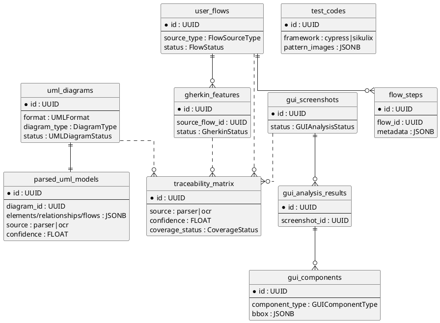

# Modele danych — moduł UML/GUI (Epic 3)

Tabele DB (SQLAlchemy 2.0 async, Postgres) i schematy Pydantic dla modułu UML/GUI
(Stories 3.1–3.15). Wszystkie tabele dziedziczą po mixinach `UUIDMixin` (`id: UUID`
PK), `TimestampMixin` (`created_at`/`updated_at`); tabele tenantowe dodatkowo
`TenantMixin` (`tenant_id` FK→tenants, CASCADE) i są chronione **Row-Level Security**
(polityki `tenant_isolation` + `admin_bypass`). Wartości enum z introspekcji żywego kodu.

## Diagram ERD (PlantUML)



## Enumy (wartości live)

| Enum | Wartości |
|---|---|
| `UMLFormat` | `xmi`, `plantuml`, `svg`, `pdf`, `raster` |
| `DiagramType` | `sequence`, `use_case`, `class`, `activity`, `state_machine` |
| `UMLDiagramStatus` | `pending`, `parsing`, `completed`, `failed` |
| `GUIComponentType` | `button`, `input`, `dropdown`, `checkbox`, `radio`, `menu`, `link`, `table`, `form`, `modal`, `tab`, `unknown` |
| `GUIAnalysisStatus` | `pending`, `processing`, `completed`, `failed` |
| `FlowSourceType` | `uml`, `gui`, `uml_and_gui` |
| `FlowStatus` | `draft`, `validated`, `tests_generated` |
| `GherkinStatus` | `generated`, `validated`, `approved` |
| `TestType` | `unit`, `integration`, `e2e`, `security`, `performance`, `positive`, `negative`, `boundary`, `accessibility`, `semantic` |
| `TestPriority` | `critical`, `high`, `medium`, `low` |
| `ComparisonStatus` | `match`, `minor_diff`, `major_diff`, `error` |
| `CoverageStatus` | `covered`, `partial`, `uncovered` |

## Tabele (kluczowe pola)

### `uml_diagrams` (3.1)
`project_id` FK, `filename`, `storage_key`, `format` (UMLFormat), `diagram_type`
(DiagramType, nullable), `raw_content` TEXT, `status` (UMLDiagramStatus),
`file_size`, `mime_type`, `error_message` + tenant mixins.

### `parsed_uml_models` (3.2–3.6, 3.1b)
`diagram_id` FK (1:1), `model_type`, `participants`/`elements`/`relationships`/
`fragments`/`flows` (JSONB), `source` (`parser`|`ocr`), `confidence` FLOAT.

### `gui_screenshots` (3.8)
`project_id` FK, `filename`, `storage_key`, `screen_sequence`, `status`
(GUIAnalysisStatus), `file_size`, `mime_type`, `error_message` + tenant mixins.

### `gui_analysis_results` (3.8)
`screenshot_id` FK, `ocr_text_blocks`/`layout_tree`/`warnings` (JSONB), `processing_time_ms`.

### `gui_components` (3.8)
`analysis_id` FK, `sequence`, `component_type` (GUIComponentType), `label`,
`bbox` JSONB (`{x,y,width,height}`), `confidence` FLOAT, `attributes` JSONB.

### `user_flows` (3.7, 3.9)
`project_id` FK, `source_type` (FlowSourceType), `source_ids`/`steps`/`warnings`
(JSONB), `name`, `status` (FlowStatus) + tenant mixins.

### `flow_steps` (3.7, 3.9, **3-11**)
`flow_id` FK, `sequence`, `action`, `actor`, `target_element`, `expected_result`,
`source_diagram_id`, `source_screenshot_id`, `source`, **`metadata` JSONB**
(`relation_type`/`parameters`/`branch_label` — domknięcie 3-11, migracja `028`).

### `gherkin_features` (3.11)
`project_id` FK, `source_flow_id` FK, `feature_name`, `feature_description`,
`scenarios` JSONB, `raw_feature` TEXT, `validation_warnings` JSONB, `status`
(GherkinStatus) + tenant mixins.

### `test_codes` (3.12, 3.13, **3-13**)
`test_case_id` FK, `framework` (`cypress`/`sikulix`), `language`, `code` TEXT,
`file_path`, **`pattern_images` JSONB** (`[{name, storage_key, component_id}]` —
domknięcie 3-13, migracja `026`; tylko SikuliX) + tenant mixins.

### `visual_regression_results` (3.10)
`project_id` FK, `baseline_screenshot_id`/`comparison_screenshot_id` FK,
`pixel_diff_percentage` FLOAT, `semantic_diff`/`changes`/`warnings` JSONB,
`diff_image_key`, `status` (ComparisonStatus) + tenant mixins.

### `traceability_matrix` (3.15, **3-15**)
`project_id` FK, `source_type` (`uml`/`gui`), `source_element_id`, `source_element_type`,
`source_element_name`, **`source` (`parser`|`ocr`), `confidence` FLOAT** (domknięcie
3-15, migracja `025`), `source_diagram_id`/`source_screenshot_id`/`linked_flow_id`/
`linked_gherkin_id`/`test_case_id` FK (SET NULL), `code_reference`, `code_framework`,
`coverage_status` (CoverageStatus) + tenant mixins. Indeksy: `(project_id, source_type)`,
`(project_id, coverage_status)`, `(source_element_id)`.

## Schematy Pydantic (przykłady)

### `TraceabilityMatrixOut` (GET /traceability)
```json
{
  "elements": [{
    "id": "8b1f…", "source_type": "uml", "source": "parser", "confidence": 1.0,
    "source_element_type": "use_case", "source_element_name": "Logowanie",
    "linked_flow_id": "a2c4…", "linked_gherkin_id": "f9e1…", "test_case_id": null,
    "code_reference": "Feature: Logowanie", "code_framework": "gherkin/bdd",
    "coverage_status": "covered"
  }],
  "summary": {
    "uml_total": 12, "gui_total": 8, "uml_coverage_pct": 75.0, "gui_coverage_pct": 50.0,
    "code_coverage_pct": 40.0
  },
  "total": 20, "page": 1, "page_size": 20
}
```

### `GherkinFeatureOut` (GET /gherkin/{id})
```json
{
  "id": "f9e1…", "feature_name": "Logowanie", "source_flow_id": "a2c4…",
  "scenarios": [{"name": "Poprawne logowanie", "tags": [],
    "steps": [{"keyword": "When", "text": "podaję dane"}],
    "examples_headers": [], "examples_rows": []}],
  "status": "approved"
}
```

## Golden data (3-14)

Regresja parserów i detekcji jest pokryta golden datasetem w
`backend/tests/golden_data/`: **30 UML** (25 PlantUML + 5 XMI, 6/typ), **5 SVG**
(visual, `_parse_visual`, `source=ocr`), **15 GUI PNG** + **10 par** visual_regression.
Stage CI `golden-regression` + artefakt `golden-accuracy.json` (threshold-gate);
testy obrazowe image-gated (skip bez cv2/Tesseract). Patrz [ADR-008](../../architecture/adr/ADR-008-golden-data.md).

## Powiązane

- [uml-parsing.md](./uml-parsing.md), [gui-analysis.md](./gui-analysis.md),
  [test-generation-uml-gui.md](./test-generation-uml-gui.md), [traceability-uml-gui.md](./traceability-uml-gui.md).
