# Podręcznik użytkownika — Część 1: Wprowadzenie

> **Wersja:** 2.0 (2026-09-20) · **Odbiorcy:** użytkownicy platformy TestGEN
> (analitycy QA, deweloperzy, kierownicy projektów) · **Część 1 z 4**
> (całość: [02 — Praca z systemem](02-projekty-i-analiza.md),
> [03 — Zaawansowane funkcje](03-testy-bezpieczenstwo-eksport.md),
> [04 — Administracja i rozwiązywanie problemów](04-integracje-ustawienia-faq.md),
> [Spis treści całego podręcznika](00-spis-tresci.md))
>
> **Konwencje:** forma bezpośrednia („Ty"), nazwy przycisków i ekranów w
> cudzysłowie dokładnie tak, jak widzisz je w aplikacji, czas wykonania
> podany przy każdym kroku. Ramki: 💡 **Wskazówka** (oszczędza czas) i
> ⚠️ **Uwaga** (częsta pułapka). Definicje pojęć: [Glosariusz](../glosariusz.md),
> nawigacja po pojęciach: [Indeks terminów](indeks-terminow.md).

## Spis treści części

- **Rozdział 1. O systemie TestGEN** — 1.1. Czym jest TestGEN ·
  1.2. Kluczowe funkcjonalności · 1.3. Korzyści dla użytkowników ·
  1.4. Jak działa analiza · 1.5. Plany · 1.6. Wymagania systemowe
- **Rozdział 2. Szybki start** — 2.1. Rejestracja i pierwsze logowanie ·
  2.2. Pierwszy pulpit · 2.3. Konfiguracja pierwszego projektu ·
  2.4. Pierwsza analiza kodu · 2.5. Pierwsze testy · 2.6. Pierwszy raport ·
  2.7. Interfejs w pigułce

---

## Rozdział 1. O systemie TestGEN

### 1.1. Czym jest TestGEN

TestGEN to platforma, która **automatycznie tworzy przypadki testowe i kod
testów** na podstawie tego, co już masz w projekcie: kodu źródłowego,
dokumentacji, diagramów UML i zrzutów ekranu interfejsu.

**Jaki problem rozwiązuje?** Pisanie przypadków testowych ręcznie jest
wolne, powtarzalne i łatwo w nim o przeoczenia. Analityk QA spędza dni
na przekładaniu wymagań na tabele kroków; deweloperzy odkładają testy
„na później", bo żal im czasu na żmudne wzorce; kierownik projektu
nie ma pod koniec sprintu twardej odpowiedzi na pytanie „co jest
przetestowane?". TestGEN analizuje Twoje materiały i proponuje gotowe
przypadki testowe w kilka minut — Ty decydujesz, co zaakceptować.

**Jak wygląda praca z platformą w praktyce?**

1. Zakładasz konto i firmę (bez karty płatniczej — startujesz na planie
   Freemium).
2. Tworzysz projekt i wgrywasz materiały: pliki kodu, archiwum ZIP,
   dokumentację, diagramy, zrzuty ekranu — albo podłączasz repozytorium
   Git.
3. Uruchamiasz analizę jednym przyciskiem; działa w tle, a Ty w tym
   czasie pracujesz dalej.
4. Przeglądasz wyniki: struktury kodu, wymagania, luki, podatności —
   i zestaw proponowanych przypadków testowych.
5. Zatwierdzasz przypadki, generujesz kod testów w swoim frameworku
   i eksportujesz raporty albo paczkę testów do narzędzia TMS.

**Dla kogo jest TestGEN?**

| Rola | Korzyść |
|---|---|
| Analityk QA | przypadki testowe z wymagań i kodu w minutę, nie w dni; mniej przeklepywania, więcej testowania |
| Deweloper | widzi, czego brakuje w kodzie względem dokumentacji; gotowe szkielety testów bez żmudnego powtarzania wzorców |
| Kierownik projektu | raporty pokrycia i zgodności dla całego zespołu; twarde liczby na spotkaniach |
| Audytor / bezpiecznik | skany podatności z CVSS, bilans komponentów (SBOM), ścieżka dowodowa |

### 1.2. Kluczowe funkcjonalności

- **Analiza kodu źródłowego** — rozpoznaje język i framework, mapuje
  funkcje, klasy i zależności (11 języków rozpoznawanych, 8 z pełną
  analizą struktury).
- **Analiza dokumentacji** — czyta dokumenty techniczne (SRS, podręczniki,
  opisy API), wyciąga wymagania funkcjonalne i niefunkcjonalne, wykrywa
  niespójności w tekście i buduje glosariusz pojęć.
- **Analiza UML i GUI** — rozumie diagramy klas, sekwencji, aktywności,
  przypadków użycia i stanów (źródła PlantUML/XMI oraz rysunki z OCR),
  a także zrzuty ekranu interfejsu (komponenty, układ, tekst).
- **Generowanie przypadków testowych** — kompletne kroki, oczekiwane
  rezultaty, priorytety; scenariusze pozytywne, negatywne i brzegowe
  z kodu oraz z wymagań.
- **Generowanie kodu testów** — szablony testów automatycznych dla
  dziesięciu frameworków (pytest, JUnit, NUnit, Mocha/Jest, Cypress,
  Selenium, Playwright, Appium, SikuliX, PHPUnit/Pest) oraz scenariusze
  Gherkin/BDD.
- **Skanowanie bezpieczeństwa** — statyczna analiza (SAST), śledzenie
  przepływu danych (taint), podatności zależności (CVE) z bilansem
  komponentów (SBOM), analiza konfiguracji i testy dynamiczne (DAST);
  rekomendacje napraw z gotowym kodem i plikami `.patch`.
- **Analiza luk funkcjonalnych** — porównanie dokumentacji z kodem:
  czego brakuje, co się rozjechało, co jest nadmiarowe; wskaźnik
  zgodności (compliance) z trendem w czasie.
- **Raporty i eksport** — dwupoziomowe raporty (dla zarządu
  i dla zespołu), eksport do PDF, HTML, CSV, Excel, JSON, YAML oraz
  paczki przypadków do narzędzi TMS (TestRail, Jira Xray).

💡 **Wskazówka:** nie musisz używać wszystkiego naraz. Większość zespołów
zaczyna od analizy kodu i generowania przypadków testowych, a pozostałe
moduły włącza według potrzeb — każdy kolejny moduł zasilany jest tymi
samymi materiałami, które już wgrałeś.

### 1.3. Korzyści dla użytkowników

Dlaczego zespoły sięgają po TestGEN i co z tego realnie mają:

| Obszar | Bez TestGEN | Z TestGEN |
|---|---|---|
| Przypadek testowy z wymagania | 20–40 minut przekładania | minuta przeglądu propozycji |
| Pokrycie wymagań testami | ręczna tabela w arkuszu | macierz śledzenia liczona automatycznie |
| Regresja po zmianach | „uruchamiamy wszystko, na wszelki wypadek" | zestaw regresyjny z porównania wersji |
| Zgodność kodu z dokumentacją | dyskusje przy kawie | wskaźnik compliance 0–100 z listą luk |
| Podatności zależności | nikt nie śledzi wersji | skan CVE z wersją naprawczą |
| Onboarding nowego QA | tygodnie czytania kodu | podręcznik + glosariusz projektu generowane z materiałów |

Korzyść jest największa, gdy materiały już istnieją — TestGEN nie wymaga
zmiany sposobu pracy zespołu, tylko czyta to, co i tak piszecie (kod,
dokumentację, diagramy).

### 1.4. Jak działa analiza — z perspektywy użytkownika

```
   ┌──────────┐    ┌──────────┐    ┌──────────┐    ┌──────────┐
   │ Prześlij │ →  │ Uruchom  │ →  │ Zobacz   │ →  │ Wyeks-   │
   │ materiały│    │ analizę  │    │ wyniki   │    │ portuj   │
   └──────────┘    └──────────┘    └──────────┘    └──────────┘
   kod, dokumen-   jeden klik      podsumowanie,   raport, przy-
   tacja, UML,     (zadanie działa w tle)  przypadki        padki do TMS
   zrzuty GUI                      testowe         lub plik
```

Trzy zasady, które warto zapamiętać na start:

- **Analiza działa asynchronicznie** — uruchamiasz ją jednym kliknięciem
  i możesz w tym czasie pracować dalej; o zakończeniu informuje komunikat
  na ekranie.
- **Silniki analizy są deterministyczne** — te same dane wejściowe dają
  ten sam wynik, co miesiąc temu i dziś. Wyniki można więc porównywać
  między wersjami i śledzić trend.
- **Wszystko zaczyna się od materiałów** — jakość wyników zależy
  od jakości kodu, dokumentacji i diagramów, które wgrasz. Na śmieciach
  nie da się zbudować dobrego testu — garbage in, garbage out.

### 1.5. Plany

TestGEN działa w modelu miesięcznym. Nowa firma startuje na planie
**Freemium** — bez płacenia, od razu.

| | Freemium | Basic | Premium |
|---|---|---|---|
| Cena (miesiąc) | 0 zł | 30 zł | 50 zł |
| Analizy / miesiąc | 10 | 50 | bez limitu |
| Przypadki testowe / miesiąc | 50 | 250 | bez limitu |
| Miejsce na pliki | 0,5 GB | 5 GB | 10 GB |
| Plików na analizę | 5 | 25 | 50 |
| Analiza kodu + generowanie testów | ✓ | ✓ | ✓ |
| Dokumentacja, UML, GUI, CI/CD | — | ✓ | ✓ |
| Bezpieczeństwo + luki funkcjonalne | — | — | ✓ |
| Priorytetowe wsparcie | — | — | ✓ |

Moduły spoza Twojego planu są w aplikacji **widoczne, ale zablokowane**
(kłódka) — zawsze wiesz, co zyskujesz wyższym planem. Zmiana planu w każdej
chwili; dopłata przy przejściu na wyższy plan liczona jest proporcjonalnie.

Szczegóły rozliczeń: [Rozliczenia — przewodnik](billing/01-plany-i-zakup.md).

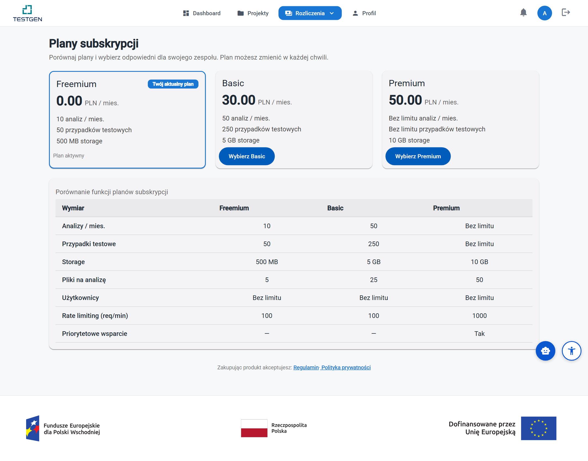
*Porównanie planów: menu „Rozliczenia" → zakładka z planami.*

Bieżące zużycie limitów swojej firmy sprawdzisz w menu **„Rozliczenia" →
„Zużycie zasobów"**:

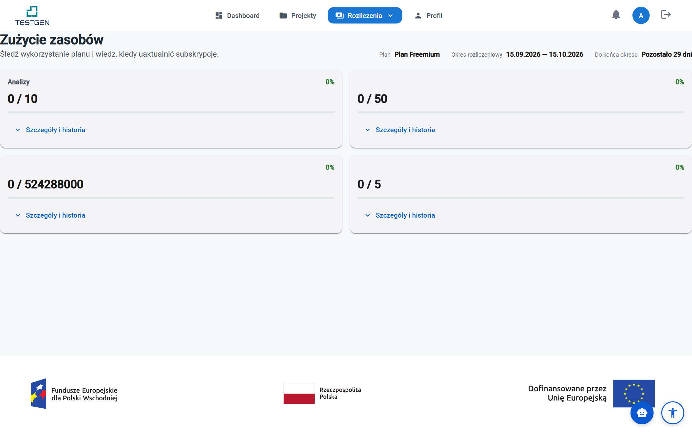
*Zużycie zasobów: liczniki z paskami postępu i prognozą wyczerpania limitu.*

### 1.6. Wymagania systemowe

- **Przeglądarka:** aktualne wersje Chrome, Edge, Firefox lub Safari.
  Aplikacja działa też na ekranach dotykowych.
- **Telefon i tablet:** pełna wersja serwisu w przeglądarce mobilnej —
  układ składa się do jednej kolumny, menu chowa się pod przyciskiem
  (szczegóły i zrzuty w [rozdziale 12](03-testy-bezpieczenstwo-eksport.md),
  poświęconym dostępności i personalizacji).
- **Dostępność:** interfejs spełnia standard WCAG 2.1 AA — obsługę
  klawiaturą i czytnikami ekranu opisuje [rozdział 12.1](03-testy-bezpieczenstwo-eksport.md).
- **Konto:** zakładasz adresem e-mail — nie potrzebujesz kont Google
  ani Apple; weryfikacja dwuetapowa (TOTP) jest opcjonalna i zalecana
  dla Właścicieli firm.
- **Materiały:** pliki na dysku lub repozytorium Git (github.com,
  gitlab.com, bitbucket.org) — listy obsługiwanych formatów szukaj
  w [rozdziale 4](02-projekty-i-analiza.md).

---

## Rozdział 2. Szybki start

Ten rozdział przeprowadzi Cię od zera do **pierwszego wygenerowanego
raportu w około 20 minut**. Czas podany przy każdym kroku to realny,
zmierzony czas dla małego projektu (kilka plików). Na końcu rozdziału
znajdziesz też mapę interfejsu — wszystko, czego potrzebujesz, żeby
swobodnie poruszać się po aplikacji.

Mapa podróży:

| Krok | Co robisz | Czas | Rozdział ze szczegółami |
|---|---|---|---|
| 1 | Zakładasz konto | 3 min | [2.1](#21-rejestracja-i-pierwsze-logowanie) |
| 2 | Tworzysz pierwszy projekt | 1 min | [2.3](#23-konfiguracja-pierwszego-projektu) |
| 3 | Przesyłasz kod źródłowy | 2 min | [2.3](#23-konfiguracja-pierwszego-projektu) |
| 4 | Uruchamiasz analizę | 1 min (+ ok. 2 min w tle) | [2.4](#24-pierwsza-analiza-kodu) |
| 5 | Przeglądasz wyniki i przypadki testowe | 7 min | [2.4](#24-pierwsza-analiza-kodu) i [2.5](#25-pierwsze-testy) |
| 6 | Generujesz i pobierasz raport | 3 min | [2.6](#26-pierwszy-raport) |

### 2.1. Rejestracja i pierwsze logowanie

1. Otwórz w przeglądarce adres platformy i kliknij **„Zarejestruj się"**.
2. Wypełnij formularz: imię i nazwisko, firmowy adres e-mail, hasło
   (minimum 12 znaków), nazwę firmy i NIP (jeśli chcesz faktury).
3. Kliknij **„Zarejestruj"** — na Twój adres przyjdzie wiadomość
   z linkiem aktywacyjnym.
4. Otwórz wiadomość i kliknij link. Konto jest aktywne.

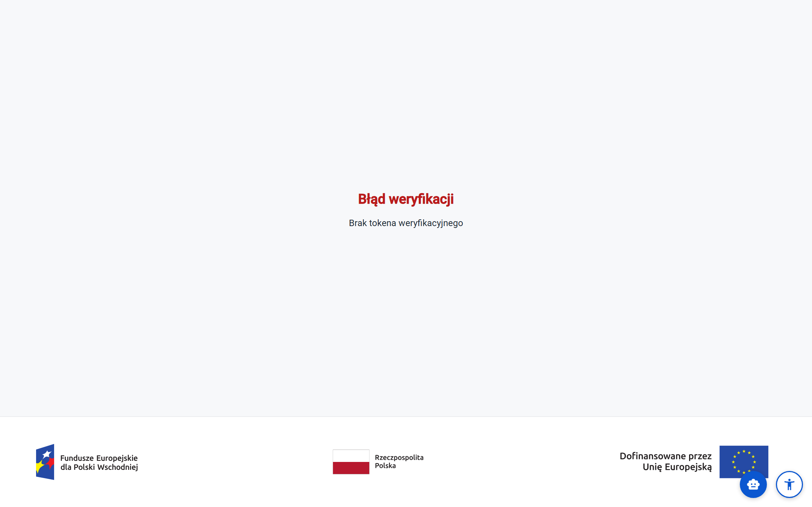
*Potwierdzenie adresu e-mail kończy rejestrację.*

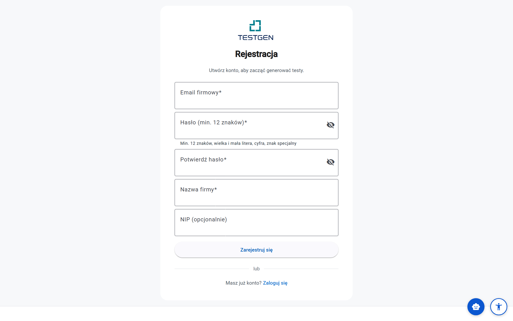
*Rejestracja: dane firmy użyjemy później na fakturach — możesz je zmienić w
ustawieniach.*

⚠️ **Uwaga:** link w wiadomości może wylądować w folderze oferty/reklamy.
Jeśli wiadomości nie ma po 5 minutach, sprawdź te foldery zanim zaczniesz
rejestrację od nowa.

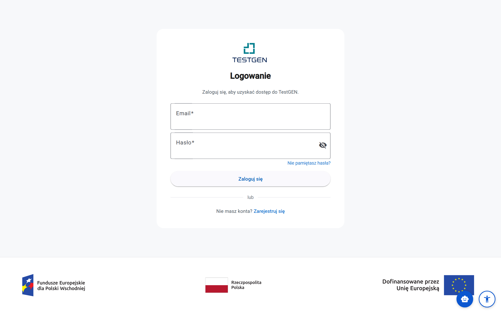
*Ekran logowania — z opcją zapamiętania sesji.*

Rejestrujący zakłada nową **firmę** (organizację) i zostaje jej
**Właścicielem**; później zaprosisz współpracowników w
**„Profil" → „Użytkownicy"** ([rozdział 13](04-integracje-ustawienia-faq.md)).
Jeśli należysz do kilku firm, przy logowaniu wybierzesz organizację,
na której chcesz pracować.

💡 **Wskazówka:** włącz **weryfikację dwuetapową (MFA)** zaraz po
rejestracji — Profil → „Uwierzytelnianie MFA". Zajmuje dwie minuty,
a chroni całą firmę, bo konto Właściciela zarządza subskrypcją i danymi
fakturowymi. Instrukcja: [rozdział 14](04-integracje-ustawienia-faq.md).

### 2.2. Pierwszy pulpit

Po pierwszym logowaniu zobaczysz pulpit startowy:

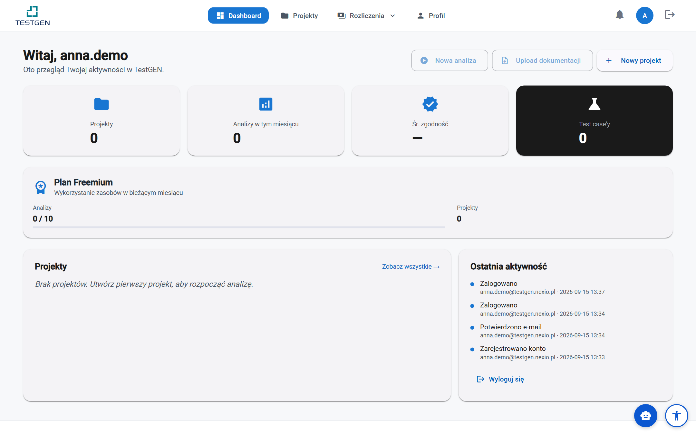
*Pulpit: statystyki na górze, karty szybkich akcji poniżej.*

- **Karty statystyk** — liczba projektów, analiz, przypadków testowych
  i bieżące zużycie limitów; kliknij kartę, żeby przejść do odpowiedniego
  ekranu.
- **Ostatnia aktywność** — co działo się ostatnio w Twoich projektach
  (analizy, wygenerowane przypadki).
- **Szybkie akcje** — karty „Nowy projekt", „Prześlij pliki",
  „Uruchom analizę", „Zobacz raporty" — skróty do najczęstszych
  czynności z tego rozdziału.

Dzwonek w menu pokazuje powiadomienia — np. o przekroczeniu 80% limitu:


*Powiadomienia o progach zużycia — te same treści mogą przychodzić e-mailem.*

### 2.3. Konfiguracja pierwszego projektu

**Projekt** to folder roboczy dla jednej aplikacji: jej pliki, analizy,
przypadki testowe i raporty żyją razem. Jeśli testujesz kilka aplikacji
albo jedną w kilku wersjach — załóż osobne projekty.

1. Z menu bocznego wybierz **„Projekty"** — na start lista jest pusta.
2. Kliknij **„Nowy projekt"**.
3. Wpisz nazwę (np. „Sklep internetowy"), opcjonalnie opis i podpowiedź
   języka (np. „python"). Kliknij **„Utwórz"**.

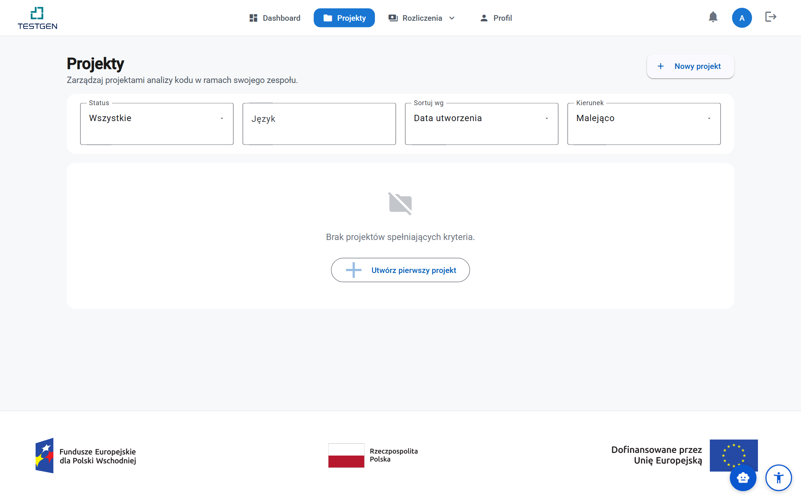
*Każdy nowy użytkownik zaczyna od czystej listy.*

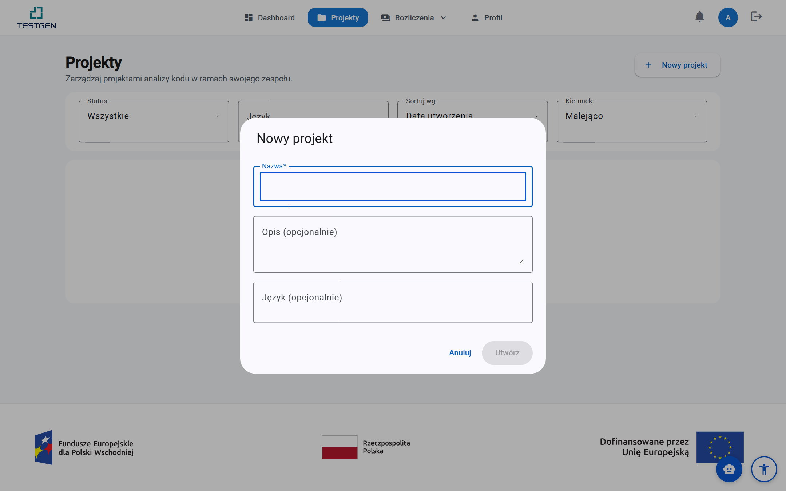
*Formularz: nazwa jest wymagana, opis i język — opcjonalne.*

💡 **Wskazówka:** podpowiedź języka przyspiesza analizę — platforma sama
rozpoznaje język z plików, ale podpowiedź pomaga przy mieszanych
projektach.

Teraz prześlij kod. W projekcie otwórz zakładkę **„Pliki"**:

1. Przeciągnij pliki na obszar przesyłania (albo kliknij i wybierz je
   z dysku). Możesz zaznaczyć wiele plików naraz albo spakowane archiwum
   ZIP.
2. Poczekaj, aż wszystkie pliki dostaną status **„Gotowy"**.

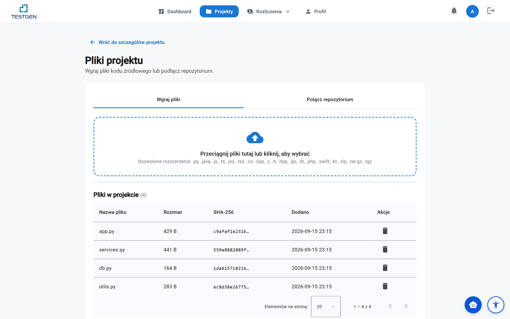
*Przeciągnij pliki tutaj albo kliknij, aby wybrać.*

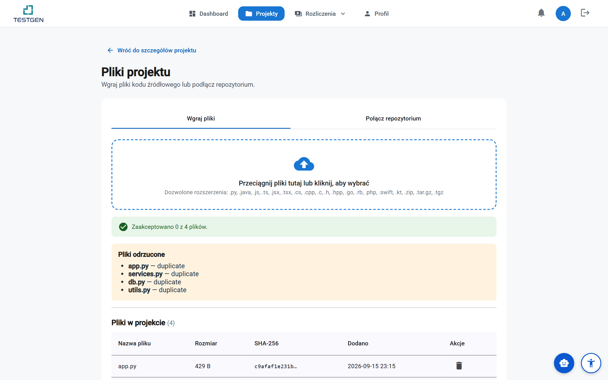
*Każdy plik ma własny pasek postępu; przerwane można przesłać ponownie.*

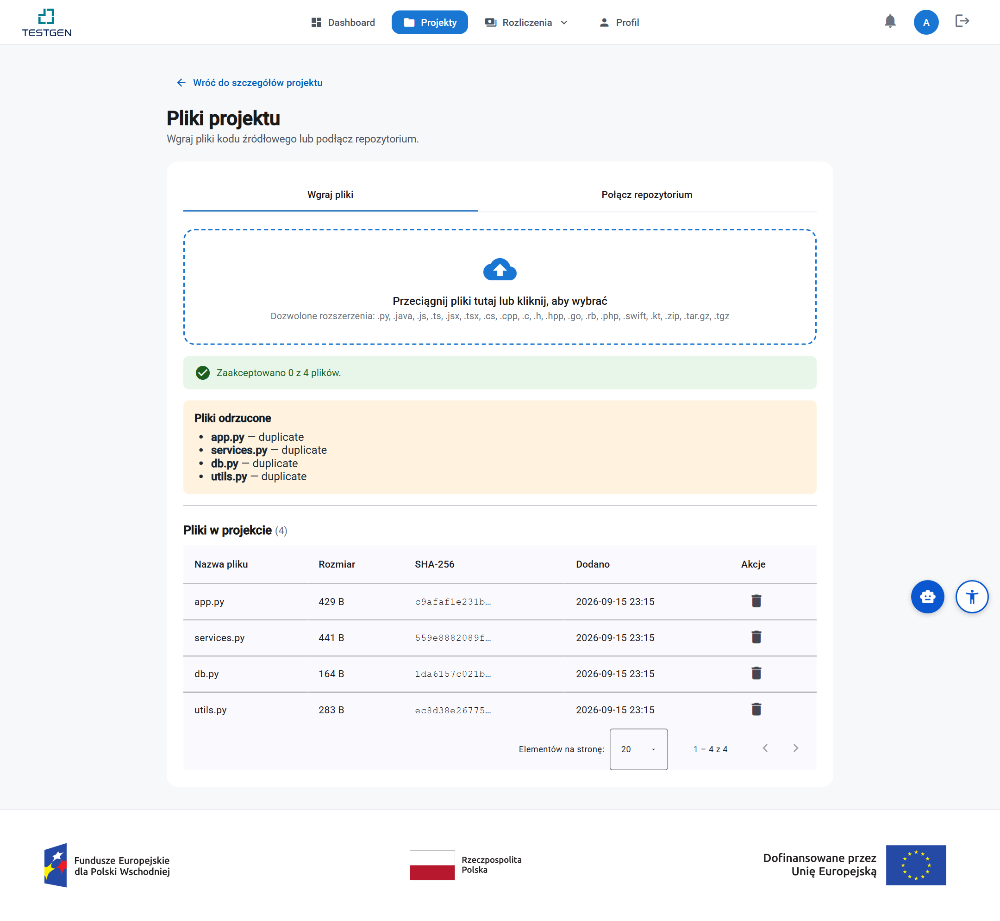
*Status „Gotowy" przy każdym pliku oznacza: można analizować.*

⚠️ **Uwaga:** plan Freemium pozwala na 5 plików jednorazowo i 0,5 GB miejsca.
Na potrzeby pierwszej analizy w zupełności wystarczy kilka plików
źródłowych. Pełne limity i listę formatów znajdziesz
w [rozdziale 4](02-projekty-i-analiza.md).

### 2.4. Pierwsza analiza kodu

1. Otwórz zakładkę **„Analiza"**.
2. Sprawdź parametry — na start zostaw domyślne (analiza kodu
   i generowanie testów, framework „— Automatyczny —").
3. Kliknij **„Uruchom analizę"**. Analiza działa w tle — możesz
   przełączyć się na inny ekran; o zakończeniu powiadomi komunikat.

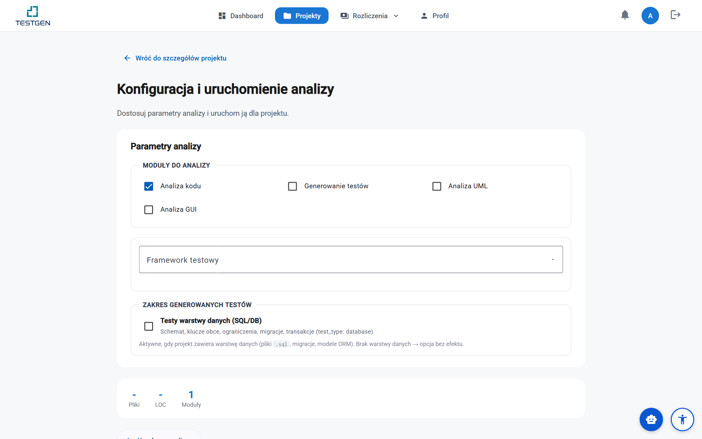
*Analiza kodu: wystarczy jeden przycisk — typ i język rozpoznaje platforma.*

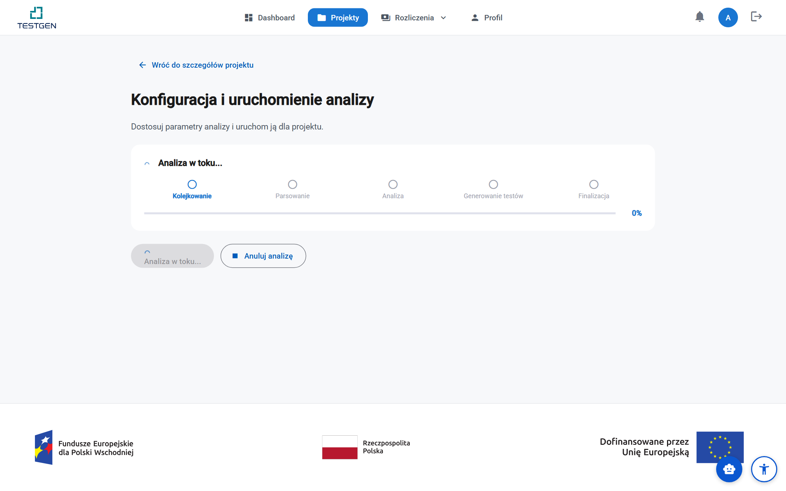
*Postęp widoczny na ekranie; zakończenie ogłasza komunikat.*

💡 **Wskazówka:** analizy zużywają limit planu (Freemium: 10 miesięcznie).
Limit odnawia się na początku każdego okresu rozliczeniowego — bieżące
zużycie sprawdza się w menu **„Rozliczenia" → „Zużycie zasobów"**.

Po zakończeniu zobaczysz, że platforma rozpoznała projekt: języki
z liczbą plików, frameworki, łączna liczba linii kodu — a w zakładce
**„Wyniki"** czeka podsumowanie analizy:

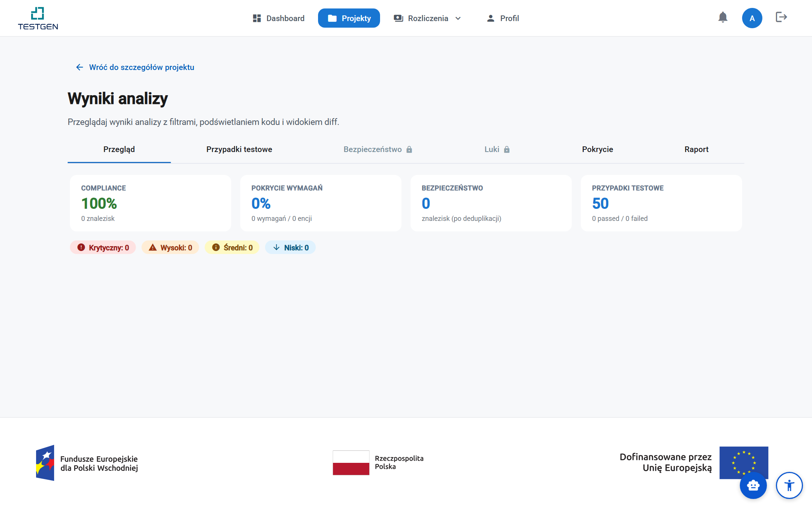
*Podsumowanie: liczba rozpoznanych elementów kodu i wykrytych znalezisk.*

- **Przegląd** — podsumowanie: ile funkcji i klas rozpoznano, ile
  znalezisk zgłoszono.
- **Pokrycie** — które elementy kodu mają pokrycie w wymaganiach.
- **Przypadki testowe** — najciekawsze: gotowe przypadki wygenerowane
  z Twojego kodu.

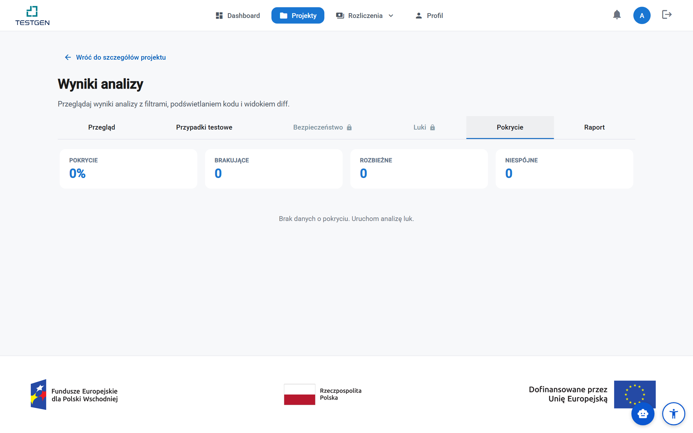
*Pokrycie kodu wymaganiami — na wyższych planach porównasz też dokumentację.*

Co dokładnie oznaczają wyniki i jak je interpretować — opisuje
[właściwy rozdział analityczny](02-projekty-i-analiza.md).

### 2.5. Pierwsze testy

Zakładka **„Przypadki testowe"** to centrum pracy analityka:

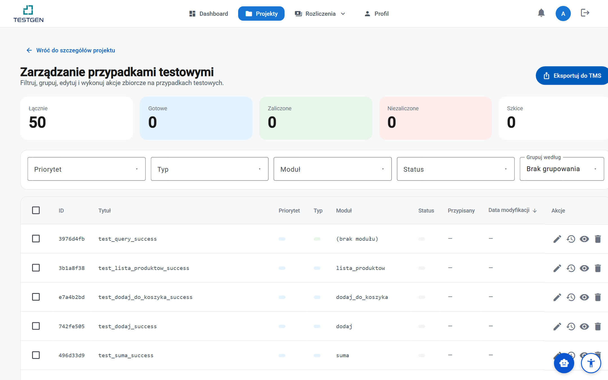
*Każdy przypadek ma tytuł, priorytet, typ i status (nowy przypadek to „Szkica").*

Kliknij wiersz, aby zobaczyć szczegóły — kroki, oczekiwane rezultaty i kod
źródłowy, z którego przypadek powstał:

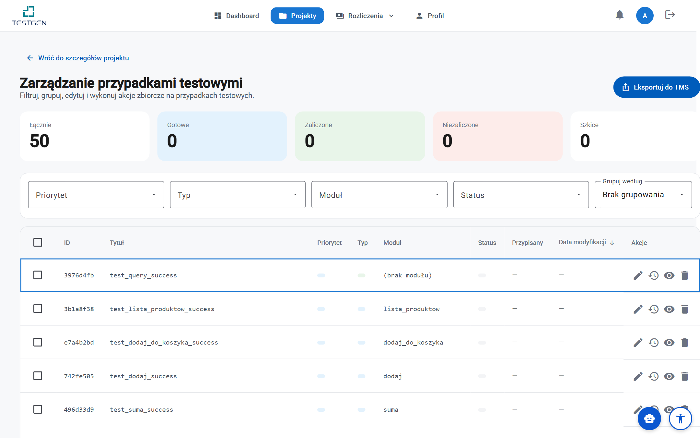
*Szczegóły przypadku: kroki i powiązanie z kodem.*

⚠️ **Uwaga:** nowe przypadki mają status **„Szkic"** — przejrzyj je przed
użyciem. Zatwierdź sensowne przyciskiem **„Zatwierdź"** (status „Gotowy");
zbędne usuń. Dopiero zaakceptowane przypadki warto eksportować do zespołu.

Pełny cykl życia przypadków (edycja, operacje masowe, uruchamianie,
generowanie kodu testów) opisuje [rozdział 8](02-projekty-i-analiza.md).

### 2.6. Pierwszy raport

1. Otwórz zakładkę **„Raporty"**.
2. Wybierz typ raportu — **„Podsumowanie wykonawcze"** (dla zarządu)
   albo **„Szczegóły techniczne"** (dla zespołu).
3. Kliknij **„Generuj raport"** — podgląd pokaże dokładnie to, co trafi
   do pliku.
4. Pobierz w wybranym formacie: PDF, HTML, CSV, Excel, JSON lub YAML.

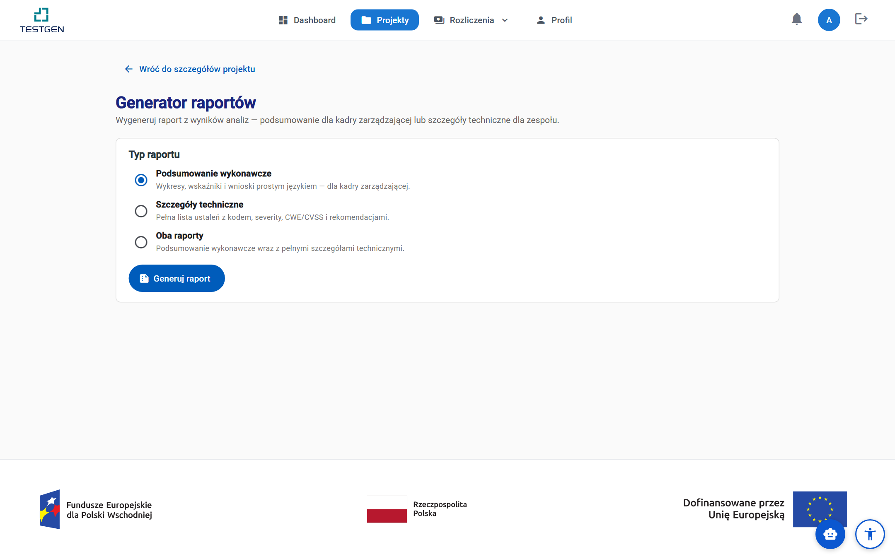
*Raporty: wybierz typ, wygeneruj, pobierz — dwa poziomy szczegółowości.*

💡 **Wskazówka:** na spotkanie z zarządem wystarczy „Podsumowanie
wykonawcze"; zespół testowy doceni „Szczegóły techniczne" z pełną listą
znalezisk.

**Gratulacje — przeszedłeś/łaś cały obieg!** Dalsze tematy — analiza
dokumentacji, UML i GUI, bezpieczeństwo, eksport do narzędzi — czekają
w [Części 2](02-projekty-i-analiza.md).

### 2.7. Interfejs w pigułce

Żebyś nie zgubił/zgubiła się poza ścieżką szybkiego startu, oto mapa
wszystkiego, czego używasz na co dzień:

- **Menu boczne** (po lewej): Pulpit („Dashboard"), Projekty, Rozliczenia,
  Profil. Zwija się do paska ikon na wąskich ekranach.
- **Okruszki** nad treścią: np. *Projekty → Sklep internetowy → Wyniki* —
  każde ogniwo klikalne; strzałka „Wróć…" prowadzi o poziom wyżej.
- **Karta projektu** to centrum dowodzenia — kafelki wszystkich funkcji;
  moduły spoza planu mają kłódkę.
- **Dzwonek** — powiadomienia (progi limitów, zdarzenia rozliczeń).
- **Przycisk „Przejdź do treści głównej"** — pierwszy element strony,
  widoczny po naciśnięciu Tab; pomija menu i przenosi od razu do treści
  (przydatny przy nawigacji klawiaturą).
- **Ekrany zachowują spokój:** ładowanie ma czytelne komunikaty, błędy
  podpowiadają następny krok, a puste listy wyjaśniają, od czego zacząć.

Dostępność (tryb wysokiego kontrastu, wyłączanie animacji), skróty
klawiszowe i wygląd na różnych ekranach opisuje
[rozdział 12](03-testy-bezpieczenstwo-eksport.md).

---

*Utrzymanie dokumentu: zmiany UI = aktualizacja zrzutów i opisów; zrzuty
pochodzą z rzeczywistej aplikacji (stan na 2026-09-20). Spójność terminów:
[Glosariusz](../glosariusz.md). Kontynuacja: [Część 2 — Praca
z systemem](02-projekty-i-analiza.md).*
