# Podręcznik użytkownika — Część 2: Praca z systemem

> **Wersja:** 2.0 (2026-09-20) · **Odbiorcy:** użytkownicy platformy TestGEN
> (analitycy QA, deweloperzy, kierownicy projektów) · **Część 2 z 4**
> (całość: [01 — Wprowadzenie](01-wprowadzenie.md),
> [03 — Zaawansowane funkcje](03-testy-bezpieczenstwo-eksport.md),
> [04 — Administracja i rozwiązywanie problemów](04-integracje-ustawienia-faq.md),
> [Spis treści](00-spis-tresci.md))
>
> **Konwencje:** forma bezpośrednia („Ty"), nazwy przycisków i ekranów w
> cudzysłowie dokładnie tak, jak widzisz je w aplikacji. Ramki:
> 💡 **Wskazówka** (oszczędza czas) i ⚠️ **Uwaga** (częsta pułapka).
> Definicje pojęć: [Glosariusz](../glosariusz.md).

## Spis treści części

- **Rozdział 3. Zarządzanie projektami** — 3.1. Tworzenie
  i konfiguracja · 3.2. Lista, filtry i sortowanie · 3.3. Karta projektu ·
  3.4. Członkowie zespołu i role · 3.5. Edycja, usuwanie, archiwizacja ·
  3.6. Dobre praktyki · 3.7. Ograniczenia
- **Rozdział 4. Analiza kodu źródłowego** — 4.1. Wgrywanie kodu (pliki,
  ZIP, repozytorium) · 4.2. Inne źródła materiałów · 4.3. Konfiguracja
  i uruchomienie analizy · 4.4. Postęp · 4.5. Preprocessing ·
  4.6. Interpretacja wyników · 4.7. Testy regresji kodu · 4.8. Przykłady
  dla różnych języków · 4.9. Dobre praktyki · 4.10. Ograniczenia
- **Rozdział 5. Analiza dokumentacji** — 5.1. Wspierane formaty ·
  5.2. Wgrywanie dokumentacji · 5.3. Wymagania · 5.4. Niespójności ·
  5.5. Glosariusz · 5.6. Porównywanie dokumentacji z kodem (luki) ·
  5.7. Generowanie testów z dokumentacji · 5.8. Dobre praktyki ·
  5.9. Ograniczenia
- **Rozdział 6. Analiza UML i GUI** — 6.1. Wgrywanie diagramów UML ·
  6.2. Widoki diagramów · 6.3. Analiza interfejsów użytkownika ·
  6.4. Generowanie testów UI (Gherkin/BDD) · 6.5. Testy regresji GUI ·
  6.6. Macierz śledzenia · 6.7. Dobre praktyki · 6.8. Ograniczenia
- **Rozdział 7. Analiza bezpieczeństwa** — 7.1. Typy skanów ·
  7.2. Uruchamianie · 7.3. Interpretacja wyników · 7.4. Zależności
  i SBOM · 7.5. Rekomendacje naprawcze · 7.6. Priorytetyzacja ·
  7.7. Dobre praktyki · 7.8. Ograniczenia
- **Rozdział 8. Generowanie testów** — 8.1. Wybór frameworka testowego ·
  8.2. Przeglądanie i edycja przypadków · 8.3. Statusy i przegląd ·
  8.4. Operacje masowe · 8.5. Generowanie kodu testów · 8.6. Eksport
  testów · 8.7. Dobre praktyki · 8.8. Ograniczenia
- **Rozdział 9. Raporty i eksport** — 9.1. Poziomy raportów ·
  9.2. Generowanie i podgląd · 9.3. Formaty plików · 9.4. Integracja
  z systemami zewnętrznymi · 9.5. Dobre praktyki · 9.6. Ograniczenia

---

## Rozdział 3. Zarządzanie projektami

**Projekt** to folder roboczy dla jednej aplikacji: jej pliki, analizy,
przypadki testowe i raporty żyją razem. Jeśli testujesz kilka aplikacji
albo jedną aplikację w kilku wersjach — załóż osobne projekty.

### 3.1. Tworzenie i konfiguracja

1. Z menu bocznego wybierz **„Projekty"**, a następnie kliknij
   **„Nowy projekt"**.
2. Wypełnij formularz:

| Pole | Wymagane | Limit | Opis |
|---|---|---|---|
| **Nazwa** | tak | 255 znaków | unikalna w ramach firmy, np. „Sklep internetowy" |
| **Opis (opcjonalnie)** | nie | 2000 znaków | cel projektu, zakres, zespół — pomoże po pół roku |
| **Język (opcjonalnie)** | nie | 50 znaków | podpowiedź, np. „python, java, typescript" |

3. Kliknij **„Utwórz"**. Nowy projekt dostaje status **„Utworzony"** —
   przechodzi w **„Aktywny"** po pierwszym przesłaniu plików lub
   podłączeniu repozytorium; analiza w trakcie daje **„W analizie"**, a jej
   zakończenie **„Zakończony"**.

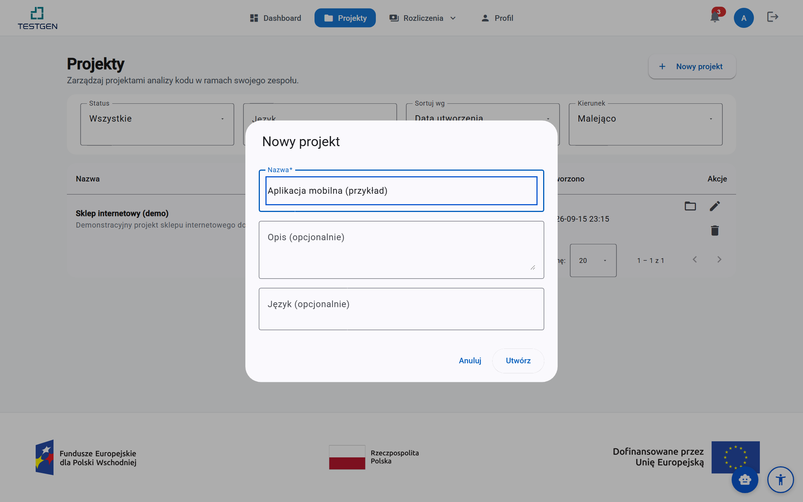
*Formularz ma trzy pola — nazwa jest wymagana, opis i język to podpowiedzi.*

💡 **Wskazówka:** podpowiedź języka przyspiesza analizę — platforma sama
rozpoznaje języki z plików, ale podpowiedź pomaga przy projektach
mieszanych (kilka języków naraz).

⚠️ **Uwaga:** nazwa musi być unikalna w firmie. Przy powtórce zobaczysz
„Projekt o tej nazwie już istnieje." — zmień nazwę albo otwórz istniejący
projekt z listy.

### 3.2. Lista, filtry i sortowanie

Lista projektów to tabela: **Nazwa** (link do karty, pod spodem opis),
**Status**, **Język** (podpowiedź lub „—"), **Utworzono** oraz **Akcje**.
Nad tabelą — karta filtrów:

- **„Status"** — Wszystkie / Utworzony / Aktywny / W analizie /
  Zakończony / Zarchiwizowany,
- **„Język"** — wpisujesz frazę, np. „python",
- **„Sortuj wg"** — Data utworzenia / Data modyfikacji / Nazwa / Status,
- **„Kierunek"** — Malejąco / Rosnąco.

Filtry reagują bez przeładowania (półsekundowe opóźnienie po wpisaniu);
tabela stronicuje po 10/20/50/100 wierszy (domyślnie 20).

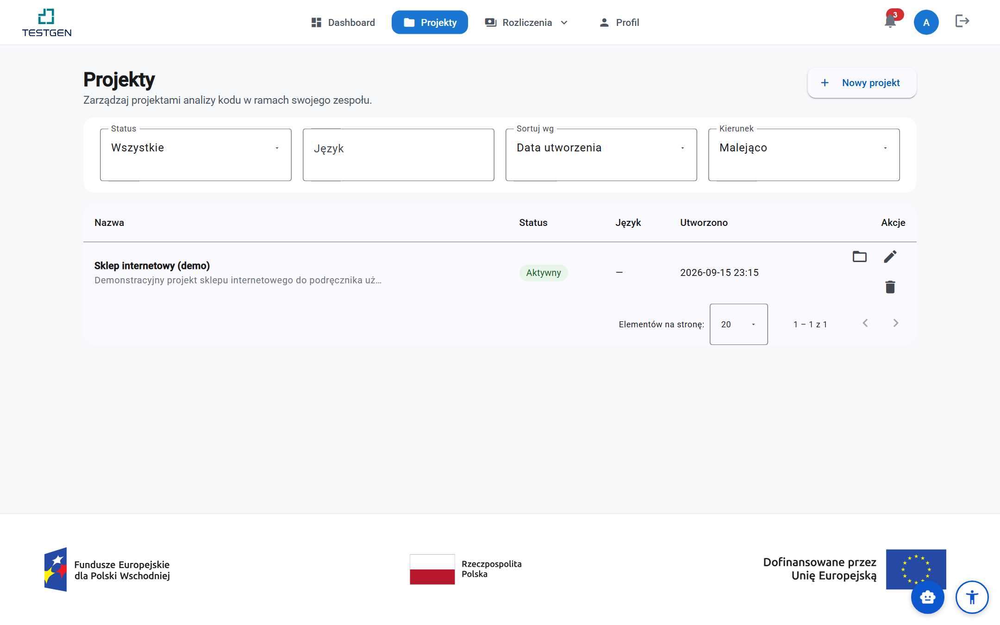
*Filtry Status i Język zawężają listę; sortowanie po dacie domyślne.*

### 3.3. Karta projektu

Karta projektu to centrum dowodzenia: nazwa, status i opis na górze,
poniżej kafelki wszystkich funkcji platformy:

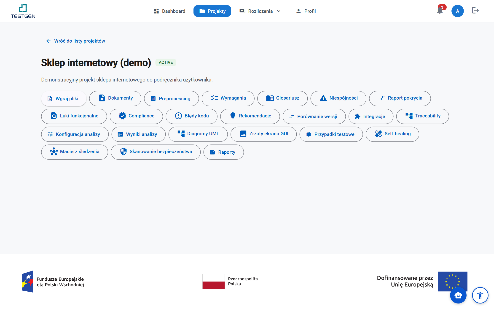
*Każdy kafelek to wejście do jednej funkcji; moduły spoza planu mają kłódkę.*

Najważniejsze kafelki: **„Wgraj pliki"** ([rozdz. 4](#41-wgrywanie-kodu-pliki-zip-repozytorium)),
**„Konfiguracja analizy"** i **„Wyniki analizy"** ([rozdz. 4](#43-konfiguracja-i-uruchomienie-analizy)),
**„Dokumenty"** i pochodne ([rozdz. 5](#52-wgrywanie-dokumentacji)),
**„Diagramy UML"**, **„Zrzuty ekranu GUI"**, **„Macierz śledzenia"**
([rozdz. 6](#61-wgrywanie-diagramów-uml)), **„Skanowanie bezpieczeństwa"**
([rozdz. 7](#71-typy-skanów)), **„Przypadki testowe"** ([rozdz. 8](#82-przeglądanie-i-edycja-przypadków)),
**„Raporty"** ([rozdz. 9](#91-poziomy-raportów)) oraz **„Integracje"**
([Część 3, rozdz. 10](03-testy-bezpieczenstwo-eksport.md)).

Kafelki modułów spoza Twojego planu mają kłódkę i podpis „Funkcja dostępna
w planie {plan}" — kliknięcie otwiera stronę planów; po zmianie planu moduł
odblokuje się bez ponownego konfigurowania projektu.

Powrót o poziom wyżej to link **„Wróć do listy projektów"**; okruszki nad
treścią (*Projekty → {nazwa} → …*) są klikalne na każdym poziomie.

### 3.4. Członkowie zespołu i role

Uprawnienia działają **na poziomie firmy**, nie pojedynczego projektu:
wszyscy członkowie firmy widzą wszystkie jej projekty.

| Rola | Kto | Uprawnienia |
|---|---|---|
| **Użytkownik** | analitycy, deweloperzy | projekty, pliki, analizy, wyniki, przypadki testowe |
| **Właściciel** | zarządza firmą | to co Użytkownik + edycja i usuwanie projektów i plików, zapraszanie ludzi, subskrypcja i dane fakturowe |
| **Administrator platformy** | obsługa TestGEN | pełny dostęp techniczny (m.in. przywracanie usuniętych projektów) |

Zapraszanie współpracowników: **„Profil" → „Użytkownicy"** (widoczne tylko
dla Właściciela) → **„Zaproś użytkownika"** — wpisujesz adres e-mail
i rolę; zaproszeni ustawiają hasło z linku w wiadomości i od razu widzą
projekty firmy. Szczegóły ekranu: [rozdział 13](04-integracje-ustawienia-faq.md).

*Właściciel zaprasza członków firmy i zmienia ich role w jednym miejscu.*

### 3.5. Edycja, usuwanie, archiwizacja

**Edycja.** Na liście projektów akcja **„Edytuj projekt"** (ikona ołówka;
tylko Właściciel) otwiera dialog z tymi samymi polami co tworzenie —
zapis przyciskiem **„Zapisz"**.

**Usuwanie.** Akcja **„Usuń projekt"** (ikona kosza) otwiera dialog
potwierdzenia:

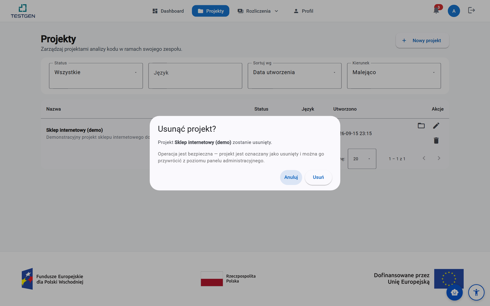
*Usuwanie jest bezpieczne: projekt można przywrócić z panelu administratora platformy.*

Usunięcie nie kasuje danych natychmiast — projekt znika z Twojej listy,
ale administrator platformy może go przywrócić. Skasowanie obejmuje
powiązane dane (pliki, analizy, przypadki), więc wcześniej wyeksportuj
raporty ([rozdz. 9](#91-poziomy-raportów)).

**Archiwizacja.** Status „Zarchiwizowany" widnieje w filtrach, ale
samodzielne zamknięcie projektu na stanie (dane zostają, projekt znika
z aktywnego obiegu) wykonuje administrator platformy na Twoje życzenie.

### 3.6. Dobre praktyki

- **Jeden projekt = jedna aplikacja.** Nie wrzucaj dwóch systemów do
  jednego projektu — analiza porówna je ze sobą, a wyniki będą szumem.
- **Opis mówiący, po co projekt.** Po pół roku „API płatności v2 —
  migracja z REST na gRPC" mówi więcej niż sama nazwa.
- **Wersje w osobnych projektach.** Porównywanie wersji działa
  wewnątrz projektu ([4.7](#47-testy-regresji-kodu)); większe przebudowy
  prowadź w projekcie „v2", a stan obu wersji zestawiaj raportami.
- **Sprzątaj przed analizą.** Usuń zewnętrzne biblioteki i artefakty
  budowania (`node_modules`, katalog `build`) — zaniżają metryki
  i zużywają miejsce.
- **Konwencja nazewnicza zamiast filtra właściciela.** Lista projektów
  jest wspólna dla firmy; prefiks zespołu w nazwie porządkuje listę
  taniej niż jakiekolwiek ustawienia.

### 3.7. Ograniczenia

- **Liczba projektów bez limitu** w każdym planie — limitowane jest miejsce
  na pliki ([4.1](#41-wgrywanie-kodu-pliki-zip-repozytorium)).
- **Brak archiwizacji z poziomu aplikacji** — tylko usunięcie (odwracalne
  przez administratora) lub zamknięcie przez obsługę.
- **Brak ról wewnątrz projektu** — dostęp zawsze obejmuje całą firmę.

---

## Rozdział 4. Analiza kodu źródłowego

Analiza kodu to serce platformy: rozkłada przesłany kod na funkcje, klasy
i zależności, wykrywa logikę biznesową, mierzy metryki i na tej podstawie
proponuje przypadki testowe. Silniki analizy są **deterministyczne** —
te same dane wejściowe dają ten sam wynik, dziś i za miesiąc. Tryb pracy
silnika należy do konfiguracji platformy (ustala go administrator), nie do
ustawień projektu — na niektórych ekranach widzisz go w nieaktywnym polu
„Silnik analizy", wyłącznie informacyjnie.

### 4.1. Wgrywanie kodu (pliki, ZIP, repozytorium)

W karcie projektu kliknij **„Wgraj pliki"** — ekran „Pliki projektu" ma
dwie zakładki: **„Wgraj pliki"** i **„Połącz repozytorium"**.

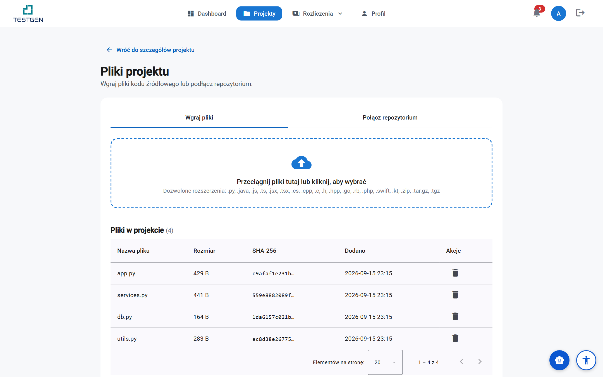
*Przeciągnij pliki tutaj albo kliknij, aby wybrać; lista dozwolonych rozszerzeń podpowiedziana pod spodem.*

**Pojedyncze pliki i wielokrotny wybór.** Przeciągnij pliki na obszar
przesyłania albo kliknij i wybierz je z dysku. Pliki są sprawdzane od razu
— rozszerzenia i rozmiar — a błędne odrzucane **przed** startem
przesyłania, więc nic nie „wisi" na serwerze.

**Archiwa ZIP i TAR.GZ.** Spakowane archiwum (`.zip`, `.tar.gz`, `.tgz`)
rozpakuje się na serwerze na osobne pliki. Bezpiecznik: maksymalnie
600 MB skompresowane, 1024 MB po rozpakowaniu i 10 000 plików — nadmiar
zostanie pominięty.

**Duplikaty.** Każdy plik dostaje skrót SHA-256; plik o identycznej
zawartości w ramach projektu jest odrzucany jako duplikat. Kolor tej
samej wersji pliku między analizami łatwo porównasz po skrócie.

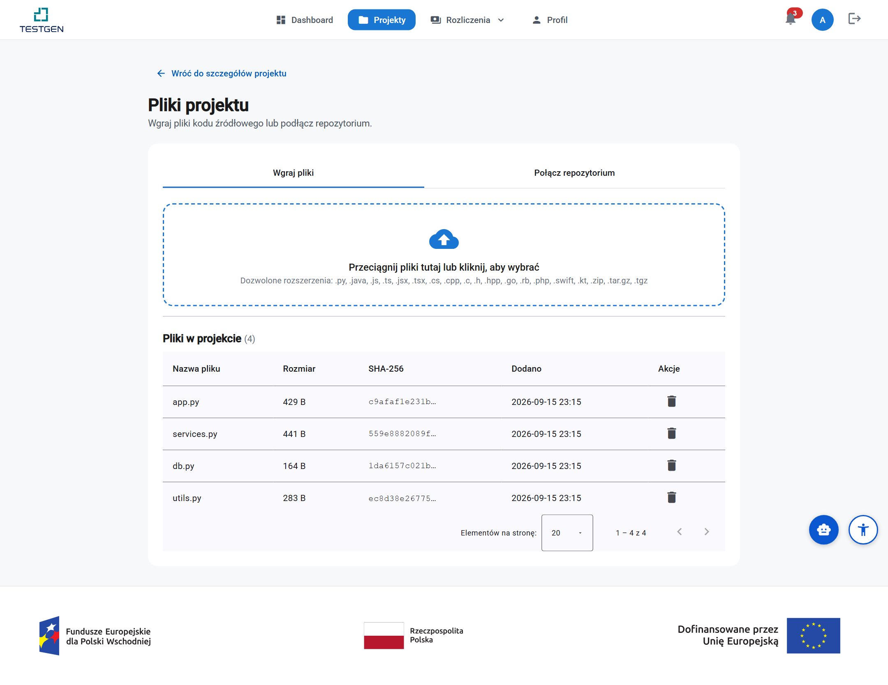
*Lista plików: nazwa, rozmiar, skrót SHA-256 i data — usuwanie plików (Właściciel) odzyskuje limit miejsca.*

**Repozytorium Git.** Zamiast klikać pliki, podłącz repozytorium:
zakładka **„Połącz repozytorium"**:

1. Wpisz **adres HTTPS** — obsługiwane `github.com`, `gitlab.com`,
   `bitbucket.org`.
2. Podaj **gałąź** (domyślnie „main").
3. Dla repozytorium prywatnego wklej **token dostępowy** — użyty raz
   do sklonowania, nie jest zapisywany.
4. Kliknij **„Połącz repozytorium"** — komunikat „Repozytorium
   podłączone. Zindeksowano {n} plików." podsumowuje płytkie klonowanie
   wybranej gałęzi.

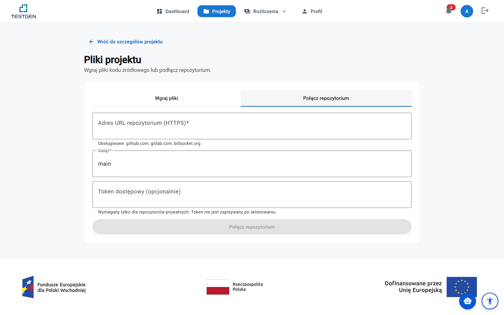
*Klon pobiera wybraną gałąź; token jest wymagany tylko dla repozytoriów prywatnych.*

⚠️ **Uwaga:** połączenie jest **jednorazowe** — po zmianach połącz
repozytorium ponownie; nowe pliki zostaną dodane, a niezmienione pominięte
(rozpoznane po skrócie). Automatycznej synchronizacji nie ma; pojedynczy
plik z repozytorium do 5 MB.

**Limity wgrywania:**

| | Freemium | Basic | Premium |
|---|---|---|---|
| Plików na analizę | 5 | 25 | 50 |
| Miejsce na pliki (łącznie) | 0,5 GB | 5 GB | 10 GB |
| Maksymalny rozmiar pliku | 100 MB | 500 MB | 500 MB |

Miejsce liczy się narastająco (stare pliki możesz usuwać, by je odzyskać);
liczniki analiz resetują się co okres rozliczeniowy. Bieżące zużycie:
**„Rozliczenia" → „Zużycie zasobów"** ([poradnik billingowy](billing/05-zuzycie-i-powiadomienia.md)).

### 4.2. Inne źródła materiałów

Kod to jedno z czterech źródeł analizy. Pozostałe wgrywasz z osobnych
ekranów (opisane we właściwych rozdziałach):

| Źródło | Ekran | Rozdział |
|---|---|---|
| Dokumentacja (PDF, DOCX, MD, HTML, TXT) | „Dokumenty" | [5](#51-wspierane-formaty) |
| Diagramy UML (PlantUML, XMI, rysunki) | „Diagramy UML" | [6](#61-wgrywanie-diagramów-uml) |
| Zrzuty ekranu GUI | „Zrzuty ekranu GUI" | [6.3](#63-analiza-interfejsów-użytkownika) |

### 4.3. Konfiguracja i uruchomienie analizy

Kafelek **„Konfiguracja analizy"** otwiera ekran z podsumowaniem projektu
(karty „Pliki", „LOC", „Moduły") i formularzem **„Parametry analizy"**:

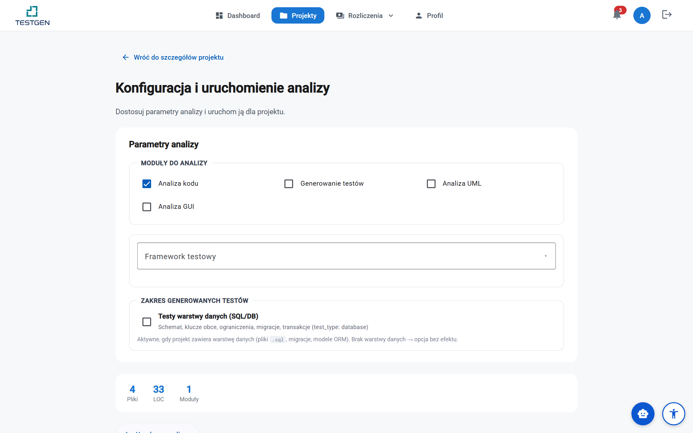
*Moduły, framework testowy i zakres generowanych testów — resztę platforma wykrywa sama.*

1. **„Moduły do analizy"** — zaznacz co najmniej jeden:
   - **„Analiza kodu"** — struktura, logika biznesowa, metryki,
   - **„Generowanie testów"** — przypadki testowe i kod testów,
   - **„Analiza UML"** — parsowanie diagramów ([rozdz. 6](#61-wgrywanie-diagramów-uml)),
   - **„Analiza GUI"** — rozpoznawanie zrzutów ([rozdz. 6.3](#63-analiza-interfejsów-użytkownika)).
2. **„Framework testowy"** — domyślnie „— Automatyczny —"; możesz wymusić
   Pytest, JUnit, NUnit, Cypress lub Mocha/Jest.
3. **„Zakres generowanych testów"** — opcjonalnie **„Testy warstwy danych
   (SQL/DB)"**: schemat, klucze obce, ograniczenia, migracje, transakcje;
   działa, gdy projekt zawiera warstwę danych (`.sql`, migracje, ORM).

Parametry zapamiętywane są osobno dla każdego projektu. Uruchomienie: **„Uruchom analizę"**
(w trakcie „Analiza w toku...", po zakończeniu „Uruchom ponownie", po
błędzie „Spróbuj ponownie").

⚠️ **Uwaga:** każde uruchomienie zużywa miesięczny limit analiz
(Freemium: 10); liczba plików w analizie limitowana planem (5/25/50).

### 4.4. Postęp

Analiza działa **w tle** — możesz przełączyć się na inny ekran, a o
zakończeniu powiadomi komunikat. Postęp widać na pięciu etapach:

**Kolejkowanie → Parsowanie → Analiza → Generowanie testów → Finalizacja**

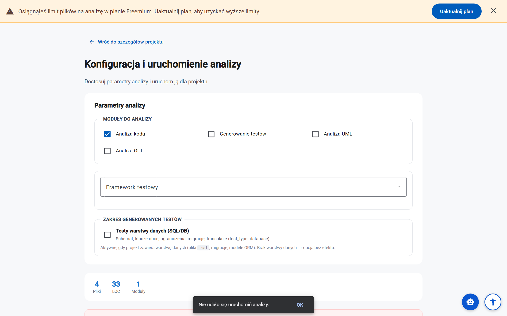
*Zakończona analiza: każdy z pięciu etapów ma „ptaszka", pasek doszedł do 100%, a pod spodem widać wykryte technologie.*

Trwającą analizę przerwiesz przyciskiem **„Anuluj analizę"**. Po zakończeniu
ekran pokazuje „Analiza zakończona. Wszystkie kroki zostały wykonane
pomyślnie." oraz **„Wykryte technologie"** — chipy języków (z liczbą plików)
i frameworki; szybkie sprawdzenie, czy platforma dobrze rozpoznała projekt.
Przerwana analiza kończy się statusem anulowana, a nieudana — komunikatem
„Analiza nie powiodła się" z przyczyną.

### 4.5. Preprocessing

Zanim kod trafi do analizy, przechodzi preprocessing — wyniki
w **„Raporcie preprocessingu"** (kafelek „Preprocessing"):

- **„Wykryte języki"** — chipy „język (liczba plików)" z liczbą linii,
- **„Frameworki testowe"** — rozpoznane z plików konfiguracyjnych,
- **„Łączne LOC"** — rozmiar projektu w liniach kodu,
- **„Pliki wymagające klasyfikacji"** — pliki bez rozszerzenia; każdemu
  ręcznie przypisz język z listy „Wybierz język".

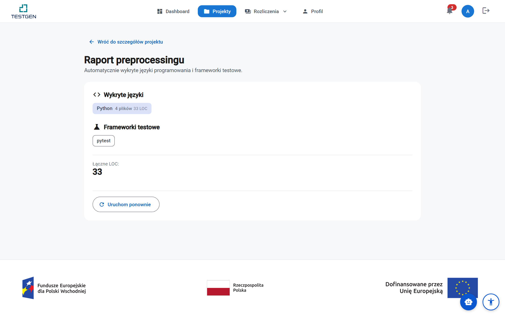
*Preprocessing potrafi rozpoznać język także z zawartości pliku — nagłówki, słowa kluczowe.*

💡 **Wskazówka:** złe wykrycie języka popraw tutaj — dopiero wtedy analiza
policzy struktury poprawnie. „Uruchom ponownie" odświeża raport po zmianach
w plikach.

### 4.6. Interpretacja wyników

Kafelek **„Wyniki analizy"** otwiera przeglądarkę wyników z sześcioma
zakładkami:

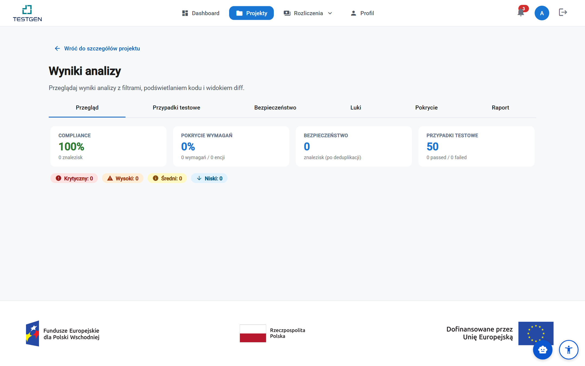
*Karty podsumowania: Compliance, pokrycie wymagań, bezpieczeństwo i przypadki testowe.*

- **„Przegląd"** — karty **Compliance** (zgodność kodu z dokumentacją
  w procentach, z liczbą znalezisk), **„Pokrycie wymagań"**,
  **„Bezpieczeństwo"**, **„Przypadki testowe"** (ile przeszło, ile nie)
  oraz zestawienie znalezisk według wagi: Krytyczny / Wysoki / Średni /
  Niski.
- **„Przypadki testowe"** — tabela wygenerowanych przypadków (szczegóły
  w [rozdz. 8](#82-przeglądanie-i-edycja-przypadków) i poradniku
  [Wyniki i test case'y](interfejs-webowy/03-wyniki-i-test-case-y.md)).
- **„Bezpieczeństwo"** 🔒 i **„Luki"** 🔒 — moduły planu Premium
  ([rozdz. 7](#71-typy-skanów) i [5.6](#56-porównywanie-dokumentacji-z-kodem-luki)).
- **„Pokrycie"** — karty „Pokrycie", „Brakujące", „Rozbieżne",
  „Niespójne" oraz tabela dla poszczególnych plików.
- **„Raport"** — liczniki „Znaleziska łącznie", „Deduplikacja",
  „Korelacje".

Panel filtrów zawęża wyniki: szukajka, przełączniki wagi i statusu, listy
„Typ"/„Moduł", autouzupełnianie pliku, „Wyczyść". Kliknięcie wiersza otwiera
szczegóły znaleziska: opis, **„Fragment kodu"** z podświetloną składnią
i **„Sugerowaną poprawkę (diff)"**. Statusy znalezisk: „Nowy",
„Zaakceptowany", „Odrzucony".

**Błędy kodu.** Sąsiedni ekran **„Błędy kodu"** listuje problemy samego
kodu: Poziom (Krytyczny / Ostrzeżenie / Info), Typ, Wiadomość, Lokalizacja
(plik:linia) i Sugestię poprawy.

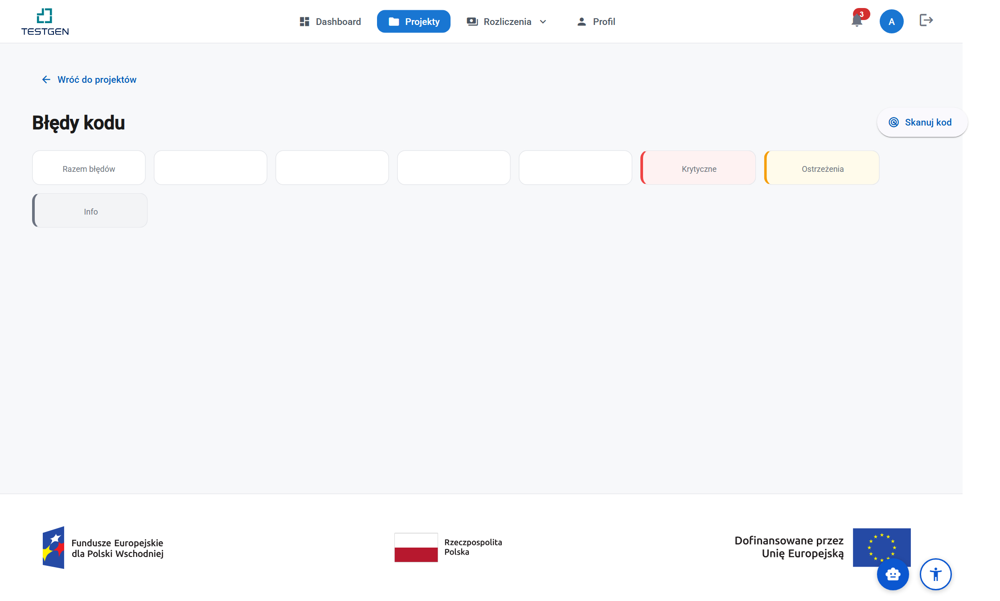
*Każdy błąd ma lokalizację i sugestię — gotową podpowiedź dla dewelopera.*

Typ **„Martwy kod"** (poziom „Ostrzeżenie") wskazuje funkcje i metody
**prywatne lub wewnętrzne, których nic nie wywołuje w projekcie** —
każde znalezisko zawiera lokalizację (plik:linia) i liczbę „0 wywołań".
Celowo NIE są zgłaszane elementy osiągalne pośrednio: endpointy API,
`main`, funkcje testowe (`test_*`, `spec`), konstruktory, nazwy
importowane gdziekolwiek w projekcie oraz handlery frameworków
(dekoratory route/endpoint/command) — wywołania dynamiczne
(getattr, wstrzykiwanie zależności, refleksja) czyniłyby z żywego kodu
martwy. Funkcję utrzymywaną celowo oznacz dekoratorem `@internal` —
detektor ją pominie; standardowa sugestia brzmi: „Sprawdź i usuń albo
oznacz `@internal`". Fałszywy pozytyw odrzucisz przyciskiem **„Odrzuć"**
— odrzucone znalezisko nie wróci przy ponownym skanie tego samego stanu
kodu (edycja treści funkcji przywraca zgłoszenie). Detektor wyłącznie
**raportuje** — niczego nie usuwa.

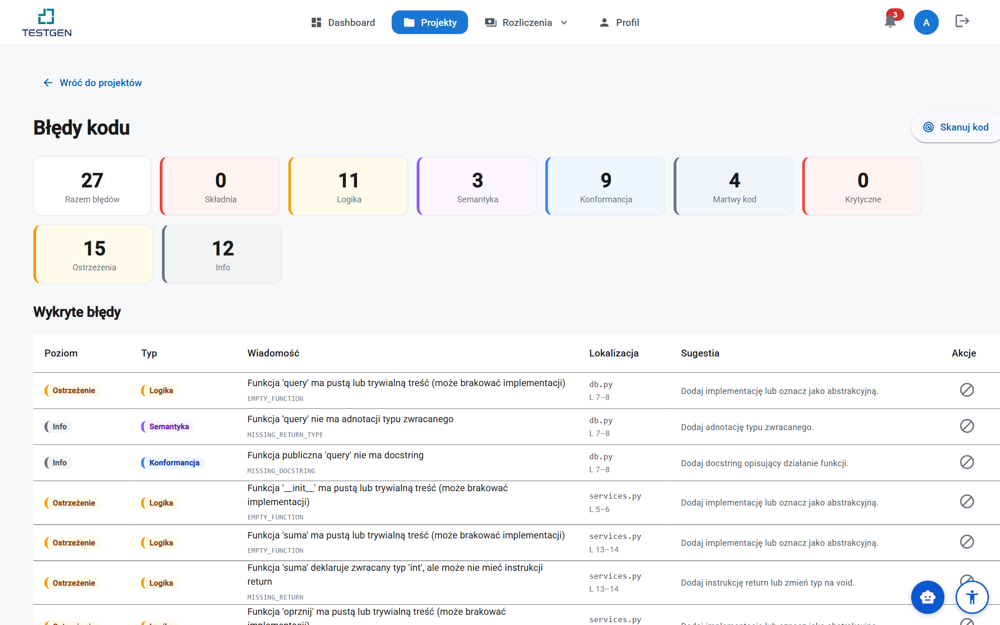
*Kategoria „Martwy kod" w podsumowaniu i tabeli; w kolumnie Akcje przycisk „Odrzuć" (fałszywy pozytyw).*

**Co dokładnie „rozumie" analiza:**

- **Struktury** — funkcje i metody (nazwa, plik, zakres linii, parametry
  z typami, typ zwracany), klasy (metody, atrybuty, dziedziczenie),
  importy i wywołania.
- **Punkty wejścia** — endpointy API (metoda, ścieżka, parametry)
  dla rozpoznanych frameworków webowych.
- **Zależności** — sprzężenia między modułami i **cykle** (zależności
  kołowe) — częsty sygnał architektonicznego długu.
- **Martwy kod** — definicje prywatne/wewnętrzne bez żadnego wywołania
  w projekcie; raportowane w kategorii „Błędy kodu" (patrz wyżej),
  z wykluczeniem punktów wejścia, testów i kodu oznaczonego `@internal`.
- **Reguły logiki biznesowej** — walidacje, ograniczenia, obliczenia,
  autoryzacje, reguły warunkowe i niezmienniki; operacje CRUD, polecenia
  i zapytania; zdarzenia i pojęcia domenowe (encje, obiekty wartości).
- **Metryki** — złożoność cyklomatyczna z progami: niska (≤ 5), średnia
  (5–10), wysoka (> 10); licznik linii kodu dla plików i całości.

To te struktury zasilają generowanie przypadków testowych
([rozdz. 8](#81-wybór-frameworka-testowego)).

### 4.7. Testy regresji kodu

Regresja w TestGEN to **zestaw przypadków, nie odrębny typ testu**.
Mechanika opiera się na porównywaniu wersji:

1. Po istotnej zmianie prześlij pliki ponownie i uruchom analizę.
2. Platforma porównuje struktury między uruchomieniami: **added**
   (nowa funkcja — brak pokrycia testami), **removed** (usunięta — testy
   do weryfikacji/usunięcia), **changed** (zmieniona sygnatura/ciało —
   testy do ponownego uruchomienia), **unchanged** (pomijalne — szybsze
   wykonanie).
3. Przypadki powiązane ze zmienionymi strukturami tworzą **zestaw
   regresyjny** — niezmienione obszary odpadają, co skraca czas przy
   dużych bazach.

Pełny obraz czasu dają **zrzuty stanu zgodności** (compliance): karta
**„Porównanie wersji"** pozwala utworzyć zrzut bieżącego wyniku, porównać
dwa zrzuty (plakietki „Naprawione" / „Nowe" / „Bez zmian" / „Pogorszone",
tabela „Szczegóły luk", wykres „Trend compliance") — szczegóły
w [rozdziale 5.6](#56-porównywanie-dokumentacji-z-kodem-luki), gdzie leży
sedno zgodności.

💡 **Wskazówka:** rób zrzut stanu po każdym sprincie. Trend mówi więcej
niż pojedynczy wynik — „compliance 72%" nic nie znaczy, „72% i rośnie od
trzech sprintów" znaczy wszystko.

### 4.8. Przykłady dla różnych języków

Platforma rozpoznaje **11 języków**; pełna analiza struktury (drzewo
składniowe) obejmuje osiem z nich:

| Język | Rozpoznawanie | Pełna analiza (funkcje, klasy) | Uwagi praktyczne |
|---|---|---|---|
| **Python** | ✓ | ✓ | najpełniejsze wsparcie: frameworki Flask/FastAPI/Django, pytest/unittest, testy bazodanowe |
| **Java** | ✓ | ✓ | Spring/JAX-RS, JUnit/TestNG; skeletony w javie |
| **JavaScript** | ✓ | ✓ | Express, Vitest/Jest/Mocha; `.js`/`.jsx` |
| **TypeScript** | ✓ | ✓ | NestJS; kod Cypress (`.cy.ts`) i Playwright (`.spec.ts`) |
| **PHP** | ✓ | ✓ | Laravel/Symfony, PHPUnit/Pest — dedykowany generator |
| **C** | ✓ | ✓ | — |
| **C++** | ✓ | ✓ | Google Test/Catch2 wykrywane |
| **C#** | ✓ | ✓ | ASP.NET, xUnit/NUnit/MSTest wykrywane |
| **Go** | ✓ | — | język i frameworki tak; bez rozkładu na funkcje/klasy |
| **Ruby** | ✓ | — | j.w. |
| **Swift / Kotlin** | ✓ | — | j.w. |

Co to znaczy w praktyce: dla języków z pełną analizą dostaniesz struktury,
logikę biznesową, metryki **i wygenerowane przypadki testowe**; dla Go,
Ruby, Swift i Kotlin — wykrycie języka, frameworków i metryki plików,
ale bez przypadków z kodu (testy możesz nadal generować z dokumentacji
i diagramów).

Przykład wykładnika różnicy — funkcja w Pythonie po analizie zasila
generator pozytywnym, negatywnym (walidacja `tax_rate < 0`) i brzegowym
(`items = []`) scenariuszem; plik `.go` z tą samą logiką przejdzie
do metryk i wykrycia frameworka bez scenariuszy.

### 4.9. Dobre praktyki

- **Analizuj czysty kod** — bez `node_modules`, katalogów budowania
  i wygenerowanych paczek.
- **Zacznij od „— Automatyczny —"** — wykrywanie frameworka wystarcza
  w przeważającej liczbie projektów.
- **Analizuj punktualnie** — po istotnej zmianie, nie po każdej edycji;
  różnice zobaczysz w porównaniu wersji.
- **Reaguj na czerwoną wagę** — zanim zaczniesz przeglądać przypadki,
  obejrzyj znaleziska „Krytyczny"; często unieważnią część scenariuszy.
- **Utrzymuj jedną wersję pliku** — duplikaty odrzuci platforma, ale
  stare kopie (`service_old.py`) wprowadzają szum do analizy.

### 4.10. Ograniczenia

- **Pełna analiza struktury: 8 języków** (lista wyżej) — dla pozostałych
  bez przypadków z kodu.
- **Analiza działa na przesłanych plikach**, nie na żywym repozytorium.
- **Analiza statyczna nie uruchamia kodu** — błędy wykonawcze łapie DAST
  ([rozdz. 7](#71-typy-skanów)).
- **Jedna analiza = limit plików planu** (5/25/50).

---

## Rozdział 5. Analiza dokumentacji

Analiza dokumentacji czyta Twoje dokumenty techniczne — specyfikacje,
podręczniki, opisy API — i zamienia je w ustrukturyzowane wymagania,
wykrywa niespójności i buduje glosariusz pojęć. To pomost między tym,
co obiecuje dokumentacja, a tym, co robi kod. Moduł wymaga planu Basic
lub wyższego.

### 5.1. Wspierane formaty

| Format | Tekst | Tabele | Nagłówki | Uwagi |
|---|---|---|---|---|
| **PDF** | tak (warstwa tekstowa; skan → OCR) | nie | tak | do 500 stron; skany wolniejsze |
| **DOCX** | tak | tak | tak (style Nagłówek N) | tabele działają w pełni |
| **Markdown** | tak | tak (GFM) | tak (`#`–`######`) | — |
| **HTML** | tak | tak (`<table>`) | tak (`<h1>`–`<h6>`) | analizowany statycznie (bez JS) |
| **TXT** | tak | nie | nie | segmentacja po akapitach |

Rozszerzenia: `.pdf`, `.docx`, `.md`/`.markdown`, `.html`/`.htm`, `.txt`
(limit pliku 100 MB). Nieobsługiwane: `.doc`, `.rtf`.

### 5.2. Wgrywanie dokumentacji

Kafelek **„Dokumenty"** otwiera ekran przesyłania (drag & drop jak
dla kodu). Każdy dokument przechodzi statusy **„Wysyłanie…" →
„Przetwarzanie…" → „Gotowy"** (lub „Błąd" z przyczyną), a po przetworzeniu
platforma **automatycznie klasyfikuje** jego typ: „Specyfikacja wymagań",
„Podręcznik użytkownika", „Instrukcja techniczna", „Opis API", „Notatki
projektowe" lub „Inny" — z procentem pewności (po najechaniu na etykietę).
Pomyłkę poprawisz **„Klasyfikuj ponownie"**.

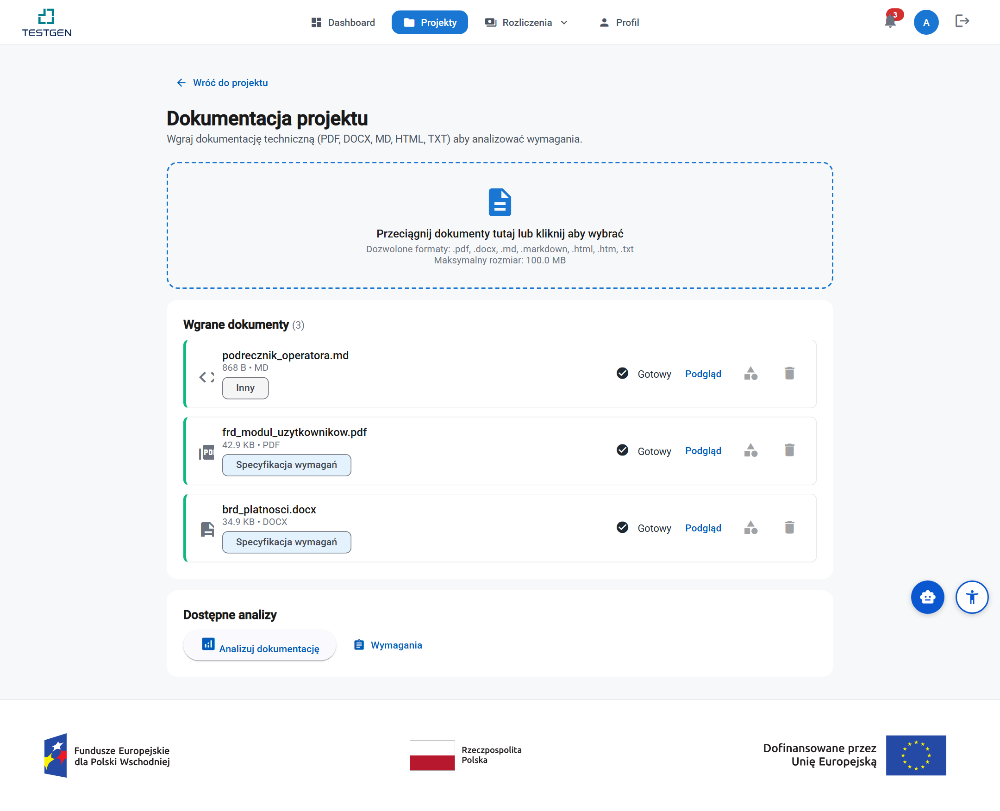
*Każda karta pokazuje format, liczbę stron i rozpoznany typ dokumentu z pewnością klasyfikacji.*

Skan zapisany jako PDF (bez warstwy tekstowej) jest rozpoznawany OCR-em —
dłuższe dokumenty przetwarzają się wyraźnie dłużej niż pliki z tekstem.
Analizę dokumentacji uruchamia przycisk **„Analizuj dokumentację"** (sekcja
„Dostępne analizy"); działa w tle i zużywa miesięczny limit analiz.
Powtórzenie analizy nie traci Twoich decyzji (zaakceptowane wymagania
i zweryfikowane terminy zostają).

### 5.3. Wymagania

Ekran **„Wymagania z: {dokument}"** pokazuje listę wymagań z plakietką
„Znaleziono: {n} z {m}" — widać, jaką część zdań platforma uznała
za wymagania.

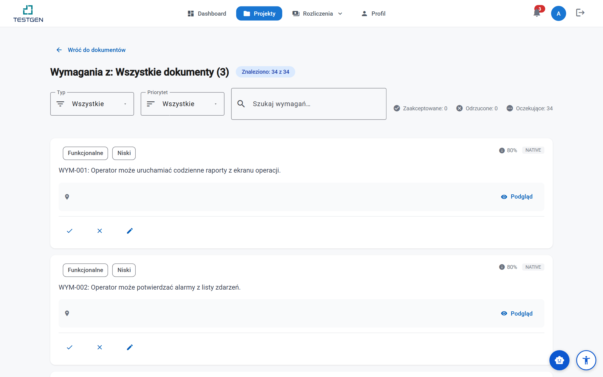
*Każde wymaganie ma typ, priorytet, pewność i źródło w dokumencie.*

Zdanie zostaje wymaganiem, gdy: ma identyfikator („FR-12", „WYM-3"),
leży w sekcji wymagań albo brzmi jak wymaganie („system musi…"). Każde
opisują: **typ** (Funkcjonalne/Niefunkcjonalne), **priorytet**
(Krytyczny/Wysoki/Średni/Niski), **pewność** i **źródło** (fragment
dokumentu z podglądem).

Wygenerowane wymagania to **propozycje** — dla każdego dostępne „Akceptuj
wymaganie", „Odrzuć wymaganie", „Edytuj wymaganie" (treść i priorytet)
oraz „Cofnij decyzję"; filtry Typ/Priorytet i szukajka zawężają listę,
a statystyki („Zaakceptowane"/„Odrzucone"/„Oczekujące") pokazują postęp.

💡 **Wskazówka:** zaakceptowane wymagania mają znaczenie dalsze — to one
porównywane są z kodem (pokrycie, compliance) i zasilają generowanie
przypadków ([5.7](#57-generowanie-testów-z-dokumentacji)).

### 5.4. Niespójności

Ekran **„Niespójności: {dokument}"** zbiera problemy **wewnątrz
dokumentacji** — zanim porównasz ją z kodem, warto tu posprzątać:

| Typ | Co wykrywa | Typowa waga |
|---|---|---|
| **Sprzeczności** | wzajemnie wykluczające się zapisy („maksimum 5" vs „bez limitu") | krytyczna |
| **Brakujące referencje** | odwołanie do nieistniejącego identyfikatora | wysoka |
| **Duplikaty** | ta sama treść w dwóch miejscach | średnia |
| **Terminologia** | jedna encja pod różnymi nazwami | średnia |

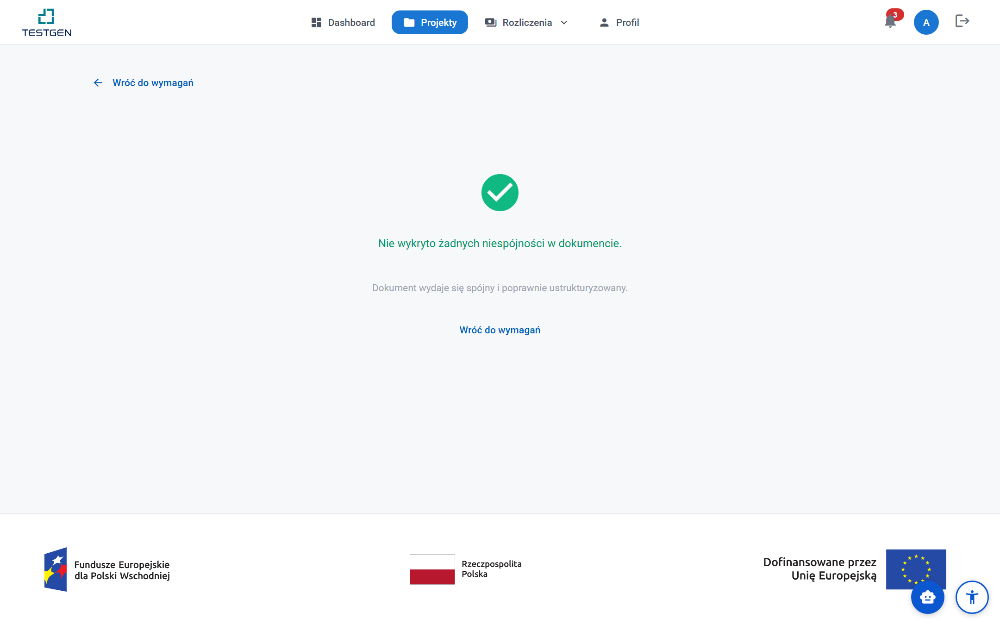
*Każda niespójność ma opis, powiązane wymagania i sugestię poprawki.*

Każda pozycja pokazuje opis, „Dotyczy wymagań" (linki) i „Sugestię".
Statusy weryfikujesz przyciskami: „Otwarte" → „Zaakceptowane" (to realny
problem), „False positive" (alarm fałszywy) lub „Naprawione".

### 5.5. Glosariusz

Ekran **„Glosariusz: {dokument}"** zbiera terminy domenowe: definicje
z sekcji słownika, wzorce definicyjne oraz akronimy i terminy często
powtarzane. Każdy termin ma typ („Dziedzina"/„Techniczny"/„Biznesowy"/
„Akronim"), liczbę wystąpień i edytowalną definicję; zweryfikowane dostają
znacznik „Zweryfikowany".

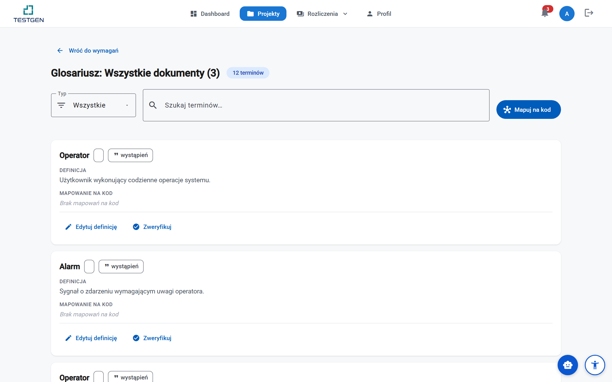
*Mapowanie terminu na encję kodu z procentem podobieństwa — potwierdzasz je jednym kliknięciem.*

Przycisk **„Mapuj na kod"** dopasowuje terminy do encji wykrytych
w kodzie projektu — do pięciu sugestii na termin z procentem podobieństwa,
mapowanie potwierdzasz checkboxem. Widać, które pojęcia z dokumentacji
mają odbicie w kodzie, a które są tylko na papierze.

### 5.6. Porównywanie dokumentacji z kodem (luki)

Najcenniejszy etap: **analiza luk funkcjonalnych** (plan Premium)
odpowiada na pytanie „czy kod robi to, co obiecuje dokumentacja?".

**Uruchomienie:** kafelek **„Luki funkcjonalne"** → **„Uruchom analizę"**
→ w dialogu wybierz dokumenty z wymaganiami → analiza liczy się
w tle (sekundy na małych projektach). Wymaga wcześniejszej analizy kodu
i dokumentacji — bez nich dostaniesz „Brak wymagań" / „Brak bytów kodu".

**Tabela luk** — Typ | Wymaganie | Byt kodu | Wynik (%) | Metoda |
Severity | Skeleton — z filtrami i rozwinięciem (fragmenty wymaganienia
i kodu, najlepszy kandydat, lokalizacja `plik:linia`):

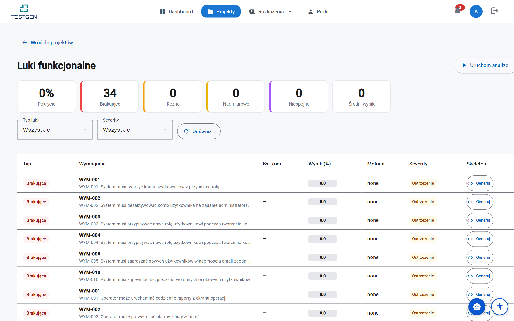
*Typ luki mówi, co zrobić: Brakujące — dopisać, Różne — poprawić, Nadmiarowe — zweryfikować.*

| Typ luki | Co znaczy | Typowa akcja |
|---|---|---|
| **Brakujące** | wymaganie istnieje, kodu brak | zaplanuj implementację, wygeneruj szkielet |
| **Różne** | kod spełnia wymaganie częściowo (30–70%) | uzupełnij albo popraw nazwę |
| **Nadmiarowe** | kod bez wymagania | `@internal`, nowe wymaganie — albo usunięcie |
| **Niespójne** | jeden byt kodu mapuje się na sprzeczne wymagania | zawsze pilne — koordynuj z właścicielem produktu |

**Compliance.** Wskaźnik zgodności 0–100 (100 = brak luk) z rozbiciem
Brakujące/Różne/Nadmiarowe/Niespójne, tabelami dla modułów i funkcji
oraz eksportem CSV — ekran „Compliance":

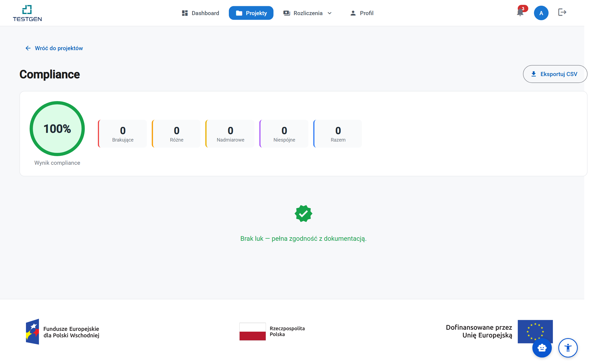
*Wskaźnik 0–100 z rozbiciem luk na typy; wysoki wynik = kod pokrywa dokumentację.*

**Rekomendacje i szkielety.** Karta **„Rekomendacje"** („Generuj
rekomendacje") zbiera sugestie z luk i błędów kodu w tabeli Priorytet
(P1–P4) | Źródło | Tytuł | Pewność | Sugestia — karty podsumowania
ostrzegają o niskiej pewności:

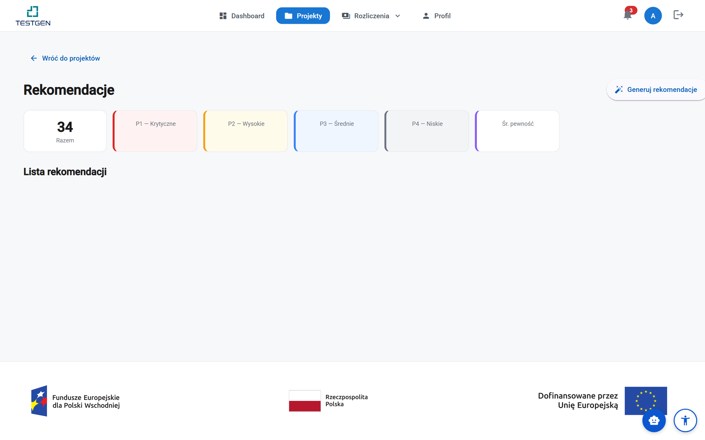
*P1 to decyzje na dziś; niska pewność wymaga ludzkiego oka przed wdrożeniem.*

Dla luk „Brakujące" kolumna **Skeleton** generuje **szkielet kodu**
nowej funkcji/klasy (nazwa z wymagania, docstring z identyfikatorem,
`NotImplementedError` do zastąpienia; języki: Python, TypeScript, Java,
C#; składnia walidowana przed zwrotem). Rozwinięcie wiersza pokazuje kod
z przyciskiem „Kopiuj".

**Zrzuty stanu i trend.** Karta **„Porównanie wersji"**: „Utwórz snapshot"
(notowany wynik zgodności), wybór „Wersji 1 (wcześniejszej)" i „Wersji 2
(nowszej)", „Porównaj" → zmiana wyniku z deltą, plakietki „Naprawione"/
„Nowe"/„Bez zmian"/„Pogorszone", „Szczegóły luk" i wykres „Trend
compliance":

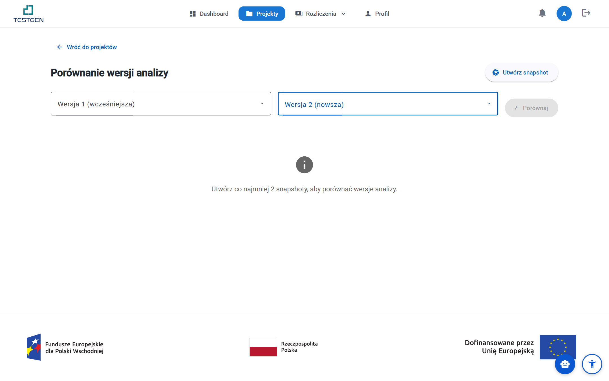
*Dwa zrzuty stanu i wykres trendu — zgodność rośnie w dobrym kierunku?*

💡 **Wskazówka:** najpierw posprzątaj wymagania (odrzuć śmieciowe) — luki
liczone są z zaakceptowanych. „Niespójne" traktuj priorytetowo: sprzeczne
wymagania mają dwie interpretacje i każda dalsza praca na nich mnoży koszt.

### 5.7. Generowanie testów z dokumentacji

Zaakceptowane wymagania zasilają generator przypadków testowych: dla
wymagań funkcjonalnych powstają scenariusze pozytywny i negatywny,
dla brzegowych warunków (jeśli wymaganie je opisuje) — brzegowe. Przypadki
trafiają na wspólną listę projektu ([rozdz. 8](#82-przeglądanie-i-edycja-przypadków))
ze statusem „Szkic", z priorytetem przejętym z wymagania — dzięki temu
krytyczne wymaganie rodzi krytyczny test.

### 5.8. Dobre praktyki

- **Numeruj wymagania** (FR-1, WYM-2…) — identyfikator to najsilniejszy
  sygnał ekstrakcji i najpewniejsze ogniwo macierzy pokrycia.
- **Buduj hierarchię nagłówków** — zwykły tekst bez nagłówków dzieli się
  tylko na akapity.
- **Jedna nazwa dla jednego pojęcia** — synonimy rodzą „Niespójności:
  Terminologia" i rozmywają mapowanie na kod.
- **PDF z warstwą tekstową zamiast skanu**; monstrualne dokumenty dziel
  (limit 500 stron).
- **Zamknij pętlę:** rekomendacja → szkielet → implementacja → ponowna
  analiza → nowy zrzut stanu.

### 5.9. Ograniczenia

- **Tabele z PDF nieodczytywane** — dane w tabelach przenieś do DOCX/MD/HTML.
- **Skan PDF** zależy od jakości obrazu; diakrytyki bywają zniekształcone,
  układ wielokolumnowy zmienia kolejność zdań.
- **TXT bez nagłówków** — wymagania wykrywane wyłącznie po treści zdań.
- **HTML statyczny** — treść dogenerowywana JavaScriptem niewidoczna.
- **Makra dokumentów** (VBA) pomijane; dopasowanie wymaganie ↔ kod jest
  przybliżone (wynik % i metoda pokazują pewność).

---

## Rozdział 6. Analiza UML i GUI

Diagramy UML opisują architekturę i przepływy, zrzuty ekranu GUI —
interfejs widziany przez użytkownika. Platforma sprowadza oba do wspólnego
mianownika (ustrukturyzowanych elementów) i wiąże je z przepływami oraz
scenariuszami testowymi. Moduły wymagają planu Basic lub wyższego.

### 6.1. Wgrywanie diagramów UML

Kafelek **„Diagramy UML"** przyjmuje dwa rodzaje plików:

| Rodzaj | Formaty | Jak analizowany |
|---|---|---|
| **Źródła diagramów** | `.puml`, `.plantuml`, `.xmi`, `.xml` | pełna ekstrakcja struktury |
| **Rysunki** | `.svg`, `.pdf`, `.png`, `.jpeg`, `.jpg` | analiza wizualna: OCR tekstu + rozpoznawanie kształtów |

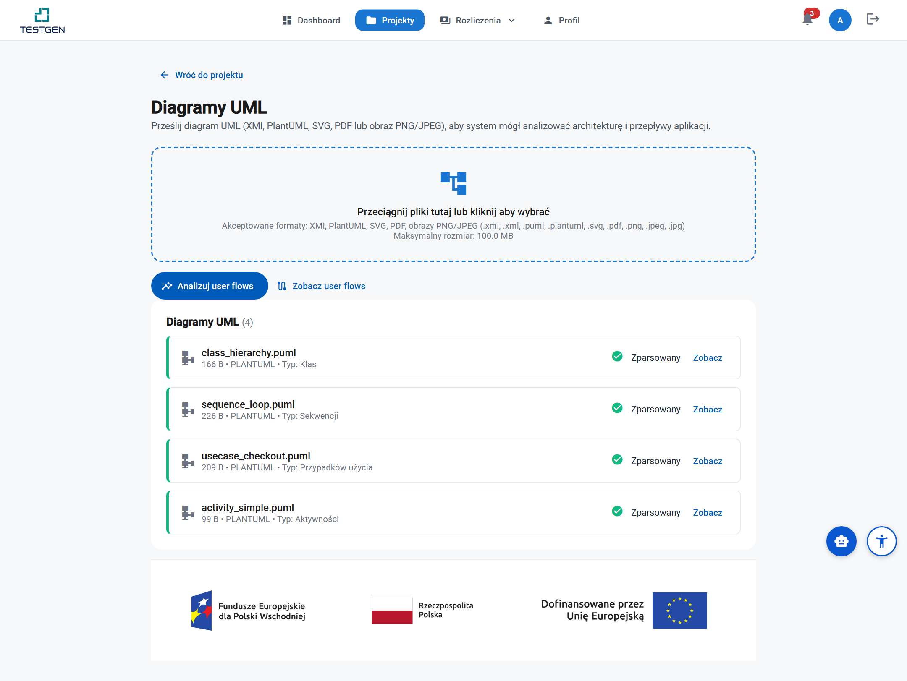
*Statusy: Oczekuje, Parsowanie, Zparsowany lub Błąd; „Zobacz" otwiera widok danego typu diagramu.*

Obsługiwane typy: **sekwencji, przypadków użycia, klas, aktywności
i stanów** — typ rozpoznawany automatycznie (źródła: zawsze poprawnie;
rysunki: z pewnością rozpoznania). Po sparsowaniu przycisk **„Analizuj
user flows"** łączy wiele diagramów w przepływy użytkownika.

### 6.2. Widoki diagramów

Każdy „Zparsowany" diagram otwiera widok dopasowany do typu:

| Typ | Co zobaczysz |
|---|---|
| **Sekwencji** | Uczestnicy, Wiadomości, Fragmenty, Ścieżki testowe |
| **Przypadków użycia** | Aktorzy, Przypadki użycia, Granica systemu, Relacje, Scenariusze |
| **Klas** | Klasy (atrybuty i metody), Interfejsy, Enumeracje, Relacje, Pakiety |
| **Aktywności** | Węzły, Tory odpowiedzialności, Przepływy, Ścieżki testowe |
| **Stanów** | Stany, Stany złożone, Przejścia, Scenariusze (pokrycie przejść, negatywne) |

Sercem widoku klas jest **„Porównanie z kodem"** — zestawienie klas
z diagramu z klasami z kodu ([rozdz. 4.6](#46-interpretacja-wyników)):

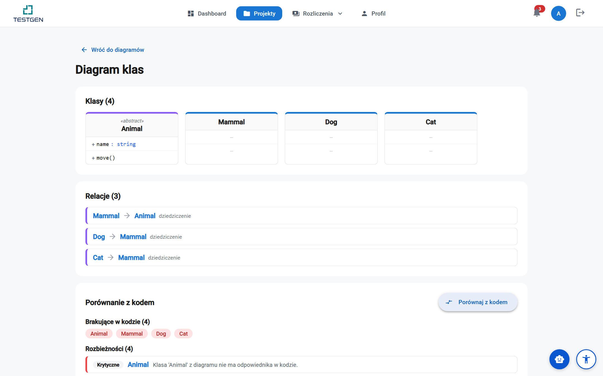
*Dopasowane klasy z procentami zgodności atrybutów i metod; osobno brakujące po obu stronach.*

„Dopasowane klasy" (zgodność atrybutów/metod w %), „Brakujące w kodzie",
„Brakujące na diagramie", „Rozbieżności" — najszybszy audyt spójności
„projekt vs implementacja".

### 6.3. Analiza interfejsów użytkownika

Kafelek **„Zrzuty ekranu GUI"** przyjmuje obrazy PNG, JPEG, BMP, TIFF,
WebP (do 20 MB). Analiza kończy się ekranem **„Wynik analizy GUI"**:

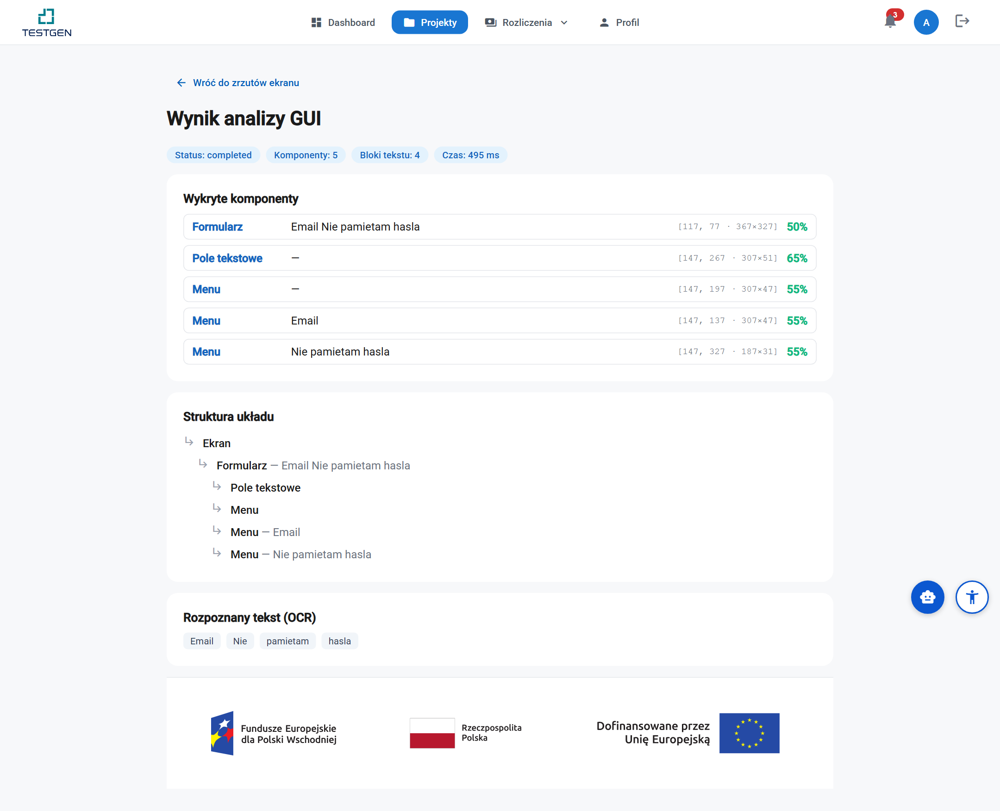
*Komponenty z typem, etykietą, położeniem i pewnością rozpoznania; drzewo układu pokazuje zagnieżdżenie.*

- **„Wykryte komponenty"** — typ (Przycisk, Pole tekstowe, Lista
  rozwijana, Pole wyboru, Przycisk opcji, Menu, Łącze, Tabela, Formularz,
  Okno modalne, Zakładka), etykieta z sąsiedztwa, położenie i pewność,
- **„Struktura układu"** — drzewo zagnieżdżenia (co zawiera co),
- **„Rozpoznany tekst (OCR)"** — bloki tekstu z położeniem.

Ekran ma też sekcję **źródeł HTML/DOM** („Wybierz pliki HTML") — wgrane
widoki aplikacji pozwalają wiązać komponenty z realnymi elementami strony
(pomocne przy samonaprawianiu testów, [Część 3, rozdz. 11](03-testy-bezpieczenstwo-eksport.md)).

### 6.4. Generowanie testów UI (Gherkin/BDD)

Z kilku zrzutów (w kolejności numerów ekranów) i diagramów platforma
buduje **przepływy użytkownika**, a generator **„Scenariuszy Gherkin/BDD"**
zamienia je na scenariusze BDD: zaznacz przepływy („Wybierz przepływy"),
nadaj opcjonalną nazwę funkcjonalności, **„Generuj scenariusze"** — lista
pokaże pliki `.feature` ze statusem („Wygenerowano" → „Zweryfikowano" →
„Zatwierdzono"), ostrzeżeniami walidacji i podglądem z **„Pobierz
.feature"**. Z tej strony prowadzi też link do generatora kodu
Cypress/SikuliX ([rozdz. 8.5](#85-generowanie-kodu-testów)).

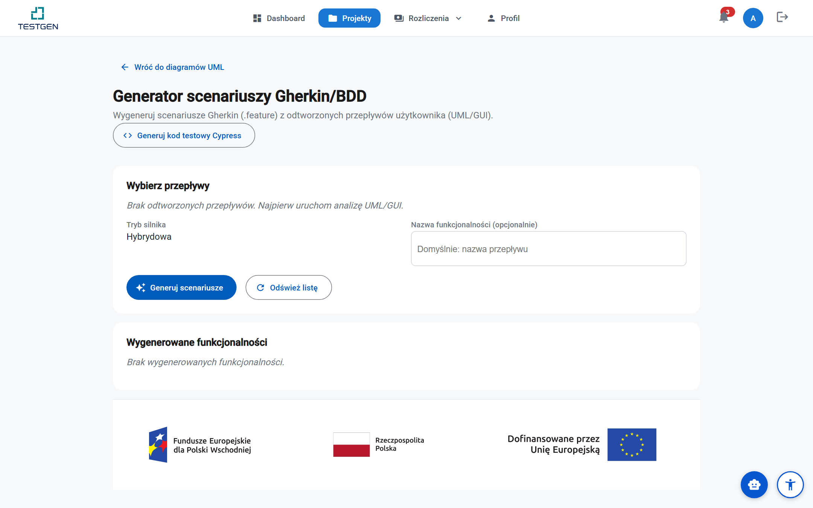
*Przepływy → scenariusze Gherkin: kroki czyta cały zespół, nie tylko automatyzer.*

### 6.5. Testy regresji GUI

Dwa zrzuty tego samego ekranu — przed i po zmianie — porówna ekran
**„Regresja wizualna"** (link na liście zrzutów GUI):

- **„Obraz różnicy"** — wizualna mapa różnic pikselowych,
- **„Wykryte zmiany"** — usunięte/dodane/przesunięte komponenty, zmiana
  układu lub tekstu,
- **„Wygenerowany kod testów"** — szkielet testu stabilności ekranu.

Wynik dostaje status: **istotna różnica**, **drobna różnica** lub **brak
różnic** — szybki werdykt, czy zmiana interfejsu była zamierzona.

### 6.6. Macierz śledzenia

Kafelek **„Macierz śledzenia"** zbiera elementy UML i komponenty GUI →
przepływy → zatwierdzone scenariusze Gherkin w jedną tabelę (filtry
„Źródło" i „Pokrycie"; „Przebuduj macierz" odświeża; „Eksportuj"
CSV/JSON/XLSX/PDF):

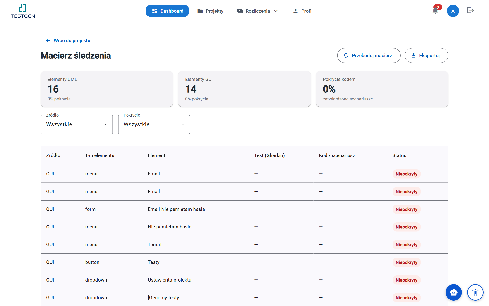
*Przycisk „Przebuduj macierz" odświeża powiązania; eksport w czterech formatach.*

⚠️ **Uwaga:** to macierz **źródeł UML/GUI** — odrębna od macierzy wymagań
dokumentacji ([5.6](#56-porównywanie-dokumentacji-z-kodem-luki)).

### 6.7. Dobre praktyki

- **Przesyłaj źródła, nie rysunki** (PlantUML/XMI > obraz).
- **Rysuj czytelnie** — duże, niekolidujące kształty, poziomy tekst.
- **Zrzuty GUI w naturalnej rozdzielczości** — bez przeskalowań
  i kompresji; ciemny i jasny motyw to dwa różne „ekrany".
- **Utrzymuj kolejność ekranów** — numery budują przepływy.
- **Etykietuj interfejs** — przycisk z tekstem rozpoznawalny pewniej niż
  ikona.

### 6.8. Ograniczenia

- **Z rysunku nie są odczytywane wnętrza klas** (atrybuty/metody) —
  wyłącznie z PlantUML/XMI.
- **Interfejs vs klasa vs wyliczenie** — z rysunku wszystkie prostokąty
  to klasy.
- **Diagramy stanów z rysunku** bywają brane za aktywności.
- **Detekcja komponentów heurystyczna** — najpewniej: przycisk, pole
  tekstowe, lista rozwijana, pole wyboru, menu, formularz; nietypowe
  kontrolki wypadną jako „Nieznany".
- **Brak minimalnej rozdzielczości** — formalny próg nie istnieje, ale
  jakość decyduje o wyniku.

---

## Rozdział 7. Analiza bezpieczeństwa

Moduł bezpieczeństwa (plan **Premium**) skanuje kod, zależności,
konfigurację — a nawet działającą aplikację — w poszukiwaniu podatności,
a następnie proponuje naprawy z gotowym kodem. Skany działają
asynchronicznie i deterministycznie.

### 7.1. Typy skanów

Kafelek **„Skanowanie bezpieczeństwa"** otwiera kartę „Uruchom skan
bezpieczeństwa" z listą **„Typ skanu"**:

| Typ skanu | Co robi |
|---|---|
| **„Skanowanie statyczne (SAST)"** | przeszukuje kod regułami wzorców (SQL injection, XSS, CSRF, autoryzacja, sekrety…) |
| **„Taint analysis (przepływ danych)"** | śledzi dane od źródła do ujścia — czy niebezpieczne dane dochodzą do SQL/HTML/ścieżek bez oczyszczenia |
| **„Zależności (CVE / SBOM)"** | porównuje zależności z bazą znanych podatności |
| **„Konfiguracja (Docker / K8s / Terraform)"** | szuka błędnych konfiguracji |
| **„Dynamiczny (DAST / OWASP ZAP)"** | skanuje **działającą** aplikację pod adresem URL (do 30 minut) |

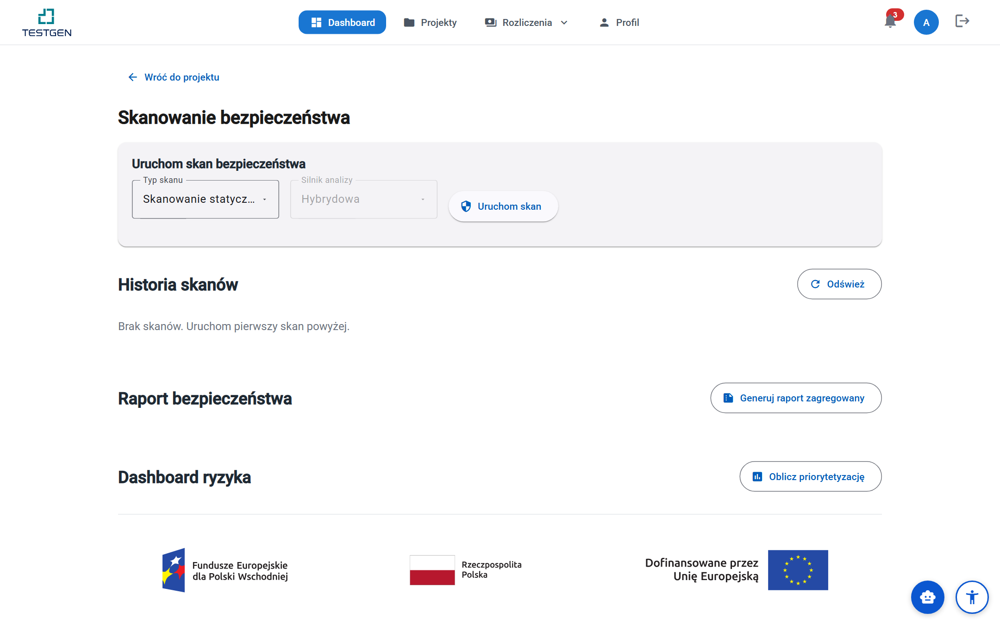
*Pięć typów skanów; dla DAST podajesz adres aplikacji i opcjonalną autentykację.*

DAST wymaga **„URL aplikacji docelowej"** oraz — dla chronionych ścieżek —
autentykacji („Bez autentykacji" / „Formularz (login)" / „Token (Bearer /
JWT)" / „Basic auth"). Skanuj wyłącznie aplikacje, do których masz prawo
testowania.

### 7.2. Uruchamianie

1. Wybierz **„Typ skanu"** i kliknij **„Uruchom skan"** (DAST: „Uruchom
   skan DAST").
2. **„Historia skanów"** pokaże kartę ze statusem „Oczekuje" → „W toku" →
   „Zakończony"/„Błąd" (przycisk „Odśwież").
3. Po zakończeniu karta pokazuje liczniki: „Krytyczne:", „Wysokie:",
   „Średnie:", „Niskie:", „Razem:".

Pod historią czeka tabela **„Podatności"**: Waga | Typ podatności | Plik |
Linia | Pewność — z identyfikatorem CWE przy typie (np. „SQL Injection
(CWE-89)").

### 7.3. Interpretacja wyników

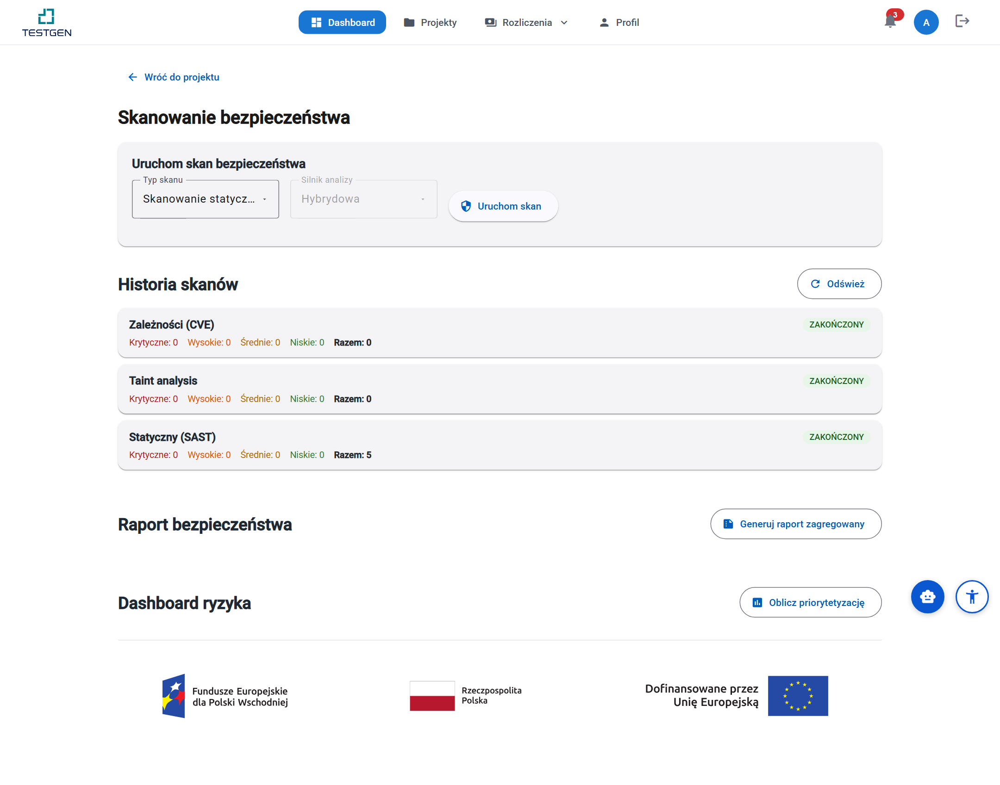
*Waga, lokalizacja w pliku i pewność — wpisy z niską pewnością traktuj ostrożnie.*

Każde znalezisko opisują pola, które warto znać przy przeglądzie zgłoszeń:

| Pole | Znaczenie |
|---|---|
| **Waga** | Krytyczna / Wysoka / Średnia / Niska / Info |
| **CWE** | identyfikator kategorii podatności |
| **Kategoria OWASP** | przypisanie do OWASP Top 10 (2021) |
| **Pewność** | 0–100%; rośnie, gdy to samo wykrywa kilka skanów (korelacja SAST↔DAST to najmocniejszy sygnał) |
| **CVSS** | ocena 0–10 z wektorem; pasma: ≥9 krytyczna, 7–8,9 wysoka, 4–6,9 średnia, 0,1–3,9 niska |
| **Status** | „Otwarte" → „Potwierdzone" / „Naprawione" / „Fałszywe" |

Dodatkowo: **taint** rysuje ścieżki `źródło → ujście` z ostrzeżeniami
(„Brak sanitizera"), **skan konfiguracji** pokazuje błędy z gotową
„Poprawną konfiguracją" jako fragmentem kodu.

💡 **Wskazówka:** wysoka pewność + kilka źródeł = mała szansa na fałszywy
alarm. Odwrotnie — niska pewność przy statycznym skanie to kandydat do
weryfikacji przed naprawą.

### 7.4. Zależności i SBOM

Skan „Zależności (CVE / SBOM)" analizuje manifesty projektu
(`requirements.txt`, `package.json`, `pom.xml`, `composer.json`, `.csproj`).
Raport „Podatne zależności (CVE)" — Waga | Pakiet | Wersja | CVE | CVSS |
Poprawka (wersja naprawiająca lub „brak"):

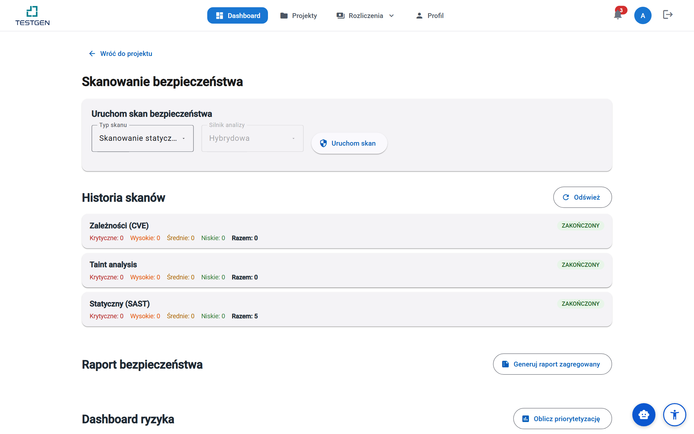
*Tabela CVE z wersjami naprawiającymi; SBOM pobierzesz w dwóch standardach.*

Przyciski **„SBOM (CycloneDX)"** i **„SBOM (SPDX)"** pobierają bilans
materiałów projektu — pełną listę komponentów (CycloneDX 1.5 lub SPDX 2.3,
JSON). Dane CVE pochodzą z NVD, OSV.dev i GitHub Advisory, synchronizowanych
miesięcznie do lokalnej bazy — skan działa offline.

### 7.5. Rekomendacje naprawcze

Rozwiń wiersz podatności — dostaniesz trzy narzędzia:

- **Rekomendacja** — „Opis problemu", „Ryzyko", „Rekomendacja naprawy",
  „Kod naprawiony" (z „Kopiuj kod") i **diff** czerwono-zielony
  (podatny → naprawiony):

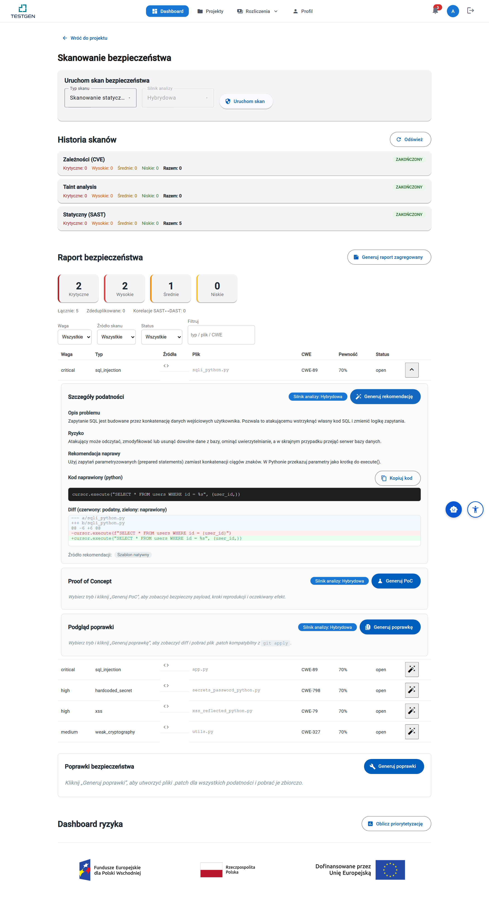
*Rekomendacja z gotowym kodem naprawy i diffem — kopiujesz i commitujesz.*

- **Proof of Concept** — dla klasycznych podatności: Payload, Kroki
  reprodukcji, Oczekiwany efekt; wzorce destrukcyjne blokuje bezpiecznik
  („Bezpieczny").
- **Poprawka** — plik `.patch` (unified diff) z podglądem i „Pobierz plik
  .patch"; sekcja „Poprawki bezpieczeństwa" generuje wszystkie naraz
  i ostrzega o konfliktach nakładających się linii (wtedy stosuj
  pojedynczo, przez `git apply`).

**Testy bezpieczeństwa.** Znaleziska zasilają też generowanie przypadków
typu „Bezpieczeństwa" ([rozdz. 8](#81-wybór-frameworka-testowego)) —
scenariusze weryfikujące poprawkę (np. próba wstrzyknięcia po naprawie).

### 7.6. Priorytetyzacja

Karta **„Dashboard ryzyka"** („Oblicz priorytetyzację") porządkuje naprawy:

- **„Rozkład CVSS"** — histogram ocen wg wag,
- **„Top 10 zagrożeń"** — najgroźniejsze znaleziska z CVSS,
- **„Rekomendowana kolejność napraw"** — tabela # | Typ | Waga | CVSS |
  Nakład pracy (Niski/Średni/Wysoki).

Kolejność liczy się jako: najpierw najpoważniejsze, najpewniejsze
i najtańsze („szybkie zwycięstwa"). Podbite wagi: znalezisko potwierdzone
przez SAST **i** DAST („Potwierdzona dynamicznie") albo zależność
z publicznym exploitem (CVSS ≥ 9).

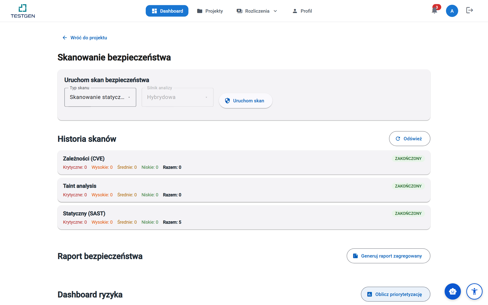
*Rekomendowana kolejność napraw łączy wagę, pewność i koszt — realizuj od góry.*

### 7.7. Dobre praktyki

- **Skanuj po każdej istotnej zmianie** — zwłaszcza nowej zależności.
- **Zacznij od „szybkich zwycięstw"** z kolejności napraw.
- **Oznaczaj fałszywe alarmy** — kolejne przeglądy krótsze, statystyki
  czystsze.
- **DAST tylko na środowisku testowym** — dynamiczny test strzela
  payloadami w Twoją aplikację.

### 7.8. Ograniczenia

- **Reguły SAST pokrywają popularne stosy** — egzotyczne języki przejdą
  bez znalezisk (fałszywy spokój).
- **DAST wymaga działającej aplikacji** (do 30 minut); głębokie przepływy
  za autoryzacją wymagają konfiguracji logowania.
- **Taint jest statyczny** — dynamiczne źródła danych widzi tylko DAST.
- **PoC jest dowodem, nie exploitem** — destrukcyjne wzorce blokowane.

---

## Rozdział 8. Generowanie testów

Przypadki testowe i ich kod to najcenniejszy wynik pracy platformy.
Ten rozdział opisuje pełny cykl: wybór frameworka, przegląd i edycję,
statusy, operacje masowe, generowanie kodu i eksport.

### 8.1. Wybór frameworka testowego

Framework wybierasz w **„Parametrach analizy"** ([4.3](#43-konfiguracja-i-uruchomienie-analizy))
— „— Automatyczny —" wykrywa z plików konfiguracyjnych (projekty
unittest/TestNG/MSTest dostają kod we własnym frameworku). Dostępne
generatory kodu (pełna lista w [8.5](#85-generowanie-kodu-testów)):
pytest, unittest, JUnit, TestNG, NUnit, MSTest, Mocha/Jest, Cypress,
Selenium, Playwright, Appium, SikuliX, PHPUnit/Pest oraz testy
bazodanowe (pytest).

Przypadki powstają z dwóch źródeł: **z kodu** (scenariusz pozytywny
dla każdej funkcji, negatywne przy walidacjach, brzegowe dla parametrów
liczbowych i kolekcji, integracyjne przy wywołaniach zewnętrznych)
i **z wymagań** ([5.7](#57-generowanie-testów-z-dokumentacji)).
Generator nadaje **typ** („Jednostkowy", „Integracyjny", „E2E",
„Pozytywny", „Negatywny", „Brzegowy" i inne) oraz **priorytet** regułowo —
np. funkcja z autoryzacją dostaje wyższy priorytet niż pomocnicza
konwersja typu. Priorytet to wskazówka: w edytorze zmienisz go jednym
kliknięciem.

### 8.2. Przeglądanie i edycja przypadków

Kafelek **„Przypadki testowe"** otwiera tabelę **Tytuł | Typ | Priorytet |
Status** z szukaczką i **„Grupuj według"** (Brak grupowania / Moduł /
Priorytet / Typ):

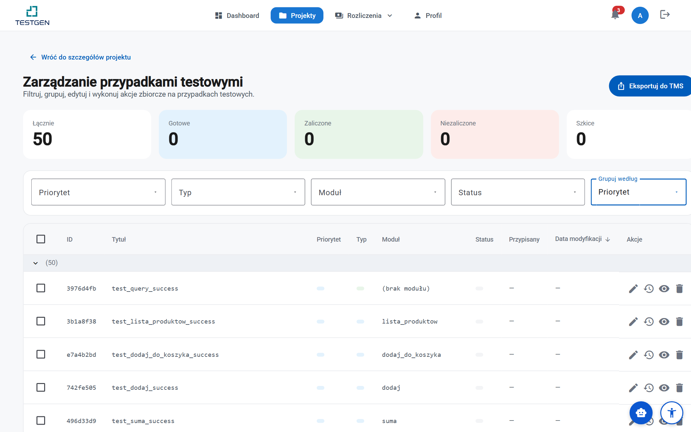
*Grupowanie po priorytecie porządkuje przegląd — zacznij od grupy „Krytyczny".*

Kliknięcie wiersza otwiera szczegóły: przyciski **„Uruchom test"**
i **„Zatwierdź"**, kartę **„Metadane"** (Typ, Priorytet, Framework, Język,
Pewność, Plik źródłowy, Funkcja, Utworzono — pełne powiązanie z kodem),
kartę **„Kod testu"** i tabelę **„Historia wykonań"** (Data, Status, Czas
ms, Pokrycie %):

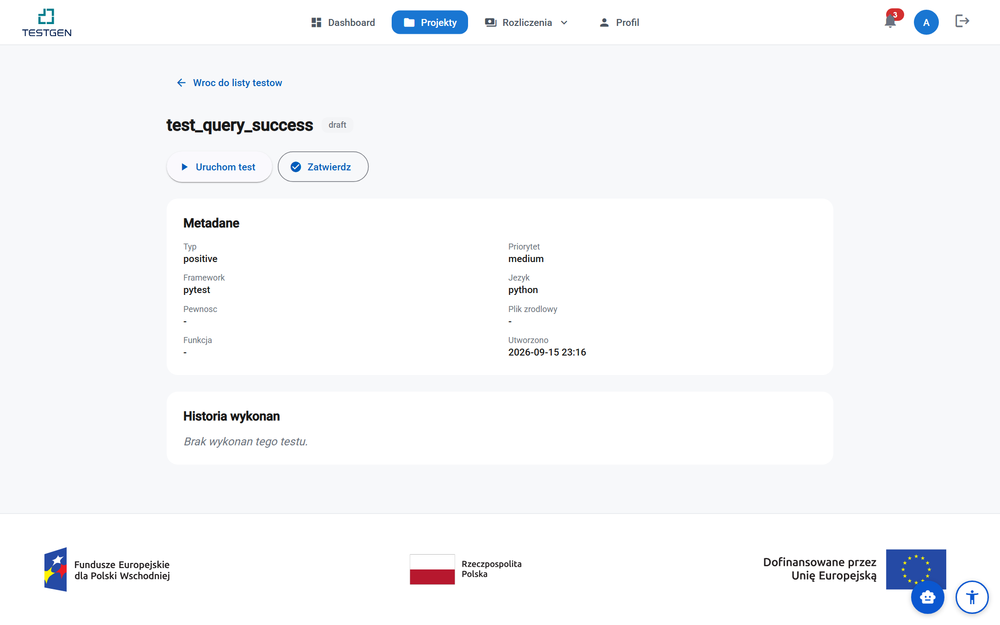
*Metadane mówią, skąd przypadek pochodzi; historia wykonań — co się stało po uruchomieniu.*

**Edytor** (z listy) pozwala poprawić **Tytuł** (wymagany), **Priorytet**
i **Status**, **Opis**, **Kroki testowe** („Dodaj krok", usuwanie,
przeciąganie kolejności) oraz **Oczekiwany wynik** — „Zapisz" zapisuje
każdą zmianę do historii zmian (dialog „Historia zmian — {tytuł}": Data,
Autor, Pole, Przed, Po):

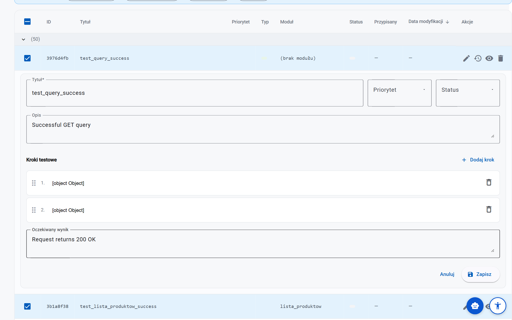
*Kroki przeciągasz w kolejność rzeczywistej ścieżki testu; edytor zapisuje historię zmian.*

### 8.3. Statusy i przegląd

| Status | Znaczenie |
|---|---|
| **„Szkic"** | świeżo wygenerowany — wymaga przeglądu |
| **„Gotowy"** | zatwierdzony („Zatwierdź") |
| **„Zaliczony" / „Niezaliczony"** | wynik uruchomienia („Uruchom test") |
| **„Pominięty"** | świadomie pominięty w biegu |
| **„Wyłączony"** | wyłączony z dalszych uruchomień |

⚠️ **Uwaga:** nie eksportuj „Szkiców" do zespołu przed przeglądem —
generator woli zaproponować więcej niż przeoczyć, więc część przypadków
będzie zbędna. Po każdej analizie przejrzyj paczkę: zatwierdź sensowne,
wyłącz śmieciowe.

### 8.4. Operacje masowe

Zaznacz wiele wierszy — pasek „Zaznaczono: N" z akcjami **„Zmień status"**
(np. zatwierdzenie paczki), **„Zmień priorytet"**, **„Eksportuj"**
([8.6](#86-eksport-testów)) i **„Usuń"**:

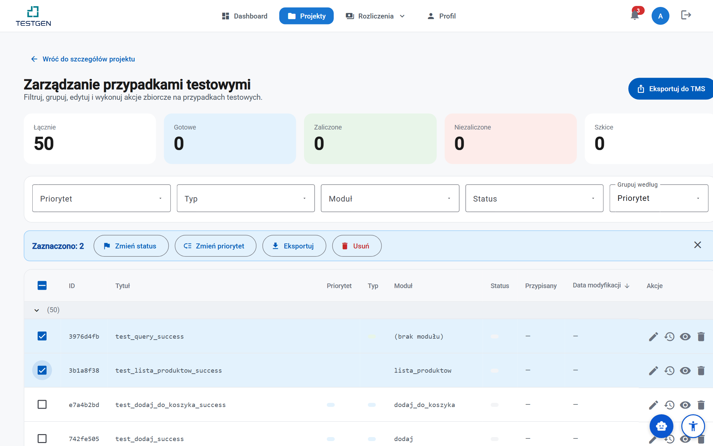
*Operacje masowe działają na zaznaczonych wierszach; „Wyczyść zaznaczenie" zamyka pasek.*

### 8.5. Generowanie kodu testów

Kod powstaje na dwa sposoby.

**Automatycznie z analizy** — w frameworku z „Parametrów analizy"; kod
zobaczysz w karcie „Kod testu" szczegółów przypadku.

**Generatory specjalistyczne** (ścieżki `/codegen/…`, link ze strony
Gherkin):

- **„Generator kodu testowego" (8 frameworków: Cypress/SikuliX/Selenium/
  Playwright/Appium + unittest/TestNG/MSTest)** — zaznacz przypadki
  i wybierz framework z listy: „Cypress (.cy.ts, web/DOM)", „SikuliX
  (.py, image-based)", „Selenium (.py, E2E web)", „Playwright (.spec.ts,
  E2E web)", „Appium (.py, E2E mobilne)", „unittest (.py, TestCase)",
  „TestNG (.java, adnotacje)" lub „MSTest (.cs, [TestClass])"; dla
  Cypressa opcjonalnie „Bazowy URL", dla Appium „Platforma urządzenia"
  (Android — UiAutomator2 / iOS — XCUITest). Przycisk **„Generuj kod
  {nazwa frameworka}"** uruchamia zadanie, a wynik pobierasz jako
  „Pobierz .cy.ts" / „Pobierz .py" / „Pobierz .spec.ts" /
  „Pobierz .java" / „Pobierz .cs":

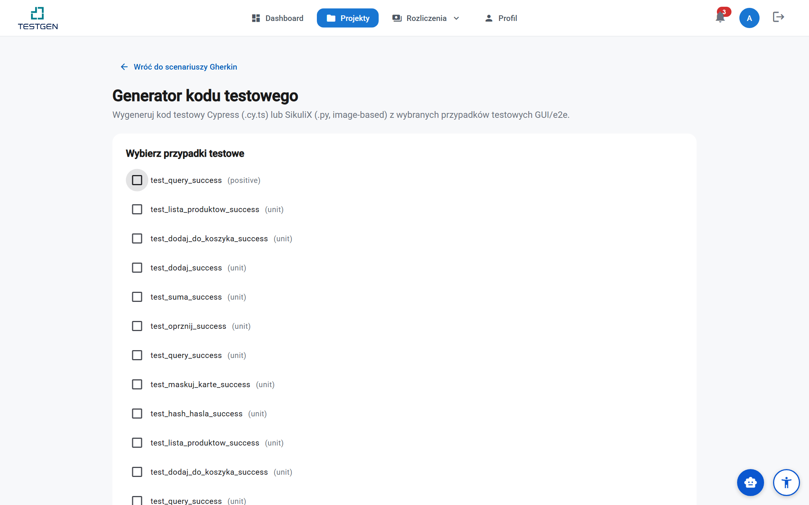
*Jeden przycisk na przypadek: zaznacz, generuj, pobierz — kod w konwencji Twojego frameworka.*

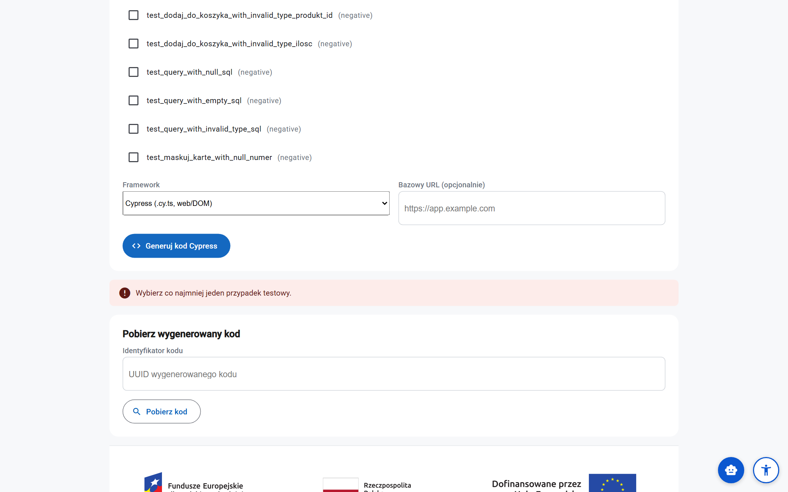
*Wygenerowany plik `.cy.ts`: kroki przypadku przełożone na `cy.visit` / `cy.get` / asercje.*

- **„Generator kodu testów bazodanowych"** — przypadki na testy **pytest**
  warstwy danych z izolacją rollback; „Pobierz .py".
- **„Generator kodu testów PHP"** — przełącznik PHPUnit/Pest, „Generuj
  kod", „Pobierz .php" (podpowiedź uruchomienia `./vendor/bin/phpunit`
  lub `./vendor/bin/pest`).

Każdy wygenerowany plik zostaje na serwerze — sekcja „Pobierz
wygenerowany kod" przyjmuje „Identyfikator kodu" (UUID) do ponownego
pobrania.

**Frameworki i ich dostępność:**

| Framework | Język | Typ | Jak dostępny |
|---|---|---|---|
| **pytest** | Python | jednostkowy | framework analizy + generator bazodanowy |
| **JUnit** | Java | jednostkowy | framework analizy |
| **NUnit** | C# | jednostkowy | framework analizy |
| **Mocha / Jest** | JavaScript/TS | jednostkowy | framework analizy |
| **unittest** | Python | jednostkowy | framework analizy + generator (`python -m unittest`) |
| **TestNG** | Java | jednostkowy | framework analizy + generator (`@Test`) |
| **MSTest** | C# | jednostkowy | framework analizy + generator (`[TestClass]`) |
| **Cypress** | TypeScript | E2E web | framework analizy + generator |
| **Selenium** | Python | E2E web | framework analizy + generator |
| **Playwright** | TypeScript | E2E web | framework analizy + generator (`.spec.ts`) |
| **Appium** | Python | E2E mobilne | framework analizy + generator (+ platforma urządzenia) |
| **SikuliX** | Python (obrazy) | GUI desktop | generator z Gherkin (`.py` + PNG) |
| **PHPUnit / Pest** | PHP | jednostkowy | generator PHP |

### 8.6. Eksport testów

Przycisk **„Eksportuj"** (pojedynczo lub masowo) otwiera dialog
**„Eksportuj do TMS"**:

- **format**: „TestRail (CSV)", „Jira Xray (XML)", „Ogólny (JSON)",
- **zakres**: „Zaznaczone (n)" / „Przefiltrowane (n)" / „Wszystkie (n)",
- **„Mapowanie pól"** — tabela „Pole TMS → Pole TestGEN" z „Przywróć
  domyślne"; mapowanie zapamiętywane lokalnie.

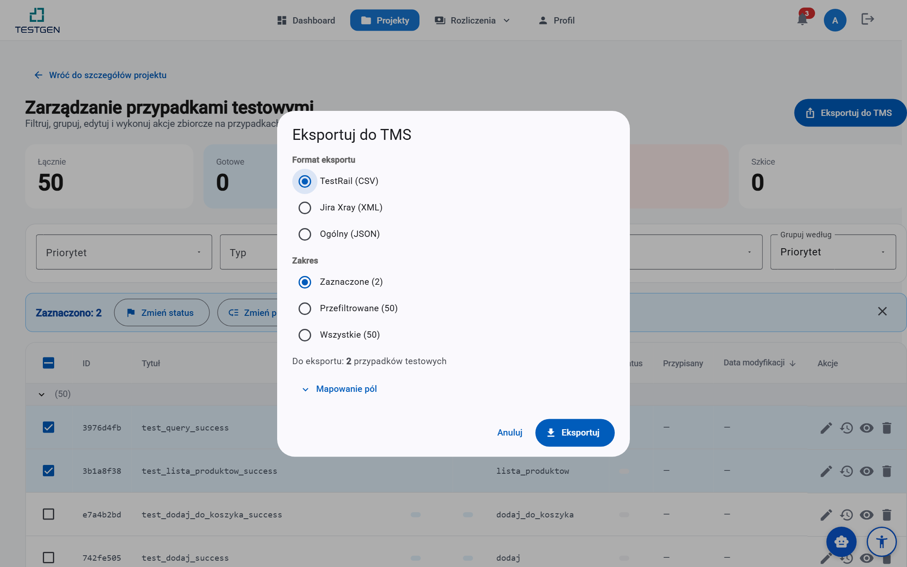
*Mapowanie pól dopasowuje nazwy kolumn TestGEN do schematu Twojego narzędzia TMS.*

Plik (`testgen_{projekt}_{data}_{format}`) importujesz w narzędziu TMS.
Bezpośrednie połączenia z trackerami (Jira, Azure DevOps) opisuje
[Część 3, rozdział 10](03-testy-bezpieczenstwo-eksport.md).

### 8.7. Dobre praktyki

- **Przejrzyj „Szkice" po każdej analizie** — zatwierdź sensowne, wyłącz
  śmieciowe.
- **Priorytet to wskazówka** — krytyczne funkcje biznesowe zasługują
  na „Krytyczny" nawet, gdy generator dał „Wysoki".
- **Kroki językiem zespołu** — doprecyzuj zbyt techniczne sformułowania.
- **Nie usuwaj przypadków negatywnych** — łapią regresje obsługi błędów.
- **Jeden framework na projekt** — spójny styl kodu obniża koszty
  utrzymania.
- **Kod SikuliX wymaga obrazów** — przygotuj zrzuty dobrej jakości
  ([6.7](#67-dobre-praktyki)).

### 8.8. Ograniczenia

- Przypadki powstają **z przesłanych materiałów** — czego nie wgrasz,
  tego nie przetestujesz.
- **Regresja to zestaw, nie typ** — wybierany z porównania wersji
  ([4.7](#47-testy-regresji-kodu)).
- **Podglądy kodu to zwykły tekst** — podświetlanie i diff zobaczysz
  w raportach i rekomendacjach bezpieczeństwa.
- **Brak edycji kodu w miejscu** — poprawki wprowadzasz w repozytorium.
- **Generatory specjalistyczne jednorazowe** — po zmianie przypadku
  wygeneruj kod ponownie.

---

## Rozdział 9. Raporty i eksport

Raporty domykają obieg: to, co wykryła platforma, trafia do zarządu,
zespołu i narzędzi zewnętrznych — w formacie, którego każdy oczekuje.

### 9.1. Poziomy raportów

Karta **„Raporty"** („Generator raportów") oferuje trzy warianty
**„Typu raportu"**:

- **„Podsumowanie wykonawcze"** — „Wykresy, wskaźniki i wnioski prostym
  językiem — dla kadry zarządzającej": karty wskaźników (zgodność
  z dokumentacją, pokrycie wymagań, wykryte i krytyczne problemy,
  przypadki testowe), „Kluczowe wnioski" i wykresy (rozkład problemów,
  trend zgodności, zgodność według modułów);
- **„Szczegóły techniczne"** — „Pełna lista ustaleń z kodem, severity,
  CWE/CVSS i rekomendacjami" — dla zespołu: każde ustalenie z wagą,
  źródłem, lokalizacją, podświetlonym fragmentem kodu i rekomendacją;
- **„Oba raporty"** — raport pełny.

### 9.2. Generowanie i podgląd

1. Wybierz typ raportu i kliknij **„Generuj raport"**.
2. Postęp widać na czterech etapach: **Zbieranie danych → Analiza
   trendów → Generowanie treści → Renderowanie**.
3. Podgląd pokaże dokładnie to, co trafi do pliku.

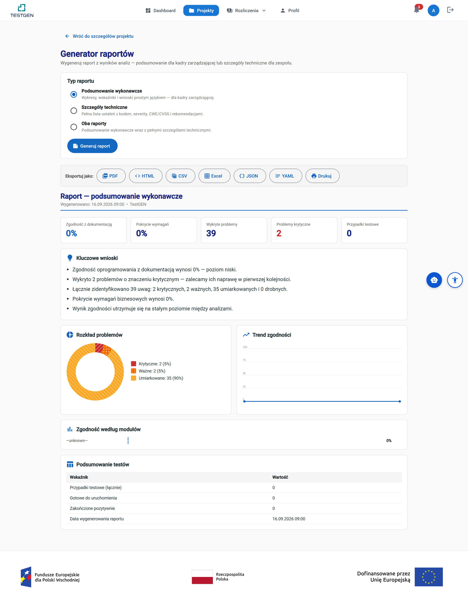
*Podgląd na ekranie = zawartość pliku; typ raportu to jedyny wybór — reszta wynika z wyników projektu.*

### 9.3. Formaty plików

Pasek **„Eksportuj jako:"** oferuje sześć formatów (plus „Drukuj"):

| Format | Kiedy |
|---|---|
| **PDF** | wysyłka, archiwizacja, druk — stały układ |
| **HTML** | podgląd w przeglądarce, intranet |
| **CSV** / **Excel** | dalsza analiza w arkuszu |
| **JSON** / **YAML** | wrzutka do narzędzi i procesów automatycznych |

⚠️ **Uwaga:** dłuższe eksporty pokazują dialog postępu (anulowalny) — plik
pobiera się sam po zakończeniu i **pozostaje na serwerze 7 dni**. Wykresy
renderują się niezależnie od przeglądarki — plik wygląda tak samo
wszędzie.

### 9.4. Integracja z systemami zewnętrznymi

Trzy drogi wyników poza platformę:

- **Eksport przypadków do TMS** — pliki TestRail/Xray/JSON z mapowaniem
  pól ([8.6](#86-eksport-testów)).
- **Bezpośrednia synchronizacja z trackerami** — Jira i Azure DevOps:
  konfiguracja, „Test połączenia", synchronizacja luk i rekomendacji
  ([Część 3, rozdział 10](03-testy-bezpieczenstwo-eksport.md)).
- **API platformy** — automatyzacja całego obiegu (uruchomienie analizy,
  pobranie wyników, eksport raportu) z przykładami curl i Python
  ([Część 3, rozdział 11](03-testy-bezpieczenstwo-eksport.md)).

### 9.5. Dobre praktyki

- **Na zarząd — „Podsumowanie wykonawcze"**; szczegóły zostaw zespołowi.
- **Eksportuj po przeglądzie** — statusy przypadków i znalezisk
  w raporcie odzwierciedlają stan bieżący: najpierw selekcja, potem
  raport.
- **PDF do archiwum, JSON do automatyzacji** — raport w JSON porównasz
  między wydaniami.

### 9.6. Ograniczenia

- **Jedyną konfiguracją raportu jest jego typ** — własnych szablonów,
  sekcji ani brandingu nie ma; treść wynika z danych i filtrów projektu.
- **Raport dotyczy stanu bieżącego** — historię pokazuje tylko trend
  zgodności ([5.6](#56-porównywanie-dokumentacji-z-kodem-luki)).
- **Pliki eksportowe żyją 7 dni** na serwerze.

---

*Utrzymanie dokumentu: zmiany UI = aktualizacja zrzutów i opisów; zrzuty
pochodzą z rzeczywistej aplikacji (stan na 2026-09-20). Spójność terminów:
[Glosariusz](../glosariusz.md). Kontynuacja: [Część 3 — Zaawansowane
funkcje](03-testy-bezpieczenstwo-eksport.md).*
