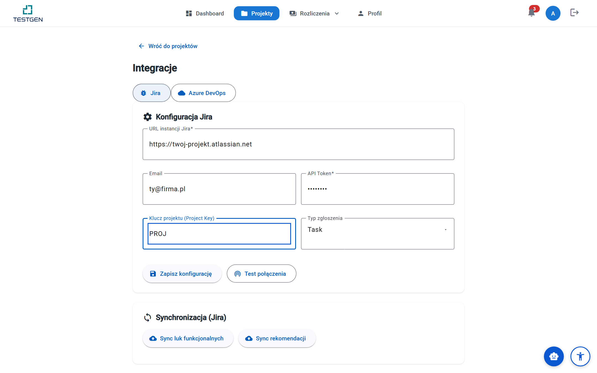
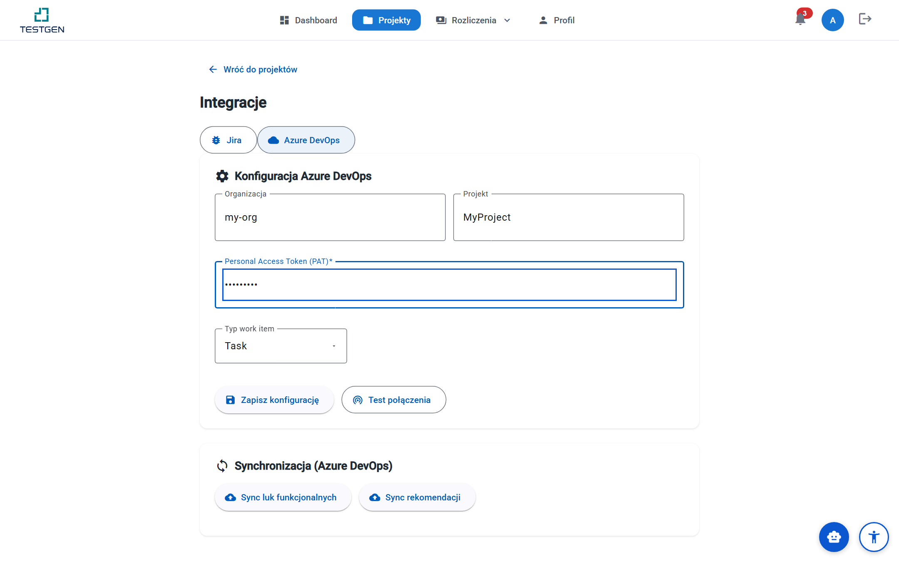
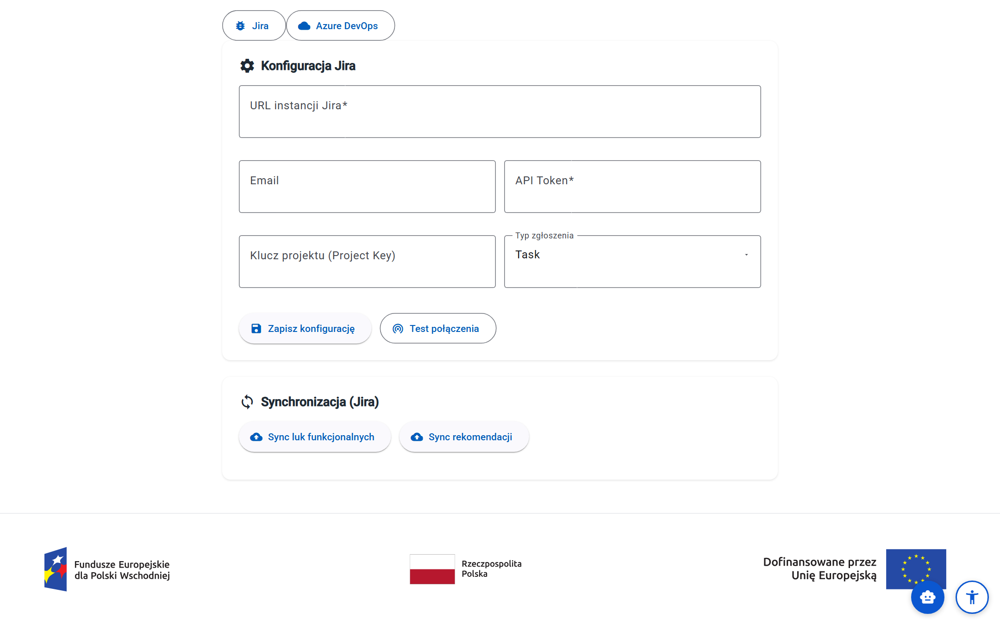
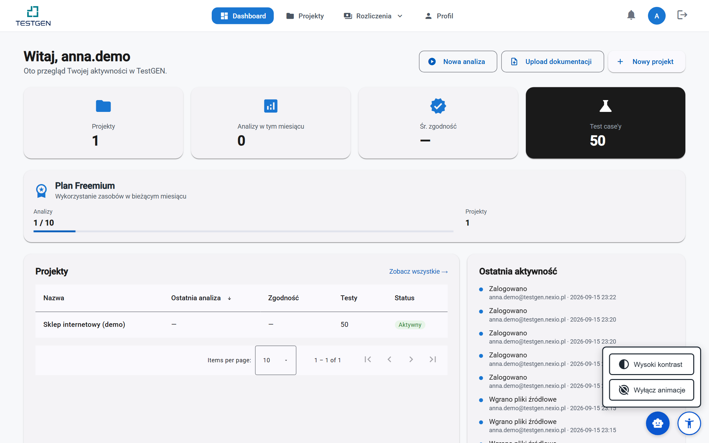
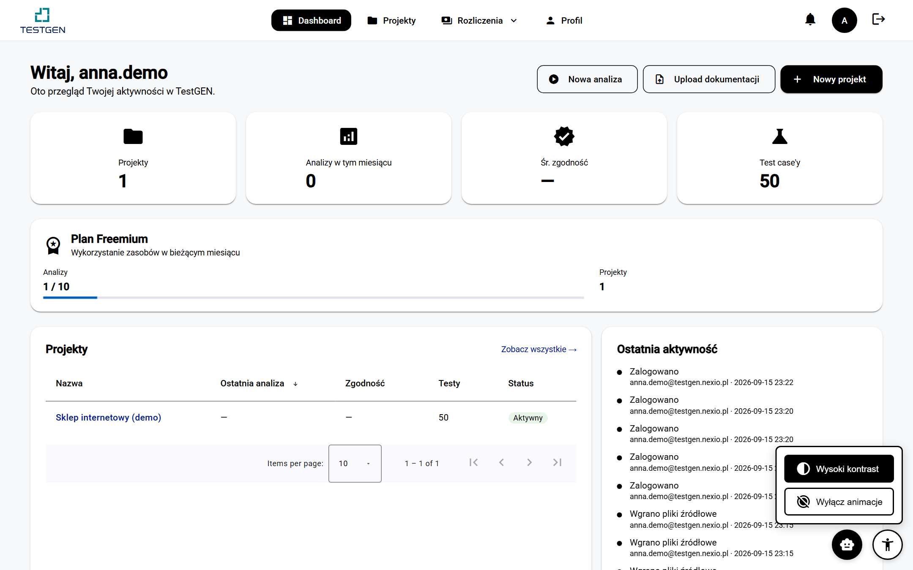
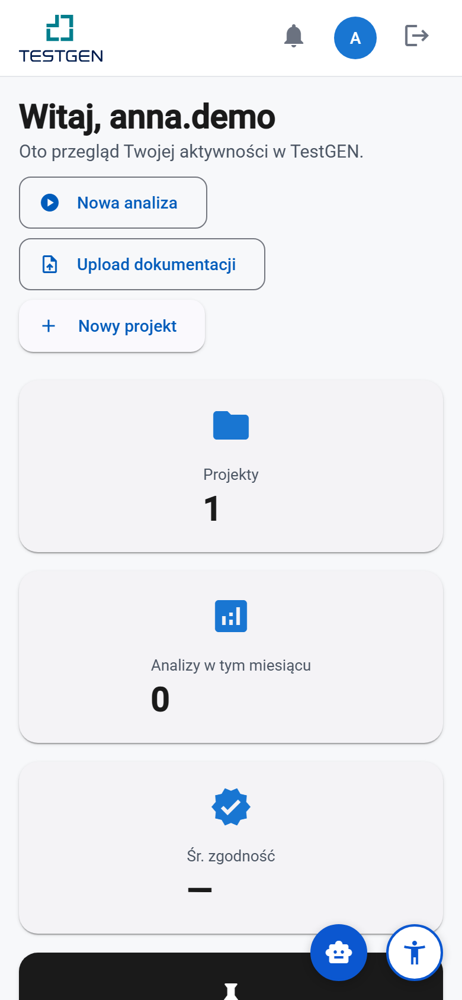

# Podręcznik użytkownika — Część 3: Zaawansowane funkcje

> **Wersja:** 2.1 (2026-09-28) · **Odbiorcy:** użytkownicy platformy TestGEN
> korzystający z integracji, API i personalizacji · **Część 3 z 4**
> (całość: [01 — Wprowadzenie](01-wprowadzenie.md),
> [02 — Praca z systemem](02-projekty-i-analiza.md),
> [04 — Administracja i rozwiązywanie problemów](04-integracje-ustawienia-faq.md),
> [Spis treści](00-spis-tresci.md))
>
> **Konwencje:** forma bezpośrednia („Ty"), nazwy przycisków i ekranów
> w cudzysłowie dokładnie tak, jak widzisz je w aplikacji. Ramki:
> 💡 **Wskazówka** (oszczędza czas) i ⚠️ **Uwaga** (częsta pułapka).
> Definicje pojęć: [Glosariusz](../glosariusz.md).

## Spis treści części

- **Rozdział 10. Integracje** — 10.1. Co z czym łączy TestGEN ·
  10.2. Jira · 10.3. Azure DevOps · 10.4. Synchronizacja wyników ·
  10.5. GitHub i GitLab · 10.6. Status checki w pull requestach ·
  10.7. Konfiguracja CI/CD · 10.8. TestRail, Xray i Zephyr ·
  10.9. Synchronizacja dwukierunkowa z TMS · 10.10. Import wymagań
  z Jiry · 10.11. Ograniczenia
- **Rozdział 11. Webhooks, API i CLI** — 11.1. Zasady dostępu ·
  11.2. Uwierzytelnianie · 11.3. Limity żądań · 11.4. Format błędów ·
  11.5. Najczęściej używane endpointy · 11.6. Przykłady (curl
  i Python) · 11.7. Praca z CLI · 11.8. Webhooki wychodzące ·
  11.9. Ograniczenia
- **Rozdział 12. Dostępność i personalizacja** — 12.1. Dostępność
  (WCAG 2.1 AA) · 12.2. Tryb wysokiego kontrastu i animacje ·
  12.3. Skróty klawiszowe · 12.4. Wygląd na różnych ekranach ·
  12.5. Personalizacja interfejsu · 12.6. Ograniczenia

---

## Rozdział 10. Integracje

TestGEN nie zastępuje Twoich narzędzi — wpisuje się w nie. Ten rozdział
opisuje, z czym platforma łączy się bezpośrednio i gdzie znajdziesz
ekran każdej integracji.

### 10.1. Co z czym łączy TestGEN

| Cel | Sposób | Gdzie |
|---|---|---|
| Wysyłanie luk i rekomendacji do trackerów | **Jira** i **Azure DevOps** | karta projektu → „Integracje" ([10.2–10.4](#102-jira)) |
| Analiza po każdym pushu i pull requeście | **GitHub** i **GitLab** (OAuth + webhooki) | „Ustawienia" → „Integracja GitHub" / „Integracja GitLab" ([10.5](#105-github-i-gitlab)) |
| Wynik analizy przy pull requeście | **status check** i komentarz w PR/MR | automatycznie po podłączeniu repozytorium ([10.6](#106-status-checki-w-pull-requestach)) |
| Bramka jakości w pipeline'ie | **generator konfiguracji CI/CD** | karta projektu → „Konfiguracja CI/CD" ([10.7](#107-konfiguracja-cicd)) |
| Przeniesienie przypadków testowych do TMS | **TestRail**, **Jira Xray**, **Zephyr Scale** — bezpośrednio albo plikiem | „Integracje" → „Systemy zarządzania testami" ([10.8](#108-testrail-xray-i-zephyr)) |
| Wspólne przypadki w TestGEN i TMS | **synchronizacja dwukierunkowa** | ekran konfiguracji TMS → „Synchronizacja dwukierunkowa" ([10.9](#109-synchronizacja-dwukierunkowa-z-tms)) |
| Wymagania prosto z Jiry | **import historyjek, epików i błędów** | karta projektu → „Import z Jiry" ([10.10](#1010-import-wymagań-z-jiry)) |
| Powiadomienia Twoich systemów | **webhooki wychodzące** | „Ustawienia" → „Webhooki" ([11.8](#118-webhooki-wychodzące)) |
| Automatyzacja z kodu i terminala | **API REST**, **klucze API**, **CLI** | [rozdz. 11](#rozdział-11-webhooks-api-i-cli) |

Kafelek **„Integracje"** na karcie projektu otwiera ekran z zakładkami
**„Jira"** i **„Azure DevOps"** oraz sekcją **„Systemy zarządzania
testami"** z odnośnikami do TestRaila, Jira Xray / Zephyr Scale i importu
wymagań.

### 10.2. Jira

W zakładce „Jira" wypełnij „Konfigurację Jira":

| Pole | Przykład | Skąd wziąć |
|---|---|---|
| **„URL instancji Jira"** | `https://twoj-projekt.atlassian.net` | adres Twojej organizacji Jira Cloud |
| **„Email"** | `ty@firma.pl` | konto z uprawnieniem tworzenia zgłoszeń |
| **„API Token"** | `ATATT3x…` | id.atlassian.com → Security → API tokens |
| **„Klucz projektu (Project Key)"** | `PROJ` | kod docelowego projektu Jira |
| **„Typ zgłoszenia"** | Task / Bug / Story / Sub-task | typ tworzonego issue |

Przyciskiem **„Test połączenia"** sprawdzisz dane (platforma odpyta Jira
o Twoje konto), a **„Zapisz konfigurację"** zapisuje je **zaszyfrowane**
(poświadczenia szyfrowane w bazie — nie trzymane jawnym tekstem).

To samo połączenie wykorzystuje import wymagań ([10.10](#1010-import-wymagań-z-jiry)).
Eksport przypadków do wtyczek Xray i Zephyr ma **osobną** konfigurację
([10.8](#108-testrail-xray-i-zephyr)) — wtyczki testowe wymagają innych
uprawnień niż tworzenie zgłoszeń.


*Test połączenia przed zapisem — błędny token wywali się tu, a nie przy pierwszej synchronizacji.*

### 10.3. Azure DevOps

Zakładka „Azure DevOps" ma analogiczną formę: **„Organizacja"**,
**„Projekt"**, **„Personal Access Token (PAT)"** (zakres *Work Items:
Read & Write*) oraz **„Typ work item"** (Task / Bug / User Story / Issue).
Adres organizacji składany jest automatycznie
(`https://dev.azure.com/{organizacja}`), a „Test połączenia" odpytuje
o listę projektów.


*PAT generujesz w ustawieniach użytkownika Azure DevOps — wystarczy zakres do elementów roboczych.*

### 10.4. Synchronizacja wyników

Sekcja „Synchronizacja" ma dwa przyciski:

- **„Sync luk funkcjonalnych"** — wysyła wykryte luki
  ([Część 2, rozdz. 5.6](02-projekty-i-analiza.md)) jako zgłoszenia
  w trackerze,
- **„Sync rekomendacji"** — wysyła rekomendacje napraw.

Synchronizacja jest **całościowa** (wszystkie luki albo wszystkie
rekomendacje projektu) i przebiega w tle; wynik podsumowują chipy
„Wysłano: {n} / {m}" i „Błędy: N". Sekcja **„Historia synchronizacji"**
przechowuje przebiegi ze statusem (poprawny / częściowy / błąd)
i licznikiem wysłanych pozycji.


*Historia pokazuje, ile pozycji realnie dotarło do trackera — przy „Błędach" sprawdź ważność tokenu.*

Zgłoszenia dostają etykiety `testgen-gap` (luki) lub `testgen-rec`
(rekomendacje) oraz priorytet przetłumaczony z wagi (P1 → Highest,
P2 → High, P3 → Medium, P4 → Low).

💡 **Wskazówka:** synchronizuj po przeglądzie wyników — najpierw odrzuć
fałszywe alarmy w TestGEN, a dopiero potem wyślij to, co naprawdę wymaga
pracy zespołu. Limit bezpieczeństwa: 10 synchronizacji na godzinę
na projekt.

⚠️ **Uwaga:** ponowna synchronizacja **tworzy nowe zgłoszenia** także
dla już wysłanych pozycji — nie klikaj jej wielokrotnie „na wszelki
wypadek". (Dotyczy luk i rekomendacji; eksport przypadków testowych do
TMS deduplikuje — patrz [10.8](#108-testrail-xray-i-zephyr).)

### 10.5. GitHub i GitLab

Po podłączeniu repozytorium TestGEN **sam** analizuje kod przy każdym
pushu na gałąź główną i przy każdym pull requeście (w GitLabie: merge
requeście). Nie musisz niczego wgrywać ręcznie.

**Podłączenie GitHub:**

1. Otwórz „Ustawienia" → **„Integracja GitHub"**.
2. Kliknij **„Połącz z GitHub"** i zatwierdź dostęp na stronie GitHuba.
3. W oknie **„Wybierz repozytorium"** wskaż repozytorium — TestGEN założy
   w nim webhook.

**Podłączenie GitLab** („Ustawienia" → **„Integracja GitLab"**) działa tak
samo, z jedną różnicą: w polu **„Adres GitLaba"** podajesz adres instancji
— `https://gitlab.com` albo firmowy, np. `https://git.twojafirma.pl`.
Instancje self-hosted są obsługiwane.

Lista **„Podłączone repozytoria"** (w GitLabie: **„Podłączone projekty"**)
pokazuje gałąź główną i stan webhooka, a sekcja **„Ostatnie zdarzenia"** —
każdy push i pull request, który dotarł do TestGEN, wraz ze statusem analizy.

⚠️ **Uwaga:** komunikat „Integracja z GitHub nie jest skonfigurowana na tym
serwerze" oznacza, że administrator platformy nie zarejestrował aplikacji
OAuth — to nie jest błąd Twojego konta ([Część 4](04-integracje-ustawienia-faq.md)).

Odłączenie repozytorium usuwa webhook i zatrzymuje nowe analizy;
dotychczasowe wyniki zostają.

💡 **Wskazówka:** jednorazowy import kodu bez ciągłej integracji nadal
zrobisz przez zakładkę „Połącz repozytorium" w projekcie
([Część 2, rozdz. 4.1](02-projekty-i-analiza.md)) — działa też
z Bitbucketem.

### 10.6. Status checki w pull requestach

Każda analiza wyzwolona przez pull request kończy się **status checkiem**
o nazwie **`TestGEN / Code Analysis`** i — domyślnie — komentarzem
z podsumowaniem znalezisk. Status check jest:

- **zielony** — brak problemów na progu blokującym albo poniżej niego,
- **czerwony** — analiza znalazła problem co najmniej tak poważny jak próg,
- **w toku** — dopóki analiza trwa.

Zachowanie ustawisz osobno dla każdego repozytorium: na liście
podłączonych repozytoriów kliknij ikonę **ustawień status checka**.

| Ustawienie | Domyślnie | Znaczenie |
|---|---|---|
| **„Próg blokowania"** | Krytyczny | Krytyczny · Wysoki (krytyczne i wysokie) · Średni (krytyczne, wysokie i średnie) |
| **„Blokuj merge po przekroczeniu progu"** | włączone | gdy wyłączone, status zostaje zielony, a liczby i tak są widoczne |
| **„Dodawaj komentarz na PR/MR"** | włączone | podsumowanie znalezisk i link do raportu |

Historię zgłoszonych wyników otworzysz ikoną **historii** przy
repozytorium: ekran **„Historia status checków"** pokazuje zdarzenie,
commit, status analizy, wysłany status check i czas analizy.

💡 **Wskazówka:** w regułach ochrony gałęzi na GitHubie/GitLabie oznacz
`TestGEN / Code Analysis` jako wymagany — wtedy pull request z problemem
powyżej progu nie da się scalić. Nazwa jest stała; nie zmieni się między
wersjami.

### 10.7. Konfiguracja CI/CD

Kafelek **„Konfiguracja CI/CD"** na karcie projektu generuje gotowy plik
pipeline'u, który uruchamia analizę TestGEN przy każdym buildzie
i **przerywa build**, gdy analiza znajdzie problem powyżej wybranego progu.

| Pole | Wartości |
|---|---|
| **„Platforma"** | Jenkins, GitHub Actions, Azure Pipelines, GitLab CI |
| **„Próg blokowania builda"** | Krytyczny / Wysoki / Średni |
| **„Moduły analizy"** | Analiza kodu, Analiza dokumentacji, Skan bezpieczeństwa, Analiza UML |
| **„Tryb silnika"** | Natywny (deterministyczny), LLM (semantyczny), Hybrydowy |
| **„Limit czasu (minuty)"** | od 1 do 180, domyślnie 30 |

Sekcja **„Podgląd"** pokazuje plik i nazwę, pod którą zapisać go
w repozytorium (np. `.github/workflows/testgen.yml`, `Jenkinsfile`,
`azure-pipelines.yml`, `.gitlab-ci.yml`). Przyciski **„Kopiuj"**
i **„Pobierz plik"** — do wyboru.

Pipeline uwierzytelnia się **kluczem API** ([11.2](#112-uwierzytelnianie))
zapisanym jako sekret o nazwie `TESTGEN_API_KEY` — podgląd podpowiada,
gdzie go dodać na wybranej platformie.

Werdykt „przerwać build czy nie" liczy serwer TestGEN, nie plik
pipeline'u. Dzięki temu build i status check w pull requeście zawsze
mówią to samo — zmiana progu w pliku nie rozjedzie ich ze sobą.

### 10.8. TestRail, Xray i Zephyr

Przypadki testowe wysyłasz do TMS **bezpośrednio** z listy testów:
przyciski **„Eksportuj do TestRail"**, **„Eksportuj do Xray"**
i **„Eksportuj do Zephyr"**. Najpierw jednak skonfiguruj połączenie:
„Integracje" → sekcja „Systemy zarządzania testami".

**TestRail** (**„Integracja z TestRail"**):

| Pole | Skąd wziąć |
|---|---|
| **„Adres instancji TestRail"** | adres Twojej instancji (wymagany HTTPS) |
| **„E-mail konta TestRail"** | konto z prawem tworzenia przypadków |
| **„Klucz API"** | TestRail: My Settings → API Keys |
| **„Identyfikator projektu TestRail"** | liczba z adresu projektu w TestRailu |
| **„Suite (opcjonalnie)"** | tylko dla projektów w trybie multi-suite |

**Jira Xray i Zephyr Scale** (**„Integracja z Jira"**): wybierz
**„Wtyczkę"**, a następnie podaj „Adres instancji Jira", „E-mail konta
Atlassian", „Token API" i „Klucz projektu Jira". Opcjonalne **„Powiązane
zgłoszenie"** to historyjka, z którą zwiążesz eksportowane testy. Projekt
korzysta z jednej wtyczki naraz.

Przed zapisem sprawdź dane przyciskiem **„Testuj połączenie"**, potem
**„Zapisz konfigurację"**. Sekcja **„Mapowanie pól"** pozwala dopasować
priorytety i typy testów do tego, jak skonfigurowana jest Twoja instancja.

**Deduplikacja.** Ponowny eksport **aktualizuje** przypadki wysłane
wcześniej, zamiast tworzyć duplikaty. TestRail i Zephyr rozpoznają je po
polu własnym **`testgen_id`**, Xray — po etykiecie.

⚠️ **Uwaga:** w TestRailu i Zephyrze pole własne `testgen_id` (typ
tekstowy) musisz założyć sam, zanim wyeksportujesz pierwszy przypadek.
Bez niego każdy eksport utworzy nowe przypadki.

Eksport idzie w tle — TMS-y ograniczają tempo żądań, więc setka przypadków
to kilka minut. Dialog eksportu pokazuje identyfikator zadania, którym
śledzisz postęp.

💡 **Wskazówka:** eksport **plikiem** (TestRail CSV, Jira Xray XML, JSON —
dialog „Eksportuj do TMS", [Część 2, rozdz. 8.6](02-projekty-i-analiza.md))
nadal działa i przydaje się tam, gdzie TestGEN nie ma sieciowego dostępu
do Twojego TMS-a.

### 10.9. Synchronizacja dwukierunkowa z TMS

Eksport działa w jedną stronę. Synchronizacja dokłada kierunek powrotny:
zmiany wprowadzone w TestRailu, Xrayu lub Zephyrze wracają do TestGEN,
a zmiany z TestGEN trafiają do TMS-a — samoczynnie, w stałym rytmie.

Otwórz ekran konfiguracji TMS i kliknij **„Synchronizacja
dwukierunkowa"** (odnośnik pojawia się po zapisaniu połączenia).
W sekcji **„Ustawienia"** wybierz:

| Pole | Opcje |
|---|---|
| **„Kierunek"** | TestGEN → TMS · TMS → TestGEN · W obie strony |
| **„Jak często"** | od co 5 minut do co 24 godziny |
| **„Gdy zmiana nastąpi po obu stronach"** | Wygrywa nowsza zmiana · Rozstrzygam ręcznie |

**„Zapisz ustawienia"** zapisuje konfigurację, ale **nie uruchamia**
synchronizacji — do tego służy przycisk **„Włącz"**. Przycisk
**„Synchronizuj teraz"** uruchamia przebieg bez czekania na odstęp.

Z TMS-a wracają tytuł, opis, kroki, oczekiwany wynik i priorytet. Kod
testu zostaje nietknięty. Puste pole po stronie TMS-a **nie kasuje**
wartości w TestGEN.

**Konflikty.** Gdy ten sam przypadek zmienił się po obu stronach od
ostatniej synchronizacji, sekcja **„Konflikty"** pokazuje obie wersje.
Przy „Wygrywa nowsza zmiana" rozstrzygnięcie jest automatyczne, ale
konflikt i tak zostaje zapisany — przegrana wersja jest jedynym śladem po
nadpisanych danych. Przy „Rozstrzygam ręcznie" wybierasz **„Zostaw wersję
TestGEN"** albo **„Przyjmij wersję TMS"**.

**Stan.** Karta stanu pokazuje, czy synchronizacja jest **„Włączona"**,
datę ostatniego przebiegu, liczbę zsynchronizowanych przypadków i termin
następnego. Po trzech nieudanych przebiegach z rzędu stan zmienia się na
**„Wymaga uwagi"**, a właściciel firmy dostaje e-mail. Synchronizacja
wraca do działania sama, gdy połączenie z TMS-em zostanie przywrócone.

Na liście przypadków testowych każdy zsynchronizowany przypadek ma
plakietkę z identyfikatorem po stronie TMS-a (np. `#1234`); datę ostatniej
synchronizacji zobaczysz po najechaniu na plakietkę.

### 10.10. Import wymagań z Jiry

Zamiast pobierać dokumentację z Jiry i wgrywać ją ręcznie, zaimportuj
historyjki, epiki, błędy i podzadania wprost jako wymagania. Kafelek
**„Import z Jiry"** na karcie projektu otwiera ekran importu.

Import korzysta z połączenia Jira z zakładki „Jira" ([10.2](#102-jira)) —
skonfiguruj je najpierw.

1. Wybierz **„Projekt Jiry"** — lista pochodzi z Jiry i zawiera projekty,
   które widzi konto z konfiguracji.
2. Zaznacz **„Typy zgłoszeń"**: Historyjki, Epiki, Błędy, Podzadania.
3. Wybierz **„Zakres"**: **„Tylko zmiany"** (domyślnie — zgłoszenia
   zmienione od ostatniego importu), **„Wszystko"** albo **„Od daty"**.
4. Kliknij **„Importuj"**.

| Z Jiry | W TestGEN |
|---|---|
| historyjka, epik, podzadanie | wymaganie funkcjonalne |
| błąd | wymaganie **negatywne** (czego system robić nie powinien) |
| epik | moduł grupujący swoje historyjki |
| sekcja „Acceptance Criteria" w opisie | lista kryteriów akceptacji |
| załączniki | pliki projektu, analizowane jak każdy wgrany dokument |

Wymagania trafiają do dokumentu `jira-<KLUCZ>.md` na liście dokumentów
projektu i od razu uruchamia się dla nich analiza luk
([Część 2, rozdz. 5](02-projekty-i-analiza.md)). **„Historia importów"**
podsumowuje każdy przebieg: „Zaimportowano 12 wymagań i 3 załączniki".

Ponowny import **aktualizuje** wymagania zamiast je dublować i nie cofa
Twoich decyzji z przeglądu (akceptacji albo odrzucenia). Ten sam
załącznik dołączony do kilku historyjek zapisuje się raz.

💡 **Wskazówka:** kryteria akceptacji zostaną rozpoznane, gdy w opisie
zgłoszenia są pod nagłówkiem `h2. Acceptance Criteria` (albo
`h3. Kryteria akceptacji`) jako lista punktowana.

### 10.11. Ograniczenia

- **Trackery zgłoszeń to Jira Cloud i Azure DevOps** — GitHub Issues
  i GitLab Issues nie są obsługiwane (integracja GitHub/GitLab dotyczy
  repozytoriów i pull requestów, nie zgłoszeń).
- **Synchronizacja luk i rekomendacji jest jednokierunkowa i całościowa**
  — bez wyboru pojedynczych pozycji i bez deduplikacji
  (etykiety `testgen-*` pomogą je odnaleźć). Nie dotyczy to przypadków
  testowych, które synchronizują się dwukierunkowo ([10.9](#109-synchronizacja-dwukierunkowa-z-tms)).
- **Synchronizacja z TMS nie zakłada nowych przypadków w TestGEN** —
  przypadek utworzony tylko w TMS-ie zostaje pominięty; najpierw musi
  pochodzić z TestGEN.
- **Usunięcie przypadku w TestGEN nie usuwa go w TMS-ie.**
- **Import z Jiry: do 200 załączników na przebieg, do 25 MB każdy.**
  Kryteria akceptacji rozpoznajemy tylko z opisu, nie z pól własnych.
- **Trackery i TMS konfigurujesz osobno dla każdego projektu** — każdy
  projekt łączy się z własną Jirą, Azure DevOps i TMS-em (zaleta przy wielu
  klientach, uwaga przy kopiowaniu ustawień).
- **GitHub, GitLab, klucze API i webhooki wychodzące to ustawienia firmy**
  („Ustawienia"), nie projektu. Każde podłączone repozytorium zasila
  własny projekt, zakładany automatycznie przy pierwszym zdarzeniu.

---

## Rozdział 11. Webhooks, API i CLI

Wszystko, co robisz w interfejsie, da się wykonać programistycznie —
platforma wystawia spójne REST API. Ten rozdział to praktyczne minimum:
jak się uwierzytelnić, na jakie limity uważać, które endpointy
wykorzystasz najczęściej, jak działa narzędzie wiersza poleceń i jak
TestGEN powiadamia Twoje systemy webhookami.

### 11.1. Zasady dostępu

- Wszystkie endpointy żyją pod prefiksem **`/api/v1`** — wersjonowanie
  w ścieżce; zmiany łamiące zgodność wejdą jako `/api/v2`.
- Odpowiedzi i żądania to **JSON**.
- Operacje długotrwałe (analiza, eksport raportu, eksport do TMS, import
  z Jiry) zwracają **`202 Accepted`** od razu z identyfikatorem zadania —
  wynik pobierasz osobno (status + pobranie).
- Interaktywna dokumentacja (`/docs`, `/openapi.json`) dostępna jest
  w środowiskach deweloperskich; w produkcji wyłączona. Pełna referencja
  wszystkich endpointów, z przykładami w curl, Pythonie i JavaScripcie,
  znajduje się w [dokumentacji API](../../api/index.md).

### 11.2. Uwierzytelnianie

Do skryptów, pipeline'ów i integracji używaj **klucza API**. Sesja
z logowania (e-mail i hasło) służy interfejsowi.

**Utworzenie klucza** (tylko **właściciel firmy**):

1. Otwórz „Ustawienia" → **„Klucze API"**.
2. Kliknij **„Utwórz klucz API"**, nadaj **„Nazwę klucza"** i wybierz
   **„Zakres uprawnień"**:
   - **„Tylko odczyt"** — pobieranie wyników i raportów,
   - **„Pełny dostęp"** — także uruchamianie analiz i zapis danych.
3. Opcjonalnie ustaw **„Datę wygaśnięcia"** (maksymalnie 2 lata; puste —
   bezterminowy).
4. **Skopiuj klucz od razu** — po zamknięciu okna zobaczysz już tylko jego
   pierwsze znaki.

Klucz ma postać `tgn_…` i przekazujesz go w nagłówku:

```
Authorization: Bearer tgn_…
```

Lista kluczy pokazuje zakres, datę wygaśnięcia i **ostatnie użycie** —
po tym poznasz klucz, którego nic już nie używa. **„Odwołaj klucz"**
wyłącza go natychmiast; pipeline'y, które go używają, zaczną dostawać
`401`.

⚠️ **Uwaga:** klucz o zakresie „Tylko odczyt" dostanie `403` przy próbie
uruchomienia analizy. Kluczem API **nie** zarządzisz też innymi kluczami
ani webhookami — to wymaga zalogowania w interfejsie, żeby wyciek jednego
klucza nie pozwolił wystawić sobie kolejnych.

**Sesja (interfejs).** API akceptuje też token JWT z logowania:
nagłówek `Authorization: Bearer <token>` albo ciasteczko `access_token`
(HttpOnly) — przy ciasteczku żądania zmieniające stan wymagają dodatkowo
nagłówka `X-XSRF-TOKEN` z treścią ciasteczka `XSRF-TOKEN`. Logowanie:
`POST /api/v1/auth/login` z `{email, password}` (przy wielu firmach —
najpierw `POST /auth/select-tenant`; przy włączonej MFA —
`POST /auth/mfa/verify`). Sesja wygasa, więc do automatyzacji się nie
nadaje.

### 11.3. Limity żądań

Limity zależą od planu: **Freemium 100, Basic 100, Premium 1000 żądań
na minutę** (okno pełnej minuty). Każda odpowiedź zwraca nagłówki
`X-RateLimit-Limit`, `X-RateLimit-Remaining` i `X-RateLimit-Reset`;
po wyczerpaniu API odpowiada **429** z `Retry-After` i komunikatem,
po ilu sekundach spróbować ponownie. Interfejs, skrypty i klucze API
**współdzielą** limit firmy.

### 11.4. Format błędów

Błędy zwracane są w ustandaryzowanym formacie **problem+json** (RFC
7807): `type` (identyfikator, np. `…/errors/validation-error`), `title`,
`status` i `detail` po polsku. Najczęstsze kody:

| Kod | Kiedy |
|---|---|
| 400/422 | nieprawidłowe dane żądania (walidacja pól) |
| 401 | brak/nieważna sesja albo odwołany lub wygasły klucz API |
| 402 | funkcja wymaga wyższego planu (z linkiem do zmiany planu) |
| 403 | brak uprawnień do zasobu albo klucz „Tylko odczyt" przy operacji zapisu |
| 404 | nieistniejący zasób (lub projektu innej firmy) |
| 429 | przekroczony limit żądań (albo limit planu — np. analiza) |

### 11.5. Najczęściej używane endpointy

| Co | Metoda i ścieżka | Uwagi |
|---|---|---|
| Kim jestem | `GET /users/me` | szybki test klucza API |
| Lista projektów | `GET /projects` | paginacja + nagłówek `X-Total-Count` |
| Utworzenie projektu | `POST /projects` | `{name, description?}`; 201 + `Location` |
| Wgranie kodu | `POST /projects/{id}/upload` | multipart, także archiwum ZIP |
| Uruchomienie analizy | `POST /projects/{id}/analyze` | 202; `{modules, test_framework…}` |
| Stan zadania | `GET /tasks/{task_id}` | postęp w procentach i bieżący krok |
| Werdykt bramki CI | `GET /projects/{id}/ci-cd/summary?threshold=` | `should_fail` — przerwać build czy nie |
| Lista przypadków | `GET /test-cases?project_id=` | filtry: typ, status, priorytet, framework |
| Eksport raportu | `POST /projects/{id}/reports/export` | 202 → `GET /exports/{id}/status` → `/download` |
| Eksport do TMS | `POST /projects/{id}/export/testrail` (`xray`, `zephyr`) | 202; pusta lista = wszystkie przypadki |

### 11.6. Przykłady (curl i Python)

**Test klucza i lista projektów (curl):**

```bash
export TESTGEN_API_KEY=tgn_…

curl -s -H "Authorization: Bearer $TESTGEN_API_KEY" \
  https://app.testgen.pl/api/v1/users/me

curl -s -H "Authorization: Bearer $TESTGEN_API_KEY" \
  https://app.testgen.pl/api/v1/projects
```

**Uruchomienie analizy i czekanie na wynik (Python + requests):**

```python
import os, time, requests

base = "https://app.testgen.pl/api/v1"
s = requests.Session()
s.headers["Authorization"] = f"Bearer {os.environ['TESTGEN_API_KEY']}"

r = s.post(f"{base}/projects/{PID}/analyze",
           json={"modules": ["code_analysis", "test_generation"]})
task_id = r.json()["task_id"]

while True:
    status = s.get(f"{base}/tasks/{task_id}").json()
    if status["status"] not in ("pending", "running"):
        break          # completed, failed, cancelled, timeout, partial_failure
    time.sleep(10)

verdict = s.get(f"{base}/projects/{PID}/ci-cd/summary",
                params={"threshold": "critical"}).json()
print(verdict["description"], "— przerwać build:", verdict["should_fail"])
```

**Eksport raportu (curl, trzy kroki):**

```bash
AUTH="Authorization: Bearer $TESTGEN_API_KEY"

EXP=$(curl -s -H "$AUTH" -H "Content-Type: application/json" \
  -d '{"format":"pdf","report_type":"executive","report":{}}' \
  https://app.testgen.pl/api/v1/projects/$PID/reports/export | jq -r .export_id)

curl -s -H "$AUTH" https://app.testgen.pl/api/v1/exports/$EXP/status
curl -s -H "$AUTH" -o raport.pdf \
  https://app.testgen.pl/api/v1/exports/$EXP/download
```

💡 **Wskazówka:** zamiast odpytywać status w pętli, możesz zasubskrybować
zdarzenie „Analiza zakończona" webhookiem ([11.8](#118-webhooki-wychodzące)).

### 11.7. Praca z CLI

Narzędzie wiersza poleceń **`testgen`** wykonuje typowe operacje jednym
poleceniem, bez pisania skryptów. Instalacja z repozytorium platformy:

```bash
pip install ./cli        # wymagany Python 3.11+
testgen login --api-key tgn_…
testgen whoami
```

W CI nie loguj się — ustaw zmienne `TESTGEN_API_KEY` i
`TESTGEN_PROJECT_ID`, a CLI użyje ich samo.

| Polecenie | Co robi |
|---|---|
| `testgen analyze . --wait` | pakuje katalog, wysyła kod, uruchamia analizę i czeka na werdykt |
| `testgen generate --framework pytest -o tests` | zapisuje wygenerowane testy na dysk |
| `testgen scan --type sast --severity-threshold high` | skan bezpieczeństwa z progiem |
| `testgen export --format pdf -o raport.pdf` | pobiera raport projektu |
| `testgen status <task_id> --watch` | śledzi zadanie co 5 s |
| `testgen projects` | lista projektów |

Ustawienia projektu trzymasz w pliku **`.testgen.yaml`** w repozytorium
(`project_id`, `engine_mode`, `default_framework`, `severity_threshold`,
`api_url`) — CLI szuka go w bieżącym katalogu i wyżej, jak `git`.
Argumenty polecenia mają pierwszeństwo przed zmiennymi środowiskowymi,
a te — przed plikiem.

**Kody wyjścia** to kontrakt z pipeline'em:

| Kod | Znaczenie |
|---|---|
| 0 | sukces, brak problemów powyżej progu |
| 1 | znaleziska powyżej progu — build ma się zatrzymać |
| 2 | błąd narzędzia: brak sieci, zły klucz, zły argument |

Format wyniku wybierasz opcją `--json` albo `--yaml` (domyślnie tabele);
`--quiet` wyłącza wyjście i zostawia sam kod. Komunikaty postępu idą na
stderr, więc `testgen analyze . --wait --json | jq` działa bez sztuczek.

Pełny opis: `cli/README.md` w repozytorium platformy.

### 11.8. Webhooki wychodzące

Webhooki powiadamiają Twoje systemy o zdarzeniach w TestGEN — nie musisz
ich odpytywać. Konfiguruje je **właściciel firmy**: „Ustawienia" →
**„Webhooki"** → **„Dodaj webhook"**.

| Pole | Uwagi |
|---|---|
| **„Adres endpointu"** | wymagany HTTPS — payload niesie dane Twoich analiz |
| **„Sekret"** | minimum 16 znaków; nim podpisujemy każdy payload |
| **„Opis (opcjonalny)"** | żeby po miesiącu wiedzieć, co to za adres |
| **„Subskrybowane zdarzenia"** | jedno lub więcej z listy poniżej |

| Zdarzenie | Kiedy |
|---|---|
| **„Analiza zakończona"** (`analysis.completed`) | po każdym przebiegu analizy projektu |
| **„Podatność krytyczna lub wysoka"** (`security.finding`) | tylko te dwa poziomy — niższe zostają w raporcie |
| **„Wykryta luka funkcjonalna"** (`gap.detected`) | rozbieżność między dokumentacją a kodem |
| **„Raport gotowy"** (`export.ready`) | plik eksportu czeka do pobrania |
| **„Zmiana planu"** (`subscription.changed`) | upgrade lub downgrade subskrypcji |

Każde żądanie to `POST` z ciałem JSON (zawsze `event_type` i `timestamp`
plus pola zdarzenia) oraz nagłówkami:

- `X-TestGEN-Event` — typ zdarzenia,
- `X-TestGEN-Delivery` — identyfikator dostawy (do deduplikacji po Twojej stronie),
- `X-TestGEN-Signature` — `sha256=<HMAC-SHA256 ciała z Twoim sekretem>`.

⚠️ **Uwaga:** zawsze weryfikuj podpis, zanim uwierzysz w treść — adres
webhooka nie jest tajemnicą, sekret jest.

**Dostarczanie.** Za sukces uważamy odpowiedź 2xx w ciągu 10 sekund.
Nieudana dostawa jest ponawiana po 1 minucie, 5 minutach i 30 minutach —
razem cztery próby. **„Historia dostaw"** pokazuje każdą próbę z kodem
odpowiedzi i filtrem „Dostarczone / Oczekujące / Nieudane". Ikoną
**testu połączenia** wyślesz próbne zdarzenie, zanim podłączysz
prawdziwy system.

Webhooki **przychodzące** dotyczą rozliczeń (tpay) oraz GitHuba i GitLaba
([10.5](#105-github-i-gitlab)) — konfiguruje je platforma, niczego tu nie
ustawiasz.

### 11.9. Ograniczenia

- **Dokumentacja OpenAPI niewidoczna w produkcji** — korzystaj z
  [dokumentacji API](../../api/index.md).
- **CLI nie jest opublikowane w PyPI** — instalujesz je z repozytorium
  platformy.
- **CLI loguje się hasłem tylko bez MFA** — konta z MFA używają klucza API.
- **Limity planu obowiązują także przez API i CLI** — wyczerpany limit
  analiz zwróci 429 niezależnie od tego, czy klikniesz przycisk, czy wyślesz
  żądanie.
- **Webhook jest wyłączany ręcznie, nie automatycznie** — przy stale
  nieudanych dostawach sprawdź „Historię dostaw" i wyłącz go przełącznikiem.

---

## Rozdział 12. Dostępność i personalizacja

TestGEN ma być używalny dla każdego — także przy nawigacji klawiaturą,
czytnikiem ekranu, na małym ekranie i w trudnych warunkach
oświetleniowych. Ten rozdział zbiera wszystkie pokrętła, które masz
do dyspozycji.

### 12.1. Dostępność (WCAG 2.1 AA)

Całość interfejsu obsłużysz **klawiaturą i czytnikiem ekranu** (standard
WCAG 2.1 AA, testowane z NVDA). Elementy mechaniki:

- **Przycisk „Przejdź do treści głównej"** — pierwszy element strony,
  widoczny po naciśnięciu Tab; pomija menu i przenosi od razu do treści.
- **Okruszki i linki powrotu** („Wróć do…") — czytelne dla czytników,
  klikalne na każdym poziomie.
- **Etyykiety pól i komunikaty** — snackbar z potwierdzeniem operacji
  ogłasza się także czytnikowi ekranu.
- **Focus widoczny** — aktywny element ma wyraźną obwódkę; Escape zamyka
  okno dialogowe, a fokus wraca tam, skąd przyszedł.

### 12.2. Tryb wysokiego kontrastu i animacje

Dwie funkcje włączysz bezpośrednio w aplikacji — przycisk paska
dostępności znajduje się w menu bocznym:


*Pasek dostępności: tryb wysokiego kontrastu i wyłączenie animacji.*

- **„Wysoki kontrast"** — czarno-biały motyw o podwyższonym kontraście
  (przydatny przy słabym wzroku i jasnym świetle):


*Tryb wysokiego kontrastu — wybór zapamiętywany jest w przeglądarce.*

- **„Wyłącz animacje"** — wyłącza przejścia i ruch (pomocny przy
  zawrotach głowy i migrenach). Ustawienie systemowe „redukuj ruch"
  jest respektowane automatycznie.

Szczegóły praktyczne opisuje poradnik
[Dostępność](interfejs-webowy/05-dostepnosc.md).

### 12.3. Skróty klawiszowe

TestGEN nie wprowadza własnych skrótów aplikacyjnych — świadomie korzysta
z tych, które znasz z przeglądarki i czytników ekranu. Najczęściej
używane:

| Klawisz / kombinacja | Działanie |
|---|---|
| **Tab** / **Shift+Tab** | przejście do następnego / poprzedniego elementu |
| **Enter** / **spacja** | aktywacja przycisku lub linku |
| **Escape** | zamknięcie okna dialogowego (fokus wraca tam, skąd przyszedł) |
| **strzałki** | poruszanie się po listach i tabelach z rozwiniętym menu |

### 12.4. Wygląd na różnych ekranach

Interfejs dopasowuje się do ekranu: na tablecie i telefonie układ składa
się do jednej kolumny, menu boczne chowa się pod przyciskiem, tabele
przewijają się w miejscu bez psucia strony. Przy powiększeniu do 200%
i szerokości 320 pikseli treść pozostaje czytelna — nic się nie „gubi"
poza ekranem.


*Ten sam pulpit na telefonie: jedna kolumna, menu pod przyciskiem.*

### 12.5. Personalizacja interfejsu

Poza funkcjami dostępności ([12.2](#122-tryb-wysokiego-kontrastu-i-animacje))
interfejs jest wspólny dla wszystkich użytkowników: brak własnych motywów
kolorystycznych, układów ani języka interfejsu do wyboru (aplikacja jest
po polsku). Nazwę wyświetlaną zmienisz w profilu ([Część 4,
rozdz. 13](04-integracje-ustawienia-faq.md)); powiadomienia dostosujesz
w preferencjach kanałów.

### 12.6. Ograniczenia

- **Brak własnych motywów** — tylko tryb wysokiego kontrastu
  i wyłączanie animacji.
- **Brak wyboru języka interfejsu** — aplikacja jest po polsku
  (materiały analizujesz w dowolnym języku).
- **Skróty ograniczone do przeglądarki** — własne kombinacje klawiszy
  nie są konfigurowalne.

---

*Utrzymanie dokumentu: zmiany UI = aktualizacja zrzutów i opisów; zrzuty
pochodzą z rzeczywistej aplikacji (stan na 2026-09-20). Spójność terminów:
[Glosariusz](../glosariusz.md). Kontynuacja: [Część 4 — Administracja
i rozwiązywanie problemów](04-integracje-ustawienia-faq.md).*
