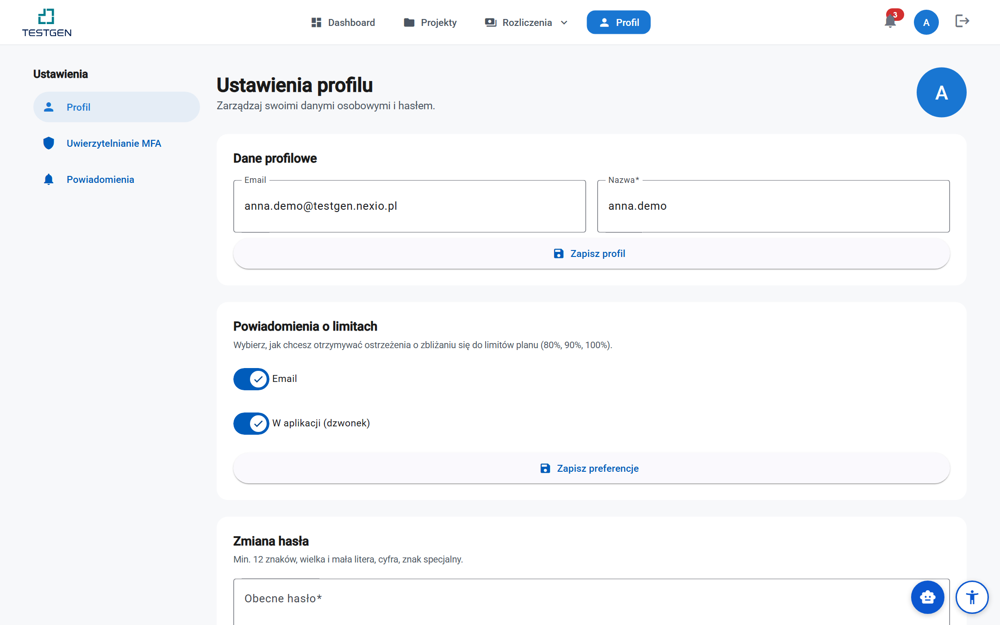
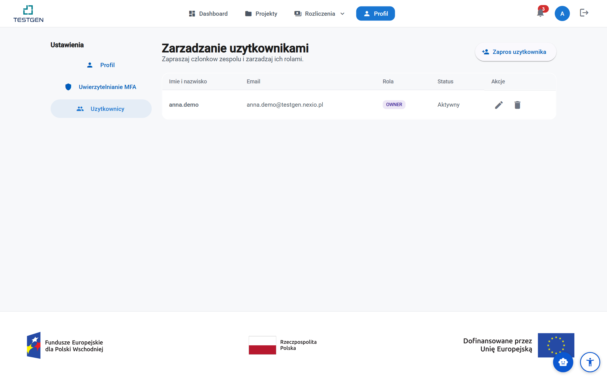
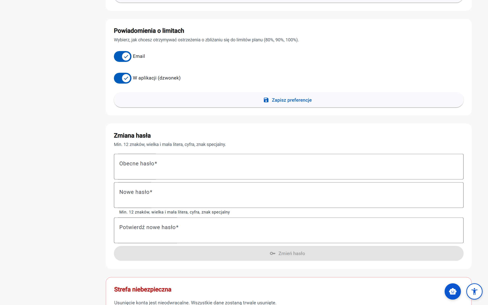
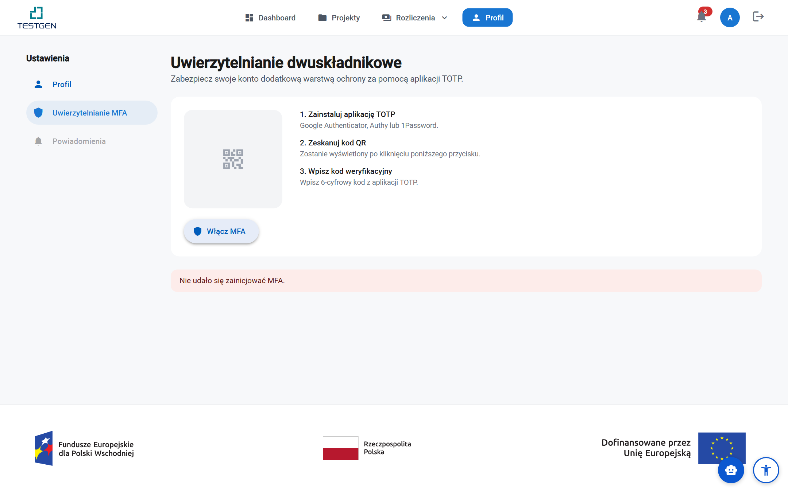

# Podręcznik użytkownika — Część 4: Administracja i rozwiązywanie problemów

> **Wersja:** 2.0 (2026-09-20) · **Odbiorcy:** użytkownicy platformy TestGEN
> (analitycy QA, deweloperzy, kierownicy projektów) · **Część 4 z 4** —
> obejmuje Część IV konspektu (Administracja i zarządzanie) oraz Część V
> (Rozwiązywanie problemów). Całość: [01 — Wprowadzenie](01-wprowadzenie.md),
> [02 — Praca z systemem](02-projekty-i-analiza.md),
> [03 — Zaawansowane funkcje](03-testy-bezpieczenstwo-eksport.md),
> [Spis treści](00-spis-tresci.md)
>
> **Konwencje:** forma bezpośrednia („Ty"), nazwy przycisków i ekranów w
> cudzysłowie dokładnie tak, jak widzisz je w aplikacji. Ramki:
> 💡 **Wskazówka** (oszczędza czas) i ⚠️ **Uwaga** (częsta pułapka).
> Definicje pojęć: [Glosariusz](../glosariusz.md), nawigacja:
> [Indeks terminów](indeks-terminow.md).

## Spis treści części

**Część IV — Administracja i zarządzanie**

- **Rozdział 13. Zarządzanie kontem i subskrypcją** — 13.1. Profil ·
  13.2. Użytkownicy firmy · 13.3. Plany i zmiana subskrypcji ·
  13.4. Płatności (tpay) · 13.5. Faktury · 13.6. Zużycie limitów
  i powiadomienia · 13.7. Usuwanie konta · 13.8. Ograniczenia
- **Rozdział 14. Bezpieczeństwo i prywatność** — 14.1. Hasło ·
  14.2. Weryfikacja dwuetapowa (MFA) · 14.3. Izolacja danych firmy ·
  14.4. RODO i prywatność danych · 14.5. Dostęp API i klucze ·
  14.6. Ograniczenia

**Część V — Rozwiązywanie problemów**

- **Rozdział 15. FAQ** — 15.1. Konto i dostęp · 15.2. Projekty ·
  15.3. Analiza kodu · 15.4. Dokumentacja, UML i GUI · 15.5. Generowanie
  testów · 15.6. Bezpieczeństwo · 15.7. Eksport i raporty ·
  15.8. Integracje · 15.9. Płatności i plany · 15.10. Błędy i problemy
- **Rozdział 16. Troubleshooting** — 16.1. Problemy z analizą ·
  16.2. Problemy z generowaniem testów · 16.3. Problemy z integracjami ·
  16.4. Problemy z wydajnością · 16.5. Problemy z dostępem i kontem
- **Rozdział 17. Wsparcie techniczne** — 17.1. Jak uzyskać pomoc ·
  17.2. Kanały wsparcia · 17.3. Zgłaszanie błędów · 17.4. Propozycje
  nowych funkcji

---

# Część IV — Administracja i zarządzanie

## Rozdział 13. Zarządzanie kontem i subskrypcją

Menu **„Profil"** prowadzi do ustawień konta, a menu **„Rozliczenia"** —
do subskrypcji. Ten rozdział zbiera całość w jednym miejscu: od danych
profilu, przez użytkowników firmy, po faktury i limity.

### 13.1. Profil

Ekran **„Ustawienia profilu"** („Zarządzaj swoimi danymi osobowymi
i hasłem") pokazuje:

- **awatar** — generowany automatycznie z inicjałów (przesyłanie
  własnego obrazka nie jest obsługiwane),
- **„Email"** — tylko do odczytu (to identyfikator logowania),
- **„Nazwa"** — edytowalna, zapis przyciskiem **„Zapisz profil"**.

*Email jest stały, nazwę zmienisz w każdej chwili; hasło — rozdział 14.*

Zmiany nazwy widzą inni członkowie firmy (m.in. na liście użytkowników
i w historii zmian przypadków testowych). Zmianę hasła opisuje
[rozdział 14.1](#141-hasło); preferencje powiadomień — [13.6](#136-zużycie-limitów-i-powiadomienia).

### 13.2. Użytkownicy firmy

Ekran **„Zarządzanie użytkownikami"** (tylko Właściciel) listuje firmę:
imię i nazwisko, e-mail, rola, status („Aktywny" / „Oczekuje") oraz
akcje — zmiana roli i usunięcie. Przycisk **„Zaproś użytkownika"**
otwiera formularz z adresem e-mail i rolą („Użytkownik" lub
„Właściciel"); zaproszona osoba ustawia hasło z linku w wiadomości
i od razu widzi projekty firmy.

*Role działają na całą firmę — zaproszony użytkownik widzi wszystkie projekty.*

Role przypomnienie ([Część 2, rozdz. 3.4](02-projekty-i-analiza.md)):

| Rola | Uprawnienia |
|---|---|
| **Użytkownik** | projekty, pliki, analizy, wyniki, przypadki testowe |
| **Właściciel** | to co Użytkownik + zarządzanie projektami i ludźmi, subskrypcja, dane fakturowe |
| **Administrator platformy** | obsługa TestGEN (m.in. blokady kont, przywracanie projektów) |

Blokowanie kont i resetowanie haseł członków firmy wykonuje administrator
platformy — Właściciel w aplikacji może usuwać użytkowników i zmieniać
role.

### 13.3. Plany i zmiana subskrypcji

Nowa firma startuje na **Freemium**; zmiany planu dokonuje Właściciel
w menu **„Rozliczenia"**:

- **upgrade** (Freemium → Basic → Premium) — natychmiast, z dopłatą
  proporcjonalną do pozostałego okresu; moduły odblokowują się od razu,
- **downgrade** — od końca bieżącego okresu (do tego czasu możesz go
  odwołać); po okresie łaski plan wraca do Freemium bez utraty danych,
- **anulowanie** — dostęp do końca opłaconego okresu, potem automatyczny
  Freemium; reaktywacja możliwa do końca okresu.

Pełny opis (w tym macierz modułów w planach): [Rozliczenia — plany
i zakup](billing/01-plany-i-zakup.md) oraz [zarządzanie
subskrypcją](billing/02-zarzadzanie-subskrypcja.md).

### 13.4. Płatności (tpay)

Płatności obsługuje **tpay** — polski operator, bez konfiguracji po
Twojej stronie:

- **BLIK** z Płatnościami Powtarzalnymi (comiesięczne odnowienia bez
  wpisywania kodu),
- **karta** (3-D Secure) z możliwością zapisania,
- **przelew** (PBL) — wybór banku w panelu tpay.

⚠️ **Uwaga:** bez zapisanej metody (karta lub aktywny alias BLIK)
miesięczne odnowienie nie powiedzie się — system ponawia próby, a po ich
wyczerpaniu włącza 7 dni łaski (z limitami płatnego planu), po których
plan wraca do Freemium. Zaktualizuj metodę w menu „Rozliczenia" →
„Metody płatności" ([poradnik](billing/03-metody-platnosci.md)).

### 13.5. Faktury

Faktura VAT powstaje automatycznie po każdej opłaconej płatności —
dostaje ją e-mailem Owner (PDF) i znajdziesz ją na liście w menu
„Rozliczenia" → „Faktury". Faktury trzymają **snapshot danych
fakturowych** z chwili wystawienia — poprawki danych zadziałają od
następnej faktury ([poradnik: faktury](billing/04-faktury-i-dane-fakturowe.md)).
Listy faktur i transakcji widzą Owner i User; dane fakturowe i metody
płatności — wyłącznie Owner.

### 13.6. Zużycie limitów i powiadomienia

Liczniki planu (analizy, przypadki testowe, miejsce) sprawdzisz w menu
**„Rozliczenia" → „Zużycie zasobów"** — karty z paskami postępu
i prognozą wyczerpania. Ostrzeżenia przychodzą przy **80%, 90% i 100%**
zużycia; kanały konfigurujesz w profilu (karta **„Powiadomienia
o limitach"** — przełączniki **„Email"** i **„W aplikacji (dzwonek)"**):

*Dwa kanały ostrzeżeń o limitach — w aplikacji zawsze, e-mailem opcjonalnie.*

O zdarzeniach rozliczeniowych (nieudane obciążenie, zmiana planu, gotowa
faktura) platforma informuje mailem automatycznie — tych powiadomień
nie konfiguruje się osobno.

### 13.7. Usuwanie konta

Samodzielne usunięcie konta **nie jest obecnie dostępne** — przycisk
w „Strefie niebezpiecznej" profilu jest zablokowany. Jeśli chcesz
zamknąć konto: wyeksportuj najpierw raporty i dane ([Część 2,
rozdz. 9](02-projekty-i-analiza.md)), a potem skontaktuj się z obsługą
TestGEN — konta i dane firmowe są usuwane z zachowaniem okresu retencji
wymaganego przepisami (faktury).

### 13.8. Ograniczenia

- **Email niezmienny** — zmiana wymaga kontaktu z obsługą.
- **Brak awatara z pliku, strefy czasowej i języka interfejsu** — profil
  jest szcząłowy z natury (aplikacja jest po polsku).
- **Usuwanie konta przez obsługę** — bez samodzielnej opcji
  i harmonogramu retencji w aplikacji.

---

## Rozdział 14. Bezpieczeństwo i prywatność

### 14.1. Hasło

Formularz zmiany hasła (profil) przyjmuje **„Obecne hasło"**, **„Nowe
hasło"** i **„Potwierdź nowe hasło"**. Nowe hasło musi mieć **minimum 12
znaków**, wielką i małą literę, cyfrę oraz znak specjalny — platforma
hasła przechowuje w formie skrótu (Argon2id), nigdy jawnym tekstem.

💡 **Wskazówka:** po zmianie hasła pozostałe sesje (np. druga przeglądarka)
wylogują się przy następnym żądaniu — to zamierzona obrona przed
zapomnianymi sesjami. Reset zapomnianego hasła: link „Nie pamiętasz
hasła?" na ekranie logowania.

### 14.2. Weryfikacja dwuetapowa (MFA)

Ekran **„Uwierzytelnianie dwuskładnikowe"** dodaje drugą barierę
logowania — kod z aplikacji TOTP. Włączenie w trzech krokach:

1. **Zainstaluj aplikację TOTP** — Google Authenticator, Authy
   lub 1Password.
2. **Zeskanuj kod QR** (alternatywnie przepisz pokazany klucz ręcznie).
3. **Wpisz kod weryfikacyjny** — sześciocyfrowy z aplikacji —
   i zatwierdź przyciskiem „Weryfikuj i włącz MFA".

*QR i klucz ręczny prowadzą do tego samego konta — skanowanie wygodniejsze, przepisywanie pewniejsze.*

Po włączeniu platforma pokaże **kody zapasowe** — zachowaj je
w bezpiecznym miejscu, bo **wyświetlane są tylko raz**: każdy z nich
jednokrotnie zastąpi kod z aplikacji (gdy np. wymienisz telefon).
Wyłączenie MFA wymaga podania hasła.

⚠️ **Uwaga:** utrata telefonu **i** kodów zapasowych oznacza kontakt
z administratorem platformy — nie ma samodzielnej drogi odzyskania.
Zrób kopię kodów w dniu włączenia. MFA jest opcjonalne, ale zalecane
dla Właścicieli (subskrypcja, dane fakturowe).

### 14.3. Izolacja danych firmy

Twoje dane widzi wyłącznie Twoja firma: projekty, pliki, wyniki
i integracje są izolowane między organizacjami na poziomie bazy danych,
a uprawnienia wewnątrz firmy wynikają z ról ([13.2](#132-użytkownicy-firmy)).
Poświadczenia integracji (tokeny Jira/ADO) szyfrowane są w bazie
i odszyfrowywane tylko na czas synchronizacji; operacje wrażliwe
(zmiany ról, synchronizacje, eksporty) trafiają do rejestru audytowego
platformy.

### 14.4. RODO i prywatność danych

W skrócie, co ważne dla codziennej pracy:

- **Przetwarzane dane** to przede wszystkim materiały, które sam
  wgrywasz (kod, dokumentacja, zrzuty) oraz dane kont i rozliczeń.
- **Materiały projektowe należą do Twojej firmy** — nie są używane
  do trenowania modeli; analizy deterministyczne działają offline,
  a tryby korzystające z modeli zewnętrznych konfiguruje administrator
  platformy ([Część 3, 11.1](03-testy-bezpieczenstwo-eksport.md)).
- **Prawa osób** (dostęp, sprostowanie, usunięcie) realizujesz przez
  obsługę — samodzielny eksport danych robisz raportami i eksportami
  przypadków, a zamknięcie konta opisano w [13.7](#137-usuwanie-konta).
- **Retencja:** faktury i dane rozliczeniowe są przechowywane przez okres
  wymagany przepisami; pliki projektu możesz usunąć w każdej chwili
  (odzyskując limit miejsca).

Szczegółowe kwestie prawne reguluje umowa i polityka prywatności
platformy — ten podręcznik opisuje mechanizmy techniczne.

### 14.5. Dostęp API i klucze

Do skryptów, pipeline'ów CI/CD i narzędzia wiersza poleceń używaj
**kluczy API** zamiast hasła ([Część 3, 11.2](03-testy-bezpieczenstwo-eksport.md#112-uwierzytelnianie)).
Klucze tworzy i odwołuje **właściciel firmy** w „Ustawienia" → „Klucze API".

Zasady bezpiecznego użycia:

- **Najmniejszy potrzebny zakres.** Pipeline, który tylko pobiera wyniki,
  dostaje klucz „Tylko odczyt" — wyciek takiego klucza nie pozwoli
  uruchamiać analiz ani zmieniać danych.
- **Osobny klucz na każdy system.** Nazwij go po pipeline'ie lub
  integracji; gdy trzeba odciąć jeden system, odwołujesz jeden klucz,
  a nie wszystkie.
- **Termin wygaśnięcia.** Ustaw go dla kluczy wydanych na czas projektu
  albo dla wykonawcy zewnętrznego.
- **Klucz trzymaj w sekretach**, nie w repozytorium — np. jako zmienna
  `TESTGEN_API_KEY` w sekretach CI. Pełny klucz zobaczysz tylko raz,
  przy tworzeniu; platforma przechowuje wyłącznie jego skrót.
- **Sprawdzaj „Ostatnie użycie".** Klucz, którego nic nie używa od
  miesięcy, odwołaj.

Klucz API nie daje dostępu do zarządzania kluczami ani webhookami — te
operacje wymagają zalogowania w interfejsie. Utworzenie, odwołanie
i użycie klucza trafiają do rejestru audytowego firmy.

### 14.6. Ograniczenia

- **Kody zapasowe MFA tylko raz** — regeneracja wymaga kontaktu
  z obsługą; zapisz je przy włączeniu.
- **Brak widoku historii logowań** dla użytkownika (rejestr audytowy
  prowadzi platforma).
- **Klucza API nie da się odzyskać** — zgubiony utwórz od nowa, a stary
  odwołaj ([14.5](#145-dostęp-api-i-klucze)).
- **Kluczami API i webhookami zarządza tylko właściciel firmy.**

---

# Część V — Rozwiązywanie problemów

## Rozdział 15. FAQ

Odpowiedzi oparliśmy na pytaniach z poradników modułowych (rozliczenia,
bezpieczeństwo, luki funkcjonalne) i na problemach, które najczęściej
przeszkadzają w codziennej pracy z platformą. Jeśli Twojego pytania
tu nie ma — zajrzyj do [rozdziału 16](#rozdział-16-troubleshooting)
i [indeksu terminów](indeks-terminow.md).

### 15.1. Konto i dostęp

**P: Czy do rejestracji potrzeba czegoś więcej niż e-mail?**
O: Nie — imię, nazwisko, adres e-mail, hasło (min. 12 znaków) oraz
nazwa firmy i NIP, jeśli chcesz otrzymywać faktury.

**P: Wiadomość aktywacyjna nie przyszła.**
O: Sprawdź folder oferty/spam. Po wygaśnięciu linku poproś o ponowne
wysłanie ze strony logowania.

**P: Jak zresetować hasło?**
O: Link „Nie pamiętasz hasła?" na ekranie logowania wyśle wiadomość
z jednorazowym linkiem. Zmiana w aplikacji: profil → zmiana hasła
(wymaga obecnego hasła).

**P: Zmieniłem telefon z aplikacją TOTP i nie mam kodów zapasowych.**
O: To sytuacja do obsługi TestGEN — samodzielnej drogi nie ma. Dlatego
kody zapasowe zapisz w dniu włączania MFA (wyświetlane tylko raz).

**P: Czy mogę zmienić adres e-mail konta?**
O: Nie samodzielnie — e-mail jest identyfikatorem logowania (pole tylko
do odczytu). Zmiana wymaga kontaktu z obsługą.

**P: Pracuję w dwóch firmach — jedno konto wystarczy?**
O: Tak, jedno konto może należeć do wielu firm; przy logowaniu wybierasz
organizację, na której chcesz pracować.

**P: Kto może blokować konta członków firmy?**
O: W aplikacji Właściciel może usuwać użytkowników i zmieniać role;
blokady i reset haseł wykonuje administrator platformy.

**P: Czy muszę włączyć MFA?**
O: Nie, jest opcjonalne — ale zalecane zwłaszcza dla Właścicieli
(subskrypcja, dane fakturowe).

### 15.2. Projekty

**P: Ile projektów mogę mieć?**
O: Bez limitu w każdym planie — limitowane jest miejsce na pliki
(0,5/5/10 GB) i liczba plików na analizę (5/25/50).

**P: Jak zarchiwizować projekt?**
O: Samodzielna archiwizacja nie istnieje — możesz projekt usunąć
(odwracalnie, przywraca administrator) albo poprosić obsługę o zamknięcie
na stanie.

**P: Usunąłem projekt przez przypadek — da się odzyskać?**
O: Tak — usuwanie jest miękkie; administrator platformy może projekt
przywrócić.

**P: Czy mogę ograniczyć współpracownika do jednego projektu?**
O: Nie — uprawnienia działają na poziomie firmy.

**P: Komunikat „Projekt o tej nazwie już istnieje".**
O: Nazwy są unikalne w firmie. Zmień nazwę albo otwórz istniejący projekt.

**P: Czym różni się status „Utworzony" od „Aktywny"?**
O: „Utworzony" = brak plików; pierwszy upload lub repozytorium daje
„Aktywny", analiza w trakcie „W analizie", jej koniec „Zakończony".

**P: Lista projektów jest wspólna dla całej firmy?**
O: Tak — zespół pracuje na tych samych materiałach; własne porządkowanie
najlepiej rozwiązać konwencją nazewniczą.

### 15.3. Analiza kodu

**P: Jakie języki rozpoznaje platforma?**
O: Jedenastu; pełna analiza struktury obejmuje osiem (Python, Java,
JavaScript, TypeScript, PHP, C, C++, C#) — pełna tabela
w [Części 2, 4.8](02-projekty-i-analiza.md).

**P: Czy wyniki analizy są powtarzalne?**
O: Tak — silniki są deterministyczne: te same dane wejściowe dają ten sam
wynik.

**P: Ile trwa analiza?**
O: Małe projekty 1–2 minuty; duże zależą od liczby plików — postęp widać
na etapach.

**P: Anulowana analiza zwraca limit?**
O: Nie — licznik rośnie o każde uruchomienie; resetuje się co okres
rozliczeniowy.

**P: Jak często uruchamiać analizę?**
O: Po istotnych zmianach lub scaleniach; przed wydaniem pełną
i z porównaniem wersji.

**P: Wykryty język jest błędny.**
O: Popraw klasyfikację w „Raporcie preprocessingu" — analiza policzy
struktury poprawnie dopiero po tym.

**P: Framework testowy: zostawić „— Automatyczny —"?**
O: Tak — wykrywanie z plików konfiguracyjnych wystarcza w przeważającej
liczbie projektów.

### 15.4. Dokumentacja, UML i GUI

**P: Jakie formaty dokumentacji są obsługiwane?**
O: PDF, DOCX, Markdown, HTML, TXT; PDF do 500 stron, skany przez OCR.

**P: Dlaczego tabele z PDF nie są widoczne w wynikach?**
O: Tabele z PDF nie są odczytywane — prześlij DOCX/HTML/Markdown.

**P: Diagram UML: źródło czy rysunek?**
O: Zawsze źródło (PlantUML/XMI) — pełna struktura; z rysunku tylko nazwy
i kształty.

**P: Jaka rozdzielczość zrzutów GUI jest wymagana?**
O: Formalnego minimum nie ma; naturalna rozdzielczość bez kompresji,
limit 20 MB.

**P: Czy kolejność zrzutów GUI ma znaczenie?**
O: Tak — numery ekranów budują przepływy użytkownika.

**P: Diagramy stanów z obrazu rozpoznane jako aktywności.**
O: Znane ograniczenie geometrii — dla stanów przesyłaj źródło.

### 15.5. Generowanie testów

**P: W jakich frameworkach powstanie kod testów?**
O: Dziesięć generatorów (pytest, JUnit, NUnit, Mocha/Jest, Cypress,
Selenium, Playwright, Appium, SikuliX, PHPUnit/Pest) + testy bazodanowe;
unittest/TestNG/MSTest tylko wykrywane.

**P: Czy wygenerowane przypadki są gotowe do użycia?**
O: Mają status „Szkic" — przejrzyj, dopracuj i zatwierdź („Gotowy");
kod działa bez poprawek po zatwierdzeniu.

**P: Jak nadawane są priorytety?**
O: Regułowo (sygnatura funkcji, rodzaj logiki) — to wskazówka do zmiany
w edytorze.

**P: Co to „przypadek brzegowy"?**
O: Scenariusz na wartościach granicznych parametrów (zero, pusta kolekcja,
maksimum).

**P: Jak zrobić zestaw testów regresyjnych?**
O: Regresja to wybór przypadków z porównania wersji — szczegóły
w [Części 2, 4.7](02-projekty-i-analiza.md).

**P: Czy mogę usunąć zbędne przypadki hurtowo?**
O: Tak — zaznacz wiersze i „Usuń" z paska operacji masowych.

**P: Czy przypadki powstaną z dokumentacji?**
O: Tak — z zaakceptowanych wymagań; odrzucone nie generują testów.

### 15.6. Bezpieczeństwo

**P: Czym różni się SAST od DAST?**
O: SAST bada kod statycznie; DAST działającą aplikację pod adresem URL
(do 30 minut). Potwierdzenie przez oba podbija wagę.

**P: Czy skany wymagają internetu?**
O: SAST, taint, konfiguracja i zależności działają offline (lokalna baza
CVE synchronizowana co miesiąc z NVD, OSV.dev i GitHub Advisory). DAST
testuje żywą aplikację.

**P: Mam fałszywy alarm.**
O: Ustaw status znaleziska na „Fałszywe" — przeglądy będą krótsze.

**P: Jak zastosować poprawkę?**
O: Pobierz `.patch` i zastosuj `git apply`; przy wielu naprawach
w jednym pliku sprawdź konflikty.

**P: Czy PoC jest bezpieczny?**
O: Filtr blokuje operacje destrukcyjne; używaj tylko na systemach,
do których masz prawa.

**P: Co to SBOM i po co mi?**
O: Bilans materiałów projektu (CycloneDX/SPDX) — lista komponentów;
pobierzesz z raportu zależności.

### 15.7. Eksport i raporty

**P: Jakie formaty raportów są dostępne?**
O: PDF, HTML, CSV, Excel, JSON, YAML oraz druk.

**P: Czy mogę dodać logo firmy do raportu?**
O: Nie — własne szablony i branding obecnie nie istnieją.

**P: Jak przenieść przypadki do TestRail?**
O: „Eksportuj do TMS" → „TestRail (CSV)" z mapowaniem pól — plik
importujesz w TestRail.

**P: Jak długo plik eksportu czeka na serwerze?**
O: 7 dni od wygenerowania.

**P: Który raport wybrać na spotkanie z zarządem?**
O: „Podsumowanie wykonawcze"; „Szczegóły techniczne" zostaw zespołowi.

### 15.8. Integracje

**P: Z jakimi trackerami działa bezpośrednia integracja?**
O: Jira Cloud i Azure DevOps — dla luk i rekomendacji
([Część 3, 10.2–10.4](03-testy-bezpieczenstwo-eksport.md#102-jira)). GitHub Issues i GitLab Issues nie
są obsługiwane.

**P: A TestRail, Xray i Zephyr?**
O: Tak, bezpośrednio — przyciski „Eksportuj do TestRail / Xray / Zephyr"
na liście testów. Połączenie konfigurujesz w „Integracje" → „Systemy
zarządzania testami" ([Część 3, 10.8](03-testy-bezpieczenstwo-eksport.md#108-testrail-xray-i-zephyr)).

**P: Eksport do TestRaila zgłasza „Integracja z TestRail nie jest skonfigurowana".**
O: Konfiguracja TMS jest osobna dla każdego projektu. Otwórz „Integracje"
w tym projekcie i uzupełnij „TestRail" (albo „Jira Xray / Zephyr Scale").

**P: Każdy eksport do TestRaila lub Zephyra tworzy nowe przypadki zamiast aktualizować.**
O: Brakuje pola własnego `testgen_id` w TMS-ie. Załóż je (typ tekstowy) —
od następnego eksportu przypadki będą aktualizowane. Duplikaty powstałe
wcześniej usuń ręcznie.

**P: Zmiany z TestRaila nie wracają do TestGEN.**
O: Sprawdź na ekranie „Synchronizacja dwukierunkowa", czy synchronizacja
jest „Włączona" i czy kierunek to „TMS → TestGEN" albo „W obie strony".
Sam zapis ustawień jej nie uruchamia ([Część 3, 10.9](03-testy-bezpieczenstwo-eksport.md#109-synchronizacja-dwukierunkowa-z-tms)).

**P: Synchronizacja ma stan „Wymaga uwagi".**
O: Trzy przebiegi z rzędu zakończyły się błędem — powód znajdziesz na
karcie stanu. Najczęściej wygasł klucz API TMS-a; popraw go
w konfiguracji. Synchronizacja wróci do działania sama.

**P: Ponowna synchronizacja luk utworzyła duplikaty zgłoszeń.**
O: Tak działa — sync luk i rekomendacji nie deduplikuje. Sprzątaj po
etykietach `testgen-gap` / `testgen-rec` i synchronizuj po przeglądzie.

**P: „Test połączenia" wyrzuca błąd uwierzytelnienia.**
O: Sprawdź ważność tokenu/PAT/klucza API i uprawnienia konta w projekcie
docelowym.

**P: Pull requesty nie dostają status checka od TestGEN.**
O: Sprawdź w „Ustawienia" → „Integracja GitHub" (albo „GitLab"), czy
repozytorium jest podłączone i czy w „Ostatnich zdarzeniach" pojawiają się
pull requesty. Brak zdarzeń oznacza, że webhook nie dociera — odłącz
i podłącz repozytorium ponownie ([Część 3, 10.5](03-testy-bezpieczenstwo-eksport.md#105-github-i-gitlab)).

**P: Import z Jiry nie pobrał żadnych zgłoszeń.**
O: Przy zakresie „Tylko zmiany" to poprawne, gdy od ostatniego importu nic
się nie zmieniło. Wybierz „Wszystko", aby pobrać całość
([Część 3, 10.10](03-testy-bezpieczenstwo-eksport.md#1010-import-wymagań-z-jiry)).

**P: Czy integracja dotyczy jednego projektu?**
O: Jira, Azure DevOps i TMS — tak, konfiguruje się je osobno dla każdego
projektu. GitHub, GitLab, klucze API i webhooki są ustawieniami całej
firmy.

### 15.9. Płatności i plany

**P: Czy mogę płacić rocznie?**
O: Nie — jedyny cykl to miesięczny (Freemium 0 zł, Basic 30 zł,
Premium 50 zł).

**P: Jakie metody płatności obsługuje tpay?**
O: BLIK (płatności powtarzalne), karta (3-D Secure, z zapisaniem)
i przelew.

**P: Czy muszę zapisać kartę?**
O: Nie — ale bez zapisanej metody odnowienie nie powiedzie się
i po 7 dniach łaski plan wróci do Freemium.

**P: Czy downgrade zwraca pieniądze?**
O: Nie — obowiązuje od końca okresu, bez zwrotów; do tego czasu możesz go
odwołać.

**P: Co się dzieje po anulowaniu subskrypcji?**
O: Dostęp do końca opłaconego okresu, potem Freemium — bez utraty danych;
reaktywacja możliwa do końca okresu.

**P: Kto widzi faktury i transakcje?**
O: Listy — Owner i User; zakupy, dane fakturowe i metody płatności —
wyłącznie Owner.

### 15.10. Błędy i problemy

**P: Komunikat o funkcji dostępnej w wyższym planie (402).**
O: Moduł jest poza planem — komunikat prowadzi na stronę planów; po
zmianie planu moduł odblokuje się bez ponownego konfigurowania.

**P: Dostaję błędy 429 — przekroczony limit żądań.**
O: Plan ma limit 100 (Freemium/Basic) lub 1000 (Premium) żądań na minutę —
łącznie interfejs i skrypty. Odczekaj; jeśli to limit analiz — sprawdź
„Zużycie zasobów".

**P: Analiza zakończyła się błędem.**
O: Ekran pokaże przyczynę (najczęściej: brak plików, limit plików,
uszkodzony plik wejściowy); kontekst w [rozdz. 16](#rozdział-16-troubleshooting).

**P: Upload odrzuca pliki.**
O: Sprawdź rozszerzenie i rozmiar (100 MB Freemium / 500 MB Basic+;
zrzuty GUI 20 MB); archiwa mają dodatkowe limity rozpakowania.

**P: Gdzie zgłaszać problemy techniczne?**
O: Przez kanały wsparcia z [rozdziału 17](#rozdział-17-wsparcie-techniczne);
Premium obejmuje wsparcie priorytetowe.

---

## Rozdział 16. Troubleshooting

Problemy pogrupowane tematycznie; każdy z objawem, przyczyną i rozwiązaniem.
Jeśli twojego przypadku nie ma — [rozdział 17](#rozdział-17-wsparcie-techniczne).

### 16.1. Problemy z analizą

**Analiza kończy się statusem błędu.**
Sprawdź komunikat na ekranie analizy. Najczęstsze przyczyny: projekt bez
plików, przekroczony limit plików na analizę (5/25/50 — zmniejsz paczkę
albo zmień plan), uszkodzony plik wejściowy (zobacz, który plik ma status
błędu na liście) lub chwilowe obciążenie kolejki zadań — spróbuj ponownie
za kilka minut.

**Analiza dokumentacji zwraca „Brak wymagań".**
Analiza luk wymaga wcześniej: (1) analizy dokumentacji (wymagania) i (2)
analizy kodu (byty). Uruchom obie — dopiero wtedy „Luki funkcjonalne"
mają co porównywać.

**Wyniki analizy puste przy niepustym projekcie.**
Sprawdź „Raport preprocessingu": jeśli język wykryty błędnie (albo pliki
czekają na klasyfikację), struktury się nie policzą. Popraw klasyfikację
i uruchom analizę ponownie.

**Wynik compliance spadł po dodaniu funkcjonalności.**
To normalne: nowy kod bez wymagań rodzi luki „Nadmiarowe", częściowe
nakładanie się — „Różne". Jeśli kod jest poprawny, dopisz wymagania
do dokumentacji i przeanalizuj ponownie.

**Luka ma niski wynik dopasowania, ale wymaganie jest zaimplementowane.**
Niski wynik oznacza słabą korelację nazwy funkcji/docstring z tekstem
wymagania. Rozwiązania: lepszy docstring (np. z tekstem wymagania),
przemianowanie funkcji, albo odrzucenie pozycji z powodem.

**Skan bezpieczeństwa ma status „Błąd".**
Sprawdź komunikat przy karcie skanu. Dla DAST najczęstsze przyczyny:
niedostępny adres aplikacji (sprawdź `target_url`), przekroczenie limitu
30 minut albo wymóg autentykacji na chronionych ścieżkach (skonfiguruj
„Formularz (login)" / „Token" / „Basic auth").

### 16.2. Problemy z generowaniem testów

**Wygenerowany kod testów nie przechodzi.**
Najpierw sprawdź, czy przypadek był zatwierdzony po przeglądzie („Szkic"
może zawierać błędy generatora). Jeśli kroki przypadku są poprawne,
a kod dalej nie działa — popraw go w repozytorium (generator tworzy
szkielet zgodny ze scenariuszem, nie gwarantuje semantyki Twojej aplikacji)
i zgłoś przypadek do wsparcia ([rozdz. 17](#rozdział-17-wsparcie-techniczne)).

**Brak przypadków z kodu w Go/Ruby/Swift/Kotlin.**
Pełna analiza struktury obejmuje osiem języków ([Część 2, 4.8](02-projekty-i-analiza.md));
dla pozostałych generuj testy z wymagań i diagramów.

**Szkielet (skeleton) ma niefortunną nazwę funkcji.**
Nazwa pochodzi z tekstu wymagania; przy długich wymaganiach bywa
nieoptymalna. Popraw nazwę w generowanym pliku i dodaj docstring.

**Przypadki „Nadmiarowe" pokazują funkcje pomocnicze.**
Klasyfikator pomija `test_*`, `__init__`, `setup/teardown`, `main`
i akcesory; pozostałe pomocniki oznacz `@internal` lub prefiksem `_`
albo dodaj im wymagania.

### 16.3. Problemy z integracjami

**„Test połączenia" — błąd uwierzytelnienia (Jira/ADO).**
Token wygasł albo konto nie ma uprawnień tworzenia zgłoszeń w projekcie
docelowym. Wygeneruj nowy token (Jira: id.atlassian.com → Security;
ADO: PAT z zakresem *Work Items: Read & Write*), zapisz konfigurację
i przetestuj ponownie.

**Synchronizacja zwraca „Błędy: N".**
Najczęstsze przyczyny: wygasłe poświadczenia (patrz wyżej), przekroczony
limit 10 synchronizacji na godzinę (odczekaj) albo tymczasowa niedostępność
trackera. Historia synchronizacji pokazuje status każdego przebiegu.

**„Błąd połączenia" przy zapisie konfiguracji.**
Sprawdź adres instancji (Jira Cloud: `https://…atlassian.net`) i kompletność
pól — platforma waliduje URL przed zapisem.

**Po synchronizacji brak zgłoszeń w trackerze.**
Sprawdź, czy synchronizowałeś właściwy typ („Sync luk funkcjonalnych"
vs „Sync rekomendacji") i czy w projekcie istnieją luki/rekomendacje
(bez nich wysyłka ma pustą paczkę). Etykiet `testgen-gap`/`testgen-rec`
użyj do odszukania zgłoszeń.

### 16.4. Problemy z wydajnością

**Analiza trwa bardzo długo.**
Skala decyduje: duże projekty (setki plików) liczą się dłużej — postęp
na etapach pokazuje, czy praca idzie. Jeśli etap stoi bez ruchu kilka
minut, sprawdź komunikat błędu po zakończeniu; przy powtarzających się
problemach zgłoś przez wsparcie (dołącz nazwę projektu i czas zdarzenia).

**Analiza luk trwa > 60 sekund.**
Porównanie wymagań z bytami rośnie z iloczynem ich liczby (1000 × 1000
= milion par). W bardzo dużych projektach rozważ podział na moduły
(albo ogranicz dokumenty w dialogu uruchomienia).

**Eksport raportu się wlecze.**
Duże raporty z wykresami renderują się dłużej — dialog postępu pokazuje
etapy i pozwala anulować. Plik pozostaje dostępny 7 dni, więc jednorazowy
koszt wystarcza.

**Interfejs zamula przy dużych listach.**
Listy stronicują (domyślnie 20–50 wierszy) — zawęź filtry zamiast
przewijać tysiące wierszy; szukajka i „Grupuj według" redukują liczbę
pozycji.

### 16.5. Problemy z dostępem i kontem

**Nie mogę się zalogować — „Wymagana weryfikacja MFA".**
Wpisz sześciocyfrowy kod z aplikacji TOTP (albo użyj kodu zapasowego).
Pięć błędnych prób blokuje na chwilę — odczekaj przed kolejną.

**Utracony telefon z TOTP i brak kodów zapasowych.**
Skontaktuj się z obsługą — samodzielnej ścieżki odzyskania nie ma;
przygotuj się na weryfikację tożsamości.

**403 przy próbie edycji projektu.**
Edycja i usuwanie wymagają roli Właściciela — poproś Właściciela firmy
o zmianę roli ([13.2](#132-użytkownicy-firmy)).

**402 przy uruchomieniu analizy dokumentacji/UML/GUI.**
Moduł poza planem: dokumentacja/UML/GUI wymagają Basic, bezpieczeństwo
i luki — Premium. Zmień plan (upgrade działa natychmiast) albo użyj
modułów planu.

**Blokada konta po nieudanych próbach logowania.**
Chwilowa blokada bezpieczeństwa mija sama; upewnij się, że caps lock
wyłączony i używasz właściwego hasła (reset — „Nie pamiętasz hasła?").

---

## Rozdział 17. Wsparcie techniczne

### 17.1. Jak uzyskać pomoc

Zanim napiszesz: sprawdź [FAQ (rozdz. 15)](#rozdział-15-faq)
i [troubleshooting (rozdz. 16)](#rozdział-16-troubleshooting) — najczęstsze
problemy mają tam gotowe rozwiązania. Jeśli temat jest merytoryczny
(jak działa funkcja), [indeks terminów](indeks-terminow.md) i poradniki
modułowe ([spis](00-spis-tresci.md)) odpowiedzą szybciej niż kanał
wsparcia.

### 17.2. Kanały wsparcia

| Kanał | Dla kogo | Cechy |
|---|---|---|
| **Wsparcie priorytetowe** | plan Premium | pierwszeństwo w kolejce, krótszy czas reakcji |
| **Wsparcie standardowe** | wszystkie plany | zgłoszenia obsługiwane w kolejce |
| **Dokumentacja** | wszyscy | podręcznik + poradniki modułowe, dostępne od ręki |

Dane kontaktowe (adres e-mail, portal zgłoszeń) znajdziesz na stronie
platformy — ten podręcznik celowo nie zapisuje ich na stałe, żeby nie
zdezaktualizowały się przy zmianie.

### 17.3. Zgłaszanie błędów

Dobre zgłoszenie skraca czas naprawy o połowę. Dołącz:

1. **Co zrobiłeś/łaś** — kroki jedno po drugim (ekran, przycisk),
2. **Co się stało** — komunikat błędu (przepisz lub zrzut ekranu),
3. **Co oczekiwałeś/łaś** — zamierzony efekt,
4. **Kiedy** — data i godzina (lub przybliżony przedział),
5. **Kontekst** — projekt (nazwa), przeglądarka, plan.

⚠️ **Uwaga:** nie wklejaj do zgłoszenia haseł, tokenów ani kluczy —
wystarczy opis. Jeśli błąd zawiera wrażliwy fragment kodu, ogranicz go
do minimum potrzebnego do reprodukcji.

### 17.4. Propozycje nowych funkcji

Pomysły są mile widziane i trafiają na listę rozwojową — to z niej
wyrasta roadmapa rozwoju platformy.
Opisz: problem, który funkcja ma rozwiązać (ważniejsze niż sam pomysł
na rozwiązanie), jak dziś obchodzisz brak funkcji oraz minimalny zestaw,
który byłby dla Ciebie użyteczny. Propozycje z największą liczbą podobnych
zgłoszeń mają pierwszeństwo w planowaniu.

---

*Utrzymanie dokumentu: zmiany UI = aktualizacja zrzutów i opisów; zrzuty
pochodzą z rzeczywistej aplikacji (stan na 2026-09-20; rozdział 14.5
zaktualizowany 2026-09-28 bez nowych zrzutów). Spójność terminów:
[Glosariusz](../glosariusz.md) i [Indeks terminów](indeks-terminow.md).
To ostatnia część podręcznika — zacznij od [Części 1](01-wprowadzenie.md)
i [spisu treści](00-spis-tresci.md).*
